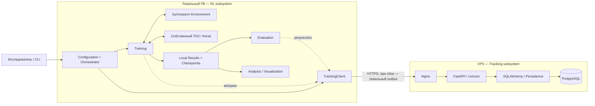

# Архитектура системы обучения с подкреплением

> **Статус документа:** базовая архитектура MVP согласована; подфазы 1.0–1.2 завершены, архитектура 1.3 утверждена для пошаговой реализации.
> **Редакция:** 0.5 от 22.11.2026 (контракт Agent и Replay Buffer 1.3; актуализация roadmap).
> **Главный архитектурный чат:** `00 — Архитектура системы`.

## 0. Как пользоваться документом

Этот документ — актуальная запись **принятых архитектурных решений**, а не исчерпывающая техническая спецификация. Здесь фиксируются границы, требования, ответственность компонентов, связи, основные сценарии и причины существенных решений.

- **MVP / обязательно** — требуется для законченного минимального системного результата.
- **Опциональная операция** — система умеет её выполнять, но она не обязана запускаться при каждом `Run`.
- **Отложено** — не входит в обязательный MVP; возвращаемся при необходимости и наличии времени.
- **Предварительно** — направление выбрано, конкретный формат, API, библиотечные версии или файловая структура ещё не утверждены.

**Рабочий цикл подфазы:** в `00` проектируется **вся подфаза** до уровня основных модулей, классов, публичных контрактов, зависимостей и проверяемых инвариантов; затем реализация разбивается на столько последовательных шагов, сколько оправдано объёмом (обычно 2–5). Первое ТЗ в `01` (RL) или `02` (backend) передаёт контекст всей подфазы, но разрешает **только шаг 1**; следующие задания выдаются после проверки предыдущих. Подробный отчёт в `00` нужен лишь при отклонениях, архитектурных вопросах или изменении контракта; штатное завершение можно подтверждать кратко. Детали приватных функций заранее не фиксируются.

В этом документе сохраняются **актуальные существенные решения и их причины**, но не все подробности обсуждений и не код реализации. Отчёт и материалы защиты — в `03`. Один активный архитектурный чат; если контекст станет слишком длинным, допускается его продолжение с опорой на этот документ.

**Правило MVP:** новая возможность не должна задерживать end-to-end результат, если она не требуется темой практики, не нужна для основного сценария и не устраняет подтверждённую проблему.

---

## 1. Назначение, пользователь и результат

**Назначение.** Система предназначена для проведения воспроизводимых экспериментов по обучению агента с подкреплением в среде с непрерывным пространством действий. Она объединяет конфигурацию запуска, обучение, сбор метрик, сохранение политики, независимую оценку, централизованный учёт результатов и их анализ.

**Основной пользователь:** RL-разработчик / исследователь, задающий параметры эксперимента, запускающий обучение и анализирующий результат. Графический интерфейс не требуется: конфигурационных файлов и/или CLI достаточно.

**Вход на уровне системы:** пользовательская спецификация запуска (среда, алгоритм, гиперпараметры, seed, лимиты обучения и позднее настройки сохранения/оценки). Перед созданием `Run` она проверяется; фактически применённая конфигурация фиксируется отдельно.

**Результат на уровне системы:** сохранённая политика (policy artifact), локальные результаты запуска, при необходимости результаты независимой evaluation, доступные через tracking API метаданные и метрики, возможность сравнения запусков и построения графиков.

Смысл темы — **программная система полного цикла**, а не один обучающий скрипт `train_td3.py` и не реализация универсального RL-фреймворка.

### 1.1. Минимальный сквозной сценарий

```text
Configuration → предстартовая подготовка Environment + TD3 Agent
  → effective config → локальный Run
  → Training + Metrics
  → локальный Policy Checkpoint
  → независимая Evaluation (в отдельном запуске или после обучения)
  → TrackingClient → Tracking API → PostgreSQL
  → чтение результатов и сравнение / графики по запросу
```

Обязательна **работоспособность полного сценария** хотя бы на одном эксперименте. Evaluation и построение графиков не обязаны автоматически выполняться **после каждого** `Run`.

### 1.2. Явные ограничения MVP (не цели)

- Не разрабатывать универсальную платформу для произвольных RL-алгоритмов, сред и моделей.
- Не делать микросервисы, распределённое обучение, систему пользователей, GUI/dashboard и сложный model registry.
- Не включать в обязательную реализацию SAC, multiprocessing, полноценный resume-training, автоматический подбор гиперпараметров и серверное выполнение RL-среды.
- Не обещать бит-в-бит одинаковых GPU-вычислений или абсолютно идентичных траекторий при повторном эксперименте.
- Не связывать успешность обучения с доступностью VPS, успешностью Evaluation или построением графиков.

---

## 2. Границы системы

### 2.1. Логические и физические границы

**Разрабатываемая система** включает две основные программные подсистемы и средства анализа:

1. **Локальная RL-подсистема:** конфигурация, `Orchestrator`, работа со средой, собственный RL Core / TD3, Training, Evaluation, локальные артефакты, TrackingClient, анализ и визуализация.
2. **Tracking-подсистема:** REST API, серверная проверка запросов, persistence/CRUD, схема данных и миграции, централизованный учёт экспериментов.
3. **Конфигурация развёртывания:** Docker Compose, Nginx/TLS, запуск API и PostgreSQL, переменные окружения, volumes и healthchecks.

**Физическое размещение:** обучение, симуляция и Evaluation выполняются на локальном ПК; VPS выполняет функции tracking/server. VPS **не обучает агент**.



*Стрелки отражают логические отношения, а не утверждённые Python-вызовы. `Orchestrator` координирует жизненный цикл, но не маршрутизирует все данные через себя.*

### 2.2. Разрабатываемые компоненты и внешние зависимости — не одно и то же

| Входит в архитектуру разрабатываемой системы | Внешняя технология или окружение |
|---|---|
| Собственная реализация TD3 и интеграция агента | Keras и выбранный вычислительный backend |
| Интеграция и конфигурация среды | Gymnasium как библиотека, готовая среда |
| Training / Evaluation / Orchestrator | Windows, физический ПК, GPU |
| TrackingClient и собственный Tracking API | Интернет, HTTPS-протокол как технология |
| Схема БД, миграции, запросы persistence | PostgreSQL как сторонняя СУБД |
| Конфигурация Nginx/Compose и deployment | Nginx, Docker, Linux/VPS как платформы |

Сторонняя технология может быть частью **развёрнутой конфигурации** системы, хотя исходный код самой технологии мы не разрабатываем. Интерфейс компонента также **не превращает** его конкретную собственную реализацию во «внешнюю».

### 2.3. Ограниченная заменяемость

- Среды: создание по конфигурации через Gymnasium API (без ветвления кода Trainer по имени среды); начальный поддерживаемый тип — **одномерные числовые векторы наблюдений `Box` и действий `Box`** с конечными границами действий. Размерности не захардкожены; характеристики извлекаются из реальной среды, неподходящие пространства отвергаются при инициализации. Не обещаем корректную работу со всеми Gymnasium-средами.
- Алгоритмы: MVP — **собственный TD3**. `Trainer` взаимодействует с RL Core через ограниченный контракт off-policy агента, а не через внутренности TD3. Потенциальный SAC — будущая реализация, но не требование и не обещание универсального Training для любых RL-алгоритмов.
- Tracking: локальная работа и передача в **наш** удалённый Tracking API, а не универсальный адаптер под любые внешние ML-трекеры.
- Не создавать заранее универсальные реестры плагинов, фабрики и дополнительные абстракции без реальной необходимости.

---

## 3. Функциональные требования (FR)

| ID | Требование | Минимальная проверка |
|---|---|---|
| **FR-01** | Задать конфигурацию: среду, алгоритм, гиперпараметры, лимиты обучения и seed; позднее — настройки checkpoint/evaluation/tracking. Сохранить **фактически применённую** конфигурацию и seed. | Повторно прочитать параметры конкретного `Run`. |
| **FR-02** | Создать и запустить отдельный `Run` в рамках `Experiment` с локальным идентификатором, не требуя доступного VPS. | Запуск начинается при недоступном tracking backend. |
| **FR-03** | Выполнить обучение собственного TD3: взаимодействовать со средой, собирать transitions, использовать Replay Buffer, обновлять нейросети. | Работает завершённый training loop на выбранной среде. |
| **FR-04** | Собирать основные обучающие метрики (reward, длина эпизода, диагностические потери и т. п. — точный список позже). | Метрики связаны с `Run` и шагами обучения. |
| **FR-05** | Периодически и при штатном завершении сохранять **policy checkpoint**; уметь загрузить его для применения и Evaluation. Полный resume-training не обязателен. | Сохранённая политика успешно загружается в новом контексте. |
| **FR-06** | Поддерживать штатное, пользовательское и аварийное завершение; сохранить доступные результаты и установить корректный статус. | Завершение по лимиту / ручная остановка / моделируемая ошибка. |
| **FR-07** | Независимо выполнить Evaluation сохранённой политики: отдельная среда, эпизоды без обновления весов, несколько seed/эпизодов, агрегированные показатели. Можно выполнить **позже и повторно**. | Результат Evaluation привязан к конкретным `Run` и checkpoint. |
| **FR-08** | Централизованно передавать experiment/run metadata, effective config, batches метрик, результаты Evaluation и статусы через TrackingClient → API → PostgreSQL. | Данные доступны на сервере по завершении синхронизации. |
| **FR-09** | При временном отказе сервера продолжать локальное обучение, устойчиво сохранять неотправленные данные и повторно отправлять их после восстановления связи / перезапуска. | Сервер недоступен → обучение продолжается → позже синхронизация. |
| **FR-10** | Получать сохранённую историю experiments/runs/config/metrics/evaluations/status через API. | Есть запросы чтения и возможность сопоставить runs. |
| **FR-11** | По запросу строить ключевые графики по сохранённым локальным или удалённым метрикам и сравнивать runs; PNG можно сохранять локально. | График строится без повторного обучения. |

**Уточнения:**

- Evaluation — **обязательная возможность системы**, но **опциональный шаг каждого `Run`**. Для принятия всей системы хотя бы один полный сценарий с Evaluation должен пройти успешно.
- Анализ/визуализация — пользовательская операция по запросу, не обязательная стадия завершения обучения.
- Серверный inference (`observation → action` на VPS) и upload/download модели — **отложенные расширения**, не пункты обязательного FR.
- Улучшение качества политики проверяется в экспериментах; не подменяет корректность функционирования программы.

---

## 4. Нефункциональные требования и ограничения (NFR)

| ID | Требование / интерпретация для MVP |
|---|---|
| **NFR-01 — Воспроизводимость** | Хранить effective config, seed, сведения о среде/алгоритме, параметры evaluation; по возможности версию кода. Обеспечить повторный запуск в сопоставимых условиях **без гарантии побитовой идентичности**. |
| **NFR-02 — Сохранность** | Важные сохранённые результаты переживают штатное завершение и ожидаемые сбои. Не обещать спасение ещё не записанных данных при внезапной гибели процесса/оборудования. |
| **NFR-03 — Изоляция отказа tracking** | Недоступность VPS не останавливает Training. Отправка данных не должна чрезмерно блокировать training loop; точный механизм доставки определяется позже. |
| **NFR-04 — Наблюдаемость** | По логам, метрикам и статусам можно понять ход выполнения, причину завершения и доступные результаты. Без обязательной Prometheus/Grafana-инфраструктуры. |
| **NFR-05 — Модульность** | Training не содержит SQL/HTTP, Backend не содержит RL-математику, Evaluation не обновляет модель, Orchestrator не становится god-object. |
| **NFR-06 — Ограниченная расширяемость** | Замена выбранной совместимой среды и потенциальное добавление SAC не должны требовать переделки всей системы. Но произвольные алгоритмы/среды не обещаются. |
| **NFR-07 — Ресурсы и платформа** | Основная локальная работа — Windows 11, ПК с 16 ГБ RAM и RTX 4050; без обязательного WSL2, multiprocessing и распределённого обучения. Tracking — обычный VPS. Текущий проверенный стек Этапа 1 — TensorFlow CPU; GPU не требуется. |
| **NFR-08 — Минимальная безопасность** | При публичном доступе к VPS: HTTPS, API key для операций записи, секреты вне Git/исходников, БД не публикуется в Интернет. Полноценная пользовательская авторизация не нужна. |

Здесь перечислены как качества, так и существенные технологические/ресурсные ограничения. Не вводим пустые обещания «высокая производительность», «99.9% uptime» или «горизонтальная масштабируемость» без задачи и критериев.

---

## 5. Компонентная архитектура и ответственность

### 5.1. Локальная RL-подсистема

| Компонент | Делает / получает / производит | Не делает; существенная граница |
|---|---|---|
| **Configuration** | Читает пользовательский YAML, валидирует общие поля и возвращает типизированный `RunConfig`. | Не создаёт Gymnasium-среду, TD3Agent, `Run` или effective config; не импортирует Environment/RL Core/Orchestrator. |
| **Orchestrator** | Координирует предстартовую проверку и подготовку компонентов, собирает effective config из их результатов, затем создаёт `Run` и запускает Training; позже — Evaluation и финализацию. | Не реализует правила TD3 или Gymnasium, `env.step()`, SQL/HTTP, сериализацию Keras и построение графиков. |
| **Environment integration** | Создаёт Gymnasium-среду по `EnvironmentConfig`, проверяет пространства и извлекает `EnvironmentSpec`; при ошибке проверки закрывает уже созданный экземпляр. | Не вызывает `reset()` ради инициализации/seed, не обучает агент, не хранит replay и не управляет Run. После успешной передачи среду закрывает её владелец (в основном Orchestrator). Собственный Environment ABC не нужен. |
| **RL Core / Agent** | Собственная реализация TD3: Actor/Critics, target networks, Replay Buffer, выбор действия, обновления и в будущем сериализация/загрузка policy. По ограниченному `OffPolicyAgent`-контракту принимает transitions, возвращает action и метрики updates; владеет буфером и его sampling. | Не вызывает `env.step()` и не управляет эпизодами, всем Run или tracking. TD3-математика и вычислительный backend не проникают в Trainer/Orchestrator. |
| **Training** | Управляет training loop и эпизодами, в том числе первым `env.reset(seed=...)` и последующими обычными `reset()`; на ранних шагах может выбирать случайные действия через `action_space.sample()`, назначает моменты запроса updates/checkpoints, собирает метрики и корректно выходит из цикла. | Не формирует minibatch из буфера, не применяет TD3 exploration/target noise и не реализует обновления нейросетей; не выполняет HTTP/SQL и независимую Evaluation. |
| **Evaluation** | Загружает сохранённую policy, создаёт **отдельный экземпляр** среды, выполняет эпизоды без update, считает агрегаты, сообщает идентификаторы Run/checkpoint/seeds. | Не использует тренировочный Replay Buffer, не изменяет веса/состояние Training, не требует работающего обучающего процесса. |
| **Local Results / Artifacts** | Устойчиво сохраняет effective config, метрики, логи, checkpoint-файлы, результаты evaluation, metadata; возвращает пути/ссылки для чтения. | Не вычисляет RL-метрики, не решает когда сохранять, не содержит HTTP-логики. Внутреннее разбиение на Store/Logger пока отложено. |
| **TrackingClient** | Переводит предметные данные в API-запросы; пакетирование, timeout, retry, outbox и подтверждение доставки; умеет синхронизировать результаты. | Не обучает, не решает, какие метрики важны, и не использует SQLAlchemy/доступ к PostgreSQL. |
| **Analysis / Visualization** | Читает локальные результаты или Tracking API, строит графики/сравнения, при необходимости сохраняет PNG локально. | Не управляет Training, не меняет agent, не обращается к PostgreSQL напрямую. Пока простые функции, не generic dashboard. |

Для Этапа 1 предусмотрена ограниченная конфигурация Actor/Critic: вход/выход определяются реальными размерами наблюдений/действий; список скрытых Dense-слоёв и их активации можно задавать по слоям, со строгой проверкой длины списков. Предварительно Actor имеет выход `tanh` с приведением к action bounds среды, Critic — скалярный линейный Q-value. Общая Configuration определена в 1.1; специфические конфигурации сетей и TD3 утверждаются в подфазах 1.4–1.5.

Критическое разделение: **Training знает, когда обновлять/сохранять; Agent знает, как обучаться и сериализовать policy; Local Results знает, куда сохранять**. `Orchestrator` отвечает за общий жизненный цикл и финальные решения по статусам, а не за каждый шаг обучения.

### 5.2. Tracking-подсистема

| Элемент | Ответственность |
|---|---|
| **Tracking API (FastAPI / Uvicorn)** | HTTP endpoints, запросы/ответы и их валидация, проверка API key, HTTP status codes, вызов операций хранения. Не содержит RL-алгоритма. |
| **Persistence / CRUD (SQLAlchemy)** | ORM, операции записи/чтения, запросы и транзакции. Не знает сетевых retry или training loop. |
| **PostgreSQL** | Централизованное долговечное хранение tracking-данных. ПО стороннее; схема и миграции — часть нашего проекта. |
| **Alembic** | Миграции схемы данных. |

Для MVP достаточно `endpoint → CRUD/persistence → SQLAlchemy → PostgreSQL`. Отдельный service/repository/unit-of-work слой **не вводить заранее**: только если появится оправдывающая его серверная логика.

### 5.3. Инфраструктура (другой архитектурный уровень)

- **Nginx:** публичная HTTPS-точка входа, TLS termination, reverse proxy на API.
- **FastAPI/Uvicorn:** ASGI-приложение, принимающее запросы TrackingClient.
- **PostgreSQL container + persistent volume:** данные переживают перезапуск/обновление контейнеров; порт БД наружу не публикуется.
- **Docker Compose:** конфигурация `nginx`, `api`, `postgres`, сети, volumes, env и healthchecks.
- **VPS:** хостинг tracking-сервера; обучение и оценку модели не выполняет.

План: три постоянно работающих контейнера (`nginx`, `api`, `postgres`). Не требуются микросервисы, отдельная авторизация пользователей, брокер сообщений или публичный доступ к БД.

---

## 6. Основные интерфейсы (смысловые контракты)

На Этапе 0 зафиксированы **смысловые** контракты. Значимые Python-сигнатуры, `Protocol`/ABC, публичные классы, фабрики и экспорты (`__all__`, если нужен) **проектируются в `00` перед реализацией соответствующей подфазы Этапа 1**; не передаются целиком на архитектурное усмотрение чата `01`. Внутренний код методов, не меняющий межмодульные контракты, остаётся в `01`.

| Граница | Передаваемые данные и смысл |
|---|---|
| `Orchestrator → Training` | Созданные зависимости и настройки → выполнение training loop; обратно — результат/причина завершения и итоговые сведения. |
| `Training ↔ Environment` | Стандарт Gymnasium: `reset()`, `step(action)` → observation, reward, `terminated`, `truncated`, info; пространство действий — непрерывное. |
| `Training ↔ Agent` | Observation → action в границах среды (с exploration или без); переход → `store_transition`; запрос `update()` → метрики либо пропуск. Агент владеет Replay Buffer; Trainer не получает прямого доступа к его массивам и TD3-внутренностям. Сохранение policy — отдельный будущий контракт. |
| `Training / Agent → Local Results → Evaluation` | Событие сохранения → сериализованная policy + metadata → устойчивый checkpoint; Evaluation загружает его независимо от объекта Agent в памяти. |
| `RL → TrackingClient → Tracking API` | Experiment/Run metadata, effective config, metric batches, evaluation, status; HTTP(S), подтверждения, отложенная доставка. Никаких ORM-моделей в RL-части. |
| `Stored Results → Analysis` | Локальные файлы и/или API чтения → графики и сравнения. Прямое подключение Analysis к PostgreSQL не требуется. |

### 6.1. Основные потоки данных

**Training:** `Configuration → Orchestrator → Training ↔ (Environment, Agent) → Agent updates → metrics`.

**Checkpoint / Evaluation:** `Training (когда) → Agent (что/как сериализовать) → Local Results (куда) → загрузка в Evaluation → результаты`.

**Tracking:** `effective config / metrics / evaluation / statuses → TrackingClient → HTTPS → Nginx → API → Persistence → PostgreSQL`; при неудаче — устойчивый локальный outbox → повторная синхронизация.

**Analysis:** `Local Results и/или Tracking API → Analysis / Visualization → график`; построение не влияет на статусы обучения.

### 6.2. Отказ сети и идемпотентность

- Сервер может быть недоступен в момент начала `Run`, во время обучения и при завершении; локальный `Run` существует независимо от сервера.
- Outbox/retry **семантически принадлежит TrackingClient**, хотя физически использует локальные файлы/хранилище.
- Отправка не должна производить длительных блокировок на каждом `env.step()`; сначала допустимы редкие batch-отправки с ограниченным timeout. Async/background worker — только при подтверждённой необходимости.
- Повтор после потери ответа сервера не должен создавать неконтролируемые дубли `Run`/метрик. Простая идемпотентность (например, локально заданный ID и/или ключ операции) — принцип; конкретная реализация Этапа 4.
- Неотправленные данные должны переживать перезапуск Python-процесса; при следующем запуске или явной команде `sync` система может продолжить отправку. Постоянно работающий фоновый сервис не требуется.

### 6.3. Configuration — контракт подфазы 1.1

**Формат:** входной YAML → безопасная загрузка → Pydantic v2 → `RunConfig`. Структурная валидация не зависит от Gymnasium, TD3 и других runtime-компонентов.

| Публичная модель | Поля и обязательность |
|---|---|
| `EnvironmentConfig` | `id: str` (непустой Gymnasium environment ID); `kwargs: dict` (необязательный, независимый default `{}`). |
| `AlgorithmConfig` | `name: str` (непустая строка); `params: dict` (**обязательный**, допускает `{}` на уровне общей схемы). |
| `TrainingConfig` | `total_steps: int` (обязательный, строго `> 0`); `seed: int` (обязательный, строго `>= 0`). Автоматическая генерация и проверка уникальности seed не требуются. |
| `RunConfig` | Обязательные вложенные `environment: EnvironmentConfig`, `algorithm: AlgorithmConfig`, `training: TrainingConfig`. |

Для всех моделей: неизвестные поля отклоняются (`extra="forbid"`); обычное присваивание запрещено (`frozen=True`, **не** глубокая неизменяемость словарей). Булевы и дробные значения не принимаются вместо целых. Содержимое `kwargs` и `params` — JSON-совместимые значения, включая конечные числа, списки и вложенные словари со строковыми ключами; `NaN`/`Inf`, произвольные Python-объекты и неподходящие типы отклоняются. Повторяющиеся ключи YAML (на любом уровне) запрещены.

**Публичный API:** `load_config(path: str | Path) -> RunConfig` читает файл и проверяет общую схему; при ошибке YAML или Pydantic выдаёт `InvalidConfigError` с сохранением причины. Ошибки доступа к файлу (`FileNotFoundError`, `OSError` и подклассы) сохраняются. При прямом `RunConfig.model_validate(data)` действует стандартный `pydantic.ValidationError`. Дополнительная публичная `validate_config()` и класс `ConfigLoader` не нужны.

**Общие исключения** в `rl_system/exceptions.py`: `RLSystemError(Exception) → ConfigurationError → {InvalidConfigError, UnsupportedConfigError}`. `UnsupportedSpaceError(UnsupportedConfigError)` относится к несовместимой **спецификации запуска**, хотя выявляется Environment. Ошибки создания и зависимостей самой среды принадлежат отдельной ветви `EnvironmentSystemError` (см. 6.4). Множественное наследование не используется.

**Разделение проверок:** Configuration проверяет структуру, типы и общие ограничения, но не существование среды, поддержку алгоритма или диапазоны TD3-специфичных параметров. Environment и Agent Factory/`TD3Config` проверяют свои правила при подготовке компонентов **до Training**. `algorithm.name` может обозначать ещё не реализованный алгоритм: общая схема проверяет строку, поддержку определяет Agent Factory. Точные `TD3Config`/гиперпараметры утверждаются в соответствующих подфазах.

**Effective config:** входной `RunConfig` не мутируется. Во время будущей подготовки Orchestrator использует результаты Environment и валидированную конфигурацию алгоритма (с явно предусмотренными defaults, если будут) и формирует **новый независимо валидированный `RunConfig`**. Лишь после успешной подготовки создаётся локальный `Run`; effective config затем сохраняется как JSON вместе с результатами (Этап 2). Runtime metadata среды и версии библиотек могут храниться отдельно. Реализация сборки effective config относится к 1.7, а не к 1.1.

### 6.4. Environment — контракт подфазы 1.2

**Назначение:** создать среду через Gymnasium, проверить совместимость её пространств с текущим векторным RL Core и вернуть характеристики без TD3-математики и без собственного Environment ABC. Реализация располагается в одном `rl_system/environment.py`.

**Публичный API:**

- `extract_environment_spec(env: gym.Env) -> EnvironmentSpec` — проверяет пространства **уже созданной** среды, формирует характеристики; не вызывает `reset()`, не устанавливает seed, не создаёт и не закрывает переданную среду.
- `make_environment(config: EnvironmentConfig) -> tuple[gym.Env, EnvironmentSpec]` — вызывает `gym.make(config.id, **config.kwargs)`, извлекает spec и возвращает среду вместе с ним. Если среда создана, но последующая проверка не прошла, Factory закрывает её и сохраняет причину ошибки. При успешной передаче ответственность за `env.close()` переходит вызывающему компоненту (в основном Orchestrator). Если `gym.make()` не вернула объект, гарантировать очистку его внутренних частично созданных ресурсов нельзя.

**`EnvironmentSpec`:** `@dataclass(frozen=True, slots=True, eq=False)` с полями `observation_dim: int`, `action_dim: int`, `action_low: np.ndarray`, `action_high: np.ndarray`. Массивы границ — независимые копии данных среды, доступные для чтения; обычная запись в них запрещена (`write=False`). Автоматический `__eq__` отключён из-за неоднозначного сравнения `np.ndarray`. В Spec не добавляем отдельные dtype, экземпляр среды и настройки TD3. Проверки корректности Gymnasium spaces принадлежат `extract_environment_spec()`. Сам Spec должен сохранять собственные инварианты и при прямом создании: положительные размерности, согласованную длину/форму массивов и допустимый порядок конечных границ, без повторной проверки всей Gymnasium-специфики.

**Поддерживаемые пространства:**

- Observation: одномерный `gymnasium.spaces.Box` с положительной размерностью и вещественным/целочисленным числовым dtype. Бесконечные границы наблюдений допустимы; изображения, `Discrete`, комплексные и нечисловые пространства — нет.
- Action: одномерный `Box` с положительной размерностью и вещественным dtype; обе границы каждой координаты конечны, и строго `low < high` покомпонентно. Несимметричные диапазоны поддерживаются. Приведение нормализованных действий Actor к этим диапазонам выполняет **TD3Agent**, не Environment.
- Размерности и границы извлекаются из фактических spaces, не задаются в YAML. Gymnasium-среды с другими пространствами отклоняются как `UnsupportedSpaceError`.

**Иерархия исключений:** в общем `rl_system/exceptions.py` сохраняется `RLSystemError → ConfigurationError → UnsupportedConfigError → UnsupportedSpaceError`; параллельно вводится `RLSystemError → EnvironmentSystemError → {EnvironmentDependencyError, EnvironmentCreationError}`. Имя `EnvironmentError` не используем из-за существующего псевдонима `OSError` в Python. Поддерживаемое название `UnsupportedSpaceError` остаётся именно ошибкой несовместимой конфигурации, а не потомком ошибок выполнения Environment.

**Преобразование ошибок на границе Gymnasium:** незарегистрированный ID → `InvalidConfigError`; заведомо неверные параметры создания → `InvalidConfigError`, заведомо неподдерживаемые возможности → `UnsupportedConfigError`; известная ошибка отсутствующей зависимости → `EnvironmentDependencyError`; прочие ожидаемые ошибки Gymnasium при создании → `EnvironmentCreationError`. Сохранять первопричину через `raise ... from exc`. **Не** перехватывать все `Exception` и не считать произвольный `TypeError` автоматически ошибкой `kwargs`: он может означать дефект кода самой среды. Неизвестный ID также может быть следствием отсутствующей регистрации сторонней среды, а не только опечатки.

**Владение и seeding:** Factory закрывает полученную среду при неудачной проверке, но не закрывает её после успешной передачи. Первый `env.reset(seed=training.seed)` выполняется в будущей Training, последующие эпизоды используют `reset()` без seed. Если используются случайные действия через `action_space.sample()`, его RNG требуется инициализировать отдельно; место такого вызова определяется при реализации Training/Agent. Никаких `reset()`, проверки seed и TensorFlow-логики внутри Environment Factory в 1.2.

**Объём 1.2:** `EnvironmentSpec`, две функции, предметные исключения и тесты. Общую вспомогательную инфраструктуру валидации без подтверждённого повторения логики не вводим. Box2D/LunarLander не были обязательным условием приёмки 1.2.


### 6.5. Off-policy Agent и Replay Buffer — контракт подфазы 1.3

**Назначение:** зафиксировать минимальный контракт взаимодействия `Trainer ↔ Agent` и самостоятельно реализовать хранилище переходов. Сети и TD3 update относятся к 1.4–1.5; полноценный Trainer — к 1.6. Универсальный интерфейс для всех RL-семейств не требуется.

**Agent:** `OffPolicyAgent(Protocol)` в `rl_system/agents/base.py`, без общего поведения и обязательного наследования. Минимальные операции:

- `select_action(observation: np.ndarray, *, explore: bool) -> np.ndarray` — действие в **реальных границах среды**. Exploration noise и масштабирование нормализованного действия выполняет TD3Agent. При `explore=False` exploration noise не применяется.
- `store_transition(obs, action, reward, next_obs, terminated, truncated) -> None` — передать опыт агенту; его внутренний Replay Buffer недоступен Trainer напрямую.
- `update() -> dict[str, float] | None` — по запросу Trainer агент сам проверяет готовность буфера; недостаточно данных → `None`, выполненный update → словарь метрик. Набор метрик не обязан быть одинаковым на каждом обновлении (Actor обновляется реже Critic).

**Граница расписаний:** Trainer управляет взаимодействиями со средой, начальной фазой случайных действий через `action_space.sample()`, моментами и частотой запросов update. Агент выбирает действие политики, применяет exploration noise, хранит опыт и выполняет алгоритмическое обновление, в том числе TD3-specific `policy_delay` и target policy smoothing. Начальная фаза случайных действий, порог старта обучения (`learning_starts`) и размер batch — разные понятия. Сигнатуры сохранения/загрузки policy не фиксируются в 1.3: их определим при проектировании checkpoint, без заглушек `NotImplementedError` сейчас.

**Replay Buffer:** отдельный класс `ReplayBuffer` в `rl_system/agents/td3/replay_buffer.py`, принадлежит TD3Agent, но сам не зависит от Gymnasium, TensorFlow/Keras и конфигурационных моделей. Конструктор принимает обязательные `capacity`, `obs_dim`, `act_dim`, `seed`; методы `add(obs, action, reward, next_obs, terminated, truncated)`, `sample(batch_size) -> ReplayBatch`, `__len__()`. Память выделяется заранее, массивы одинакового индекса образуют один transition; при заполнении новые записи перезаписывают старые циклически (`ptr`, `size`).

| Массив | Форма | dtype |
|---|---|---|
| `obs`, `next_obs` | `(capacity, obs_dim)` | `float32` |
| `actions` | `(capacity, act_dim)` | `float32` |
| `rewards` | `(capacity, 1)` | `float32` |
| `terminated`, `truncated` | `(capacity, 1)` | `bool` |

**Семантика терминальности:** хранить `terminated` и `truncated` раздельно; не заменять их общим `done`. Trainer завершает эпизод при `terminated or truncated`, но для обычного TD3 Bellman bootstrap блокирует именно `terminated`, не обычная time-limit truncation. При завершении переход содержит `next_obs` текущего шага, не observation после последующего reset. Расчёт Bellman target — в 1.5, не в Buffer.

**Sampling и результаты:** буфер использует собственный `np.random.default_rng(seed)`; `sample(B)` равномерно выбирает **без повторений** ровно `B` сохранённых переходов по общим для всех массивов индексам. Если `B > len(buffer)` или размер batch некорректен, вызов отклоняется, а не выдаёт неполный результат. `ReplayBatch` — один `@dataclass(frozen=True, slots=True, eq=False)` с шестью batch-массивами NumPy, не отдельный Python-объект на каждый сохранённый переход. Перевод в tensors выполняет TD3Agent. Автоматическое глубокое замораживание каждого batch-массива не требуется.

**Инварианты Buffer:** положительные целочисленные ёмкость и размерности; неотрицательный целочисленный seed; при `add` строго проверяются формы observations/actions (без неявного broadcasting), корректность чисел и flags, конечность числовых значений в сохраняемом `float32`; исходные массивы не сохраняются по изменяемой ссылке. `len(buffer)` не превосходит capacity, переполнение не нарушает соответствия полей transition. Для неверных вызовов внутреннего Buffer достаточно стандартных `ValueError`/`TypeError`; отдельную ветвь `ReplayBufferError` пока не вводить.

**Конфигурация и сроки:** общий `seed` уже задан в `TrainingConfig`; в 1.3 новые поля общего `RunConfig`/YAML не добавляются. **В подфазе 1.4** будет спроектирован и создан `TD3Config` с обязательными `replay_capacity`, `batch_size` и прочими TD3-параметрами; перед Training проверяется `replay_capacity >= batch_size`. Replay Buffer получает простые аргументы, не импортируя `TD3Config`. Настройки цикла (`learning_starts`, интервалы updates и т. п.) при необходимости добавим в `TrainingConfig` в 1.6.

---

## 7. Сущности и жизненный цикл

### 7.1. `Experiment`, `Run`, `Checkpoint`, `Evaluation`

- **Experiment** — логическая группа связанных запусков для исследования/сравнения.
- **Run** — конкретное выполнение обучения с зафиксированным effective config и seed. Один Experiment содержит один или несколько Runs.
- **Checkpoint / Policy artifact** — сохранённая политика, принадлежащая конкретному Run и шагу обучения.
- **Evaluation** — отдельная операция оценки конкретного checkpoint конкретного Run; у одного checkpoint может быть несколько оценок с разными параметрами/seeds.
- **Metric** — запись измерения с привязкой к Run и шагу/эпизоду или отдельной операции оценки.

Финальные таблицы/ключи БД не проектируются на Этапе 0. **Концептуальные связи** должны сохраниться независимо от схемы.

### 7.2. Жизненный цикл Run

```text
прочитать YAML → проверить общую схему, включая обязательный seed
        ↓
подготовить Environment + Agent; проверить совместимость и TD3Config
        ↓
собрать и проверить effective config (новый RunConfig)
        ↓
создать локальный Run ID / запись, сохранить effective config
        ↓
Training: interaction → updates → metrics → checkpoints
        ↓
завершить обучение; сохранить доступные итоги и policy
        ↓
Run status: completed / stopped / failed
        │
        ├── Evaluation checkpoint (по запросу, сразу или позже)
        ├── Tracking sync (при доступном сервере или позже)
        └── Analysis / Plotting (по запросу, сейчас или позже)
```

Ошибки структурной или предметной предстартовой проверки обнаруживаются **до создания Run**; их диагностируют без регистрации неудачного Run, освобождая выделенные ресурсы. Конкретная сигнатура `Orchestrator.prepare()` не утверждена: подготовка может вызываться внутри публичного запуска Orchestrator. При проблеме записи/исполнения после создания Run применяются правила его lifecycle.

Evaluation и Analysis **не обязаны быть синхронными этапами финализации Run**. Для полной демонстрации системы хотя бы один успешно завершённый Run должен иметь успешно проведённую Evaluation и синхронизированные tracking-данные.

### 7.3. Семантика состояний

| Состояние `Run` | Значение |
|---|---|
| `created` | Предстартовая проверка успешно пройдена; Run локально зарегистрирован и ожидает начала Training. |
| `running` | Выполняется цикл обучения. |
| `completed` | Обучение штатно завершено. |
| `stopped` | Досрочно остановлено пользователем с корректной финализацией доступных результатов. |
| `failed` | Обучение прервано критической ошибкой. |

Это **состояния выполнения обучения**, а не обобщённая оценка успеха всех независимых операций. Ошибка Evaluation или недоступность VPS не меняют успешно завершённый `Run` на `failed`.

- **Evaluation**: концептуально `not_run / completed / failed`; при нескольких оценках статус относится к каждой записи/операции, а не к одному общему флагу Run.
- **Tracking delivery**: концептуально `pending / synced / error`; точная схема полей и переходов решается позднее.
- **Analysis/Visualization**: не влияет на успешность Run; не требует отдельного state machine.

### 7.4. Остановки, ошибки и сохранение

1. **Нормальное завершение:** Training достигает лимита, сохраняются итоговые метрики и checkpoint, Orchestrator фиксирует `completed`.
2. **Остановка пользователем (`Ctrl+C` и т. п.):** верхний уровень инициирует завершение, Training выходит из цикла в безопасной точке, сохраняет доступные данные; Orchestrator фиксирует `stopped`. Финальный checkpoint — по возможности.
3. **Критическая ошибка:** логирование причины, сохранение уже записанных результатов, статус `failed`. Не обещается успешная запись нового checkpoint при внезапном падении процесса.
4. **Недоступность tracking:** обучение и локальное сохранение продолжаются; доставка откладывается, данные синхронизируются позже.
5. **Ошибка Evaluation:** обучение остаётся в своём статусе; операция оценки может быть повторена без повторного обучения из сохранённого checkpoint.

### 7.5. Политика сохранения модели

**Обязательный MVP:** **model/policy checkpoint**, а не полное восстановление training state. Предпочтительный состав: сериализованная actor/policy (например, `.keras`) и **минимальные метаданные, необходимые для её корректного применения** — идентификаторы Run/checkpoint, размерности/порядок наблюдений, обработка наблюдений, масштабирование действий, relevant config/versions. Конкретный набор определяется при реализации TD3.

Keras-модель может содержать архитектуру и веса, но **сама по себе не гарантирует** корректную интерпретацию наблюдений/действий или полное возобновление TD3-обучения. Сохранение состояния critics, optimizer, replay buffer и RNG для полноценного resume — отдельная отложенная задача.

**Размещение:** checkpoints хранятся **локально на вычислительном ПК**; сервер хранит tracking-данные/metadata. Наличие файлов модели на VPS в MVP **не предполагается**.

---

## 8. Данные и анализ

### 8.1. Локальные данные

Локально сохраняются effective config, logs, metrics, checkpoints, evaluation results, metadata Run и при необходимости outbox. Для раннего MVP предпочтительны простые форматы (JSON/JSONL/CSV и файлы модели); локальную БД **не вводить без причины**. Точный формат и дерево каталогов уточняются на Этапах 1–2.

### 8.2. Централизованные данные

Tracking backend хранит сведения об experiments/runs, конфигурации, метрики, оценки и статусы. Предварительные сущности: `Experiment`, `Run`, `Metric`, `Evaluation`; структура таблиц и отношения фиксируются на Этапе 3. PostgreSQL не используется для прямого подключения RL-кода.

### 8.3. Визуализация

Минимальная форма — простые функции построения графиков, например `plot_training_reward`, `plot_losses`, `plot_evaluation`, `compare_runs`. Источник — локальные результаты или Tracking API. Matplotlib может показать график и опционально сохранить PNG **на ПК**; серверное хранение изображений и live-dashboard не требуются.

Не фиксировать класс с `@staticmethod` только ради группировки функций: Python-модуль уже даёт пространство имён. Реальный API определяется при реализации.

---

## 9. Технологический стек и платформенные решения

| Область | Выбор / статус |
|---|---|
| RL-алгоритм | **TD3 — собственная реализация**; SAC — необязательное будущее расширение. |
| Нейросети | **Keras 3 + TensorFlow CPU** для текущего MVP; базовый стек и custom gradient update проверены в 1.0. Будущий GPU-backend — отдельное решение. |
| Configuration | **Pydantic v2 + PyYAML** (подфаза 1.1); YAML на входе, JSON-совместимые данные для записи результатов. |
| Среды | **Gymnasium**: `Pendulum-v1` — начальная среда и интеграционный тест Environment; `LunarLander-v3` с `continuous=True` — более сложная цель, требующая Box2D-зависимостей и отдельной проверки позднее. |
| Локальная система | **Python 3.12.10 на Windows 11**, 16 ГБ RAM, RTX 4050; нативная работа без обязательного WSL2; для текущего RL-MVP используем CPU. |
| Backend | Python 3.12 (предварительный стек), FastAPI, Uvicorn, SQLAlchemy, PostgreSQL, Alembic. |
| Связь | JSON поверх HTTP API; **HTTPS при публичном VPS**; API key на запись. |
| Deployment | Docker Compose, Nginx, контейнеры `nginx/api/postgres`, persistent volume. |
| Analysis | Matplotlib, простые функции; PNG локально по запросу. |
| Concurrency | Однопроцессный RL baseline; multiprocessing и async delivery не требуются без измеренной причины. |

**Завершены 1.0–1.2:** проверены локальный RL-стек и packaging; реализованы Configuration (Pydantic v2 + YAML) и Environment (создание Gymnasium-среды, проверка пространств, `EnvironmentSpec`). Зависимости закреплены в корневом `requirements.txt`. GPU/CUDA не требуются для текущего MVP.

**Возможное развитие:** GPU через Keras/Torch CUDA либо нативный PyTorch рассматривается в следующих итерациях при подтверждённой необходимости. Для снижения стоимости перехода TensorFlow-specific код градиентов/оптимизаторов локализовать в TD3; `Trainer`, `Orchestrator` и обработка Gymnasium-сред не должны импортировать TensorFlow. Переключение backend одной настройкой **не обещается**.

---

## 10. Предварительная структура единого репозитория

Репозиторий: **`continuous-action-rl-system`**; пакет Python: **`rl_system`**. `src` = *source* (исходный код).

```text
continuous-action-rl-system/
├── pyproject.toml            # описание и editable install RL-пакета
├── requirements.txt          # проверенные зависимости локального RL
├── configs/
│   └── td3_pendulum.yaml     # пример конфигурации Run
├── src/
│   └── rl_system/
│       ├── __init__.py
│       ├── __main__.py        # тонкая точка входа (python -m rl_system)
│       ├── config.py          # Pydantic-модели и load_config
│       ├── exceptions.py      # базовая иерархия предметных ошибок
│       ├── environment.py     # Gymnasium factory / EnvironmentSpec
│       ├── orchestrator.py
│       ├── training.py
│       ├── evaluation.py      # Этап 2
│       ├── artifacts.py       # Этап 2, название предварительное
│       ├── agents/
│       │   ├── __init__.py
│       │   ├── base.py        # общий контракт Agent
│       │   ├── factory.py
│       │   └── td3/
│       │       ├── __init__.py
│       │       ├── config.py    # TD3Config: подфаза 1.4
│       │       ├── agent.py
│       │       ├── networks.py
│       │       └── replay_buffer.py
│       ├── tracking/
│       │   └── client.py      # Этап 4
│       └── analysis/
│           └── plots.py      # по мере необходимости
├── backend/
│   ├── app/
│   │   ├── main.py
│   │   ├── db.py
│   │   ├── models.py
│   │   ├── schemas.py
│   │   └── crud.py
│   ├── alembic/
│   ├── requirements.txt
│   ├── Dockerfile
│   └── .dockerignore
├── deploy/
│   ├── compose.yaml
│   └── nginx/
│       └── nginx.conf
├── tests/
│   ├── rl_system/
│   │   ├── test_config.py
│   │   ├── test_environment.py
│   │   └── agents/
│   │       └── td3/
│   │           └── test_replay_buffer.py   # подфаза 1.3
│   └── backend/              # тесты серверной части позднее
├── docs/
│   └── architecture.md
├── runs/                     # локальные данные; .gitignore
├── .env.example
├── .gitignore
├── AGENTS.md                 # для Codex, по потребности позже
└── README.md
```

**Это целевая структура, а не требование создать все файлы и каталоги сразу.** Приняты `src layout`, editable install, будущий `__main__.py`, тесты по подсистемам в `tests/rl_system/` и `tests/backend/`; TD3-тесты будут располагаться зеркально под `tests/rl_system/agents/td3/`. Тесты 1.0 не требуется переносить ради реорганизации. `configs/` и `docs/` отслеживаются Git, `runs/` игнорируется. `artifacts.py` и детали остальных будущих модулей остаются предварительными.

- Зависимости локального RL находятся в **корневом `requirements.txt`**, зависимости будущего API — в `backend/requirements.txt`. Tracking-сервер без model serving не устанавливает Keras/Gymnasium. Pydantic v2 и PyYAML включены после 1.1.
- Входной формат пользовательской конфигурации — **YAML**; типизированная проверка — Pydantic v2. После успешной предстартовой подготовки effective config и seed сохраняются как данные конкретного Run (JSON, Этап 2). Не смешивать Run-конфигурацию с `pyproject.toml`.
- В `backend/` лежат Dockerfile, `.dockerignore` и зависимости API (при build context = `backend/`).
- В `deploy/` — описание совместного развёртывания; Compose может использовать Dockerfile из `backend/`.
- `.env` и локальные результаты не коммитить; `.env.example` — только пример без секретов.
- `AGENTS.md` можно добавить в начале реализации Codex-задач; он задаёт правила работы агента, не дублирует всю архитектуру.
- `README.md` описывает назначение, локальный запуск, тесты и путь к архитектуре.

---

## 11. Принятые ключевые решения и причины

| Решение | Почему принято |
|---|---|
| **Система, не алгоритм** | Тема практики требует полного жизненного цикла и объяснимых границ компонентов. |
| **TD3 самостоятельно, SAC необязателен** | Обучающая ценность собственной реализации при реалистичном сроке; два алгоритма не являются необходимым критерием целостности системы. |
| **Keras 3 + TensorFlow CPU на MVP** | Совместимость под нативную Windows 11 подтверждена в 1.0; GPU откладываем, backend-specific операции не переносим в Trainer. |
| **Отдельный Orchestrator** | Чтобы Training не превращался в координатор создания Run, evaluation и tracking. |
| **Gymnasium API + простая Environment Factory** | Создание по YAML-конфигурации и извлечение характеристик пространств без специального кода каждой среды в Trainer; не дублируем Gymnasium своим Environment ABC. |
| **Replay Buffer внутри RL Core** | TD3Agent владеет хранением и sampling переходов; Training работает только с контрактом агента. |
| **OffPolicyAgent через Protocol и NumPy Replay Buffer** | Минимальный независимый от TD3 деталей интерфейс; фиксированная память и индексная выборка по шести массивам без TensorFlow-зависимости в хранилище. |
| **Отдельная Evaluation + загрузка checkpoint** | Проверяется настоящая пригодность артефакта и независимость от тренировочного объекта в RAM. |
| **Policy checkpoint без полного resume** | Для MVP достаточно inference/evaluation; точное продолжение обучения значительно сложнее. |
| **Локальный Run и локальные артефакты** | Недоступность сети/VPS не должна делать длительное обучение невозможным. |
| **TrackingClient как граница HTTP** | Training не зависит от транспорта и БД; сервер можно интегрировать отдельно после стабилизации RL. |
| **Не создавать отдельный backend service-layer заранее** | CRUD/persistence достаточно, пока не появилась нетривиальная серверная бизнес-логика. |
| **Analysis по запросу** | Графики нужны исследователю и для отчёта, но не должны управлять завершением Run. |
| **Один репозиторий, два набора зависимостей** | Корневой `requirements.txt` для локального RL и `backend/requirements.txt` для API: разные runtime-условия на ПК и VPS. |
| **Pydantic v2 + YAML для Configuration** | Вложенная типизированная модель, раннее выявление ошибок пользователя и контролируемая сериализация; специализированная проверка TD3 остаётся в RL Core. |
| **EnvironmentSpec как dataclass, Gymnasium Factory как функции** | Минимальный объект характеристик и две операции без собственного ABC; проверяем пространства один раз, не создаём _internal-абстракции без дублирования. |
| **Разделение ошибок Configuration / Environment** | Несовместимые пространства — `UnsupportedSpaceError` в ветви `UnsupportedConfigError`; ошибки зависимостей и создания среды — ветвь `EnvironmentSystemError`; первопричины Gymnasium сохраняются. |
| **HTTPS и API key для публичного VPS** | Даже если метрики несекретны, API key — секрет. Нет нужды в пользовательских аккаунтах. |
| **Без multiprocessing/обязательного asyncio в MVP** | Не подтверждена необходимость, возрастает сложность отладки; оптимизация только после измерений. |

---

## 12. Отложенные решения и возможные расширения

### 12.1. Уточнить на этапах реализации

| Вопрос | Когда |
|---|---|
| `TD3Config` и параметры буфера/сетей, собственные TD3 updates и математические тесты | Подфазы 1.4–1.5 |
| Training/Orchestrator, конкретная координация seeding и освобождения ресурсов | Подфазы 1.6–1.7 |
| Сборка effective config из валидированных результатов компонентов, Run ID и начало жизненного цикла | Подфаза 1.7; долговременное сохранение — Этап 2 |
| Сериализация policy, обязательные inference-метаданные, cadence checkpoint | Этапы 1–2 |
| Формат локальных метрик, logs, Run IDs/путей, Evaluation CLI | Этап 2 |
| Точные сущности/схемы PostgreSQL, URL API, DTO и транзакции | Этап 3 |
| Блокировки/timeout, persistent outbox, batch/retry, дедупликация/idempotency | Этап 4 |
| Docker build context, volumes, secrets, домен/сертификат | Этап 5 |
| Минимальный набор графиков и сравнение seed/runs | Этап 6 |

### 12.2. Не включать в обязательный MVP

- SAC и поддержка произвольных алгоритмов/моделей.
- Multiprocessing/многопоточный RL, фоновая синхронизация и полноценное асинхронное сетевое взаимодействие (добавлять лишь по необходимости).
- Full training resume (critics/optimizers/replay/RNG).
- Web UI, live-dashboard, хранение PNG на сервере.
- Сложная внешняя авторизация, distributed training, HPO, model registry, object storage и микросервисы.

### 12.3. Приоритетное, но необязательное расширение: Model Storage / Model Inference

**Идея:** после готового MVP уметь загружать на VPS policy artifact (например, `actor.keras` + inference metadata), хранить его в файловом persistent volume с записью metadata в PostgreSQL, скачивать и, при наличии ресурсов, обрабатывать простой запрос `observation → action` через FastAPI.

**Что это не означает:** серверный inference **не является Evaluation** (для оценки нужна среда, эпизоды и награды); VPS по-прежнему не обучает TD3. Это не требование выполнять целую Gymnasium-среду на сервере.

**Причина отложить:** дополнительные upload/download API, хранение и контроль артефактов, совместимость Keras/runtime на VPS, проверки входов и тесты. Даже при одном actor это отдельный блок работы. Если добавить расширение, минимум проверки формы/типа observation и ограничение доступа оставлять — полностью отключать базовую валидацию небезопасно.

---

## 13. Roadmap

| Этап | Результат |
|---|---|
| **0 — Архитектура** | Назначение, границы, FR/NFR, компоненты, ответственности, интерфейсы, данные, lifecycle, структура, риски и DoD. |
| **1 — RL-ядро** | Проверка Keras/TensorFlow CPU/Windows; Configuration, Gymnasium Environment, собственный TD3, Trainer, Orchestrator/CLI; минимально работающее обучение. |
| **2 — Локальная система экспериментов** | Effective config/seeds, локальные метрики, model checkpoints, независимая Evaluation, завершение/ошибки. |
| **3 — Tracking backend** | FastAPI, PostgreSQL, SQLAlchemy, Alembic, API/CRUD и тесты. |
| **4 — Интеграция** | TrackingClient, offline mode, outbox/retry, идемпотентная синхронизация. |
| **5 — Инфраструктура** | Docker Compose, Nginx, HTTPS/API key, VPS, сохранность БД при обновлении. |
| **6 — Эксперименты и анализ** | Проверенные runs с разными seed/настройками, данные в tracking, графики и сравнение. |
| **7 — Проверка и защита** | End-to-end демонстрация, итоговые тесты, объяснение архитектуры и отчёт. |

**Порядок:** сначала рабочий вертикальный срез RL → локальные артефакты → Evaluation; затем backend и интеграция. Backend, инфраструктура и улучшения не должны блокировать первые локальные эксперименты. План уточняется по результатам реального кода.

### 13.1. Подфазы Этапа 1 (рабочий план)

| Подфаза | Результат |
|---|---|
| **1.0 — Основа проекта (завершена)** | Проверенный локальный стек Keras 3 + TensorFlow CPU/Gymnasium, pytest, editable install; корневой `requirements.txt`. |
| **1.1 — Configuration (завершена)** | Типизированный `RunConfig`, YAML-загрузка, проверки структуры и ошибок. |
| **1.2 — Environment (завершена)** | `EnvironmentSpec`, проверка пространств, Factory и корректное владение ресурсами Gymnasium-среды. |
| **1.3 — Agent contract / Replay Buffer (архитектура утверждена)** | `OffPolicyAgent(Protocol)`, `ReplayBatch`, фиксированный кольцевой буфер NumPy; два последовательных шага. |
| **1.4 — TD3 Networks** | Конфигурируемые MLP Actor/Critics, размерности из среды, активации и тесты. |
| **1.5 — TD3Agent** | Собственный выбор действий, TD3 updates и математические проверки. |
| **1.6 — Training** | `Trainer`, training loop, диагностические метрики, интеграционные проверки. |
| **1.7 — Orchestrator / запуск** | Сборка зависимостей, agent factory, `__main__.py`, минимальный CLI. |
| **1.8 — Первое обучение** | Проверка обучения на Pendulum, диагностика/стабилизация; LunarLander — следующая более сложная цель по готовности. |

Каждая подфаза сначала **целиком проектируется в `00`**, затем реализуется последовательно за столько шагов, сколько оправдано её объёмом. Тесты добавляются вместе с функциональностью, а не только в конце подфазы. При штатном выполнении подробные межчатовые отчёты не требуются.

### 13.2. Реализация подфазы 1.3 — два шага

| Шаг | Содержание | Критерий завершения |
|---|---|---|
| **1/2 — Контракт и запись transitions** | Реализовать `OffPolicyAgent(Protocol)` в `agents/base.py`; `ReplayBatch` и `ReplayBuffer` с инициализацией, `add()`, `__len__()`, выделением шести массивов и кольцевой перезаписью в `agents/td3/replay_buffer.py`; добавить `tests/rl_system/agents/td3/test_replay_buffer.py`. | Корректный контракт и формы данных, типы/значения, добавление, независимость от переданных массивов, перезапись при переполнении; тесты записи проходят. |
| **2/2 — Sampling и регрессия** | Реализовать `sample(batch_size)`, локальный RNG, `ReplayBatch` с единой индексной выборкой без повторений; проверить границы и воспроизводимость, выполнить регрессионные тесты. | Возвращается согласованный batch заданного размера; отклоняются невозможные/некорректные запросы; воспроизводимость при одинаковом seed/порядке операций; тесты 1.0–1.3 проходят. |

**Общий DoD 1.3:** минимальный OffPolicyAgent-контракт и NumPy Replay Buffer без TD3-сетей, градиентов и Trainer; `terminated`/`truncated` хранятся раздельно; прямые ошибки вызовов диагностируемы; проверены `add`, перезапись, `sample`, размеры, dtype, RNG и регрессия. Тесты конкретных `TD3Agent.update()` и метрик выполняются в 1.5, не в 1.3. Конфигурации `TD3Config`/`TrainingConfig` и YAML в 1.3 не менять.

## 14. Правило дальнейшего изменения архитектуры

В ходе Этапов 1–7 неизбежны уточнения. Менять архитектуру допустимо, но изменения должны быть объяснимыми:

1. Выявлена проблема, новое требование или фактическое ограничение.
2. Проверено, нельзя ли решить её без нового уровня абстракции/технологии.
3. Если меняется системная граница или ответственность — решение кратко обсуждается/фиксируется в `00`.
4. Обновляется этот документ (что изменилось и почему); подробности реализации остаются в исходниках, тестах и специализированных чатах.

**Принцип:** архитектура должна служить реализации, а не становиться самоцелью.
