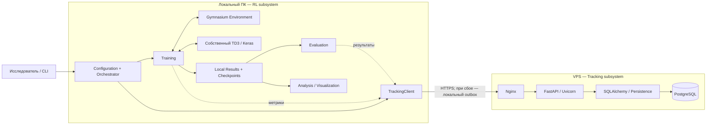

# Архитектура системы обучения с подкреплением

> **Статус документа:** базовая архитектура MVP, согласованная на Этапе 0; детали реализации уточняются по мере работы.
> **Редакция:** 0.2 от 18.10.2026 (точечные уточнения планирования Этапа 1).
> **Главный архитектурный чат:** `00 — Архитектура системы`.

## 0. Как пользоваться документом

Этот документ — актуальная запись **принятых архитектурных решений**, а не исчерпывающая техническая спецификация. Здесь фиксируются границы, требования, ответственность компонентов, связи, основные сценарии и причины существенных решений.

- **MVP / обязательно** — требуется для законченного минимального системного результата.
- **Опциональная операция** — система умеет её выполнять, но она не обязана запускаться при каждом `Run`.
- **Отложено** — не входит в обязательный MVP; возвращаемся при необходимости и наличии времени.
- **Предварительно** — направление выбрано, конкретный формат, API, библиотечные версии или файловая структура ещё не утверждены.

**Рабочий цикл каждой подфазы:** в `00` заранее согласуются её архитектура вплоть до нужных пакетов/модулей, основных классов, публичных контрактов, зависимостей и проверяемых инвариантов; затем оформляется ограниченное ТЗ для `01` (RL) либо `02` (tracking/backend). Там выполняются код, тесты и отладка. Результат и предложения, затрагивающие архитектуру, возвращаются в `00` для утверждения перед следующей подфазой. Внутренние инструкции каждой приватной функции заранее не фиксируются.

В этом документе сохраняются **актуальные существенные решения и их причины**, но не все подробности обсуждений и не код реализации. Отчёт и материалы защиты — в `03`. Один активный архитектурный чат; если контекст станет слишком длинным, допускается его продолжение с опорой на этот документ.

**Правило MVP:** новая возможность не должна задерживать end-to-end результат, если она не требуется темой практики, не нужна для основного сценария и не устраняет подтверждённую проблему.

---

## 1. Назначение, пользователь и результат

**Назначение.** Система предназначена для проведения воспроизводимых экспериментов по обучению агента с подкреплением в среде с непрерывным пространством действий. Она объединяет конфигурацию запуска, обучение, сбор метрик, сохранение политики, независимую оценку, централизованный учёт результатов и их анализ.

**Основной пользователь:** RL-разработчик / исследователь, задающий параметры эксперимента, запускающий обучение и анализирующий результат. Графический интерфейс не требуется: конфигурационных файлов и/или CLI достаточно.

**Вход на уровне системы:** фактическая конфигурация `Run` (среда, алгоритм, гиперпараметры, seed, ограничения обучения, настройки сохранения и оценки).

**Результат на уровне системы:** сохранённая политика (policy artifact), локальные результаты запуска, при необходимости результаты независимой evaluation, доступные через tracking API метаданные и метрики, возможность сравнения запусков и построения графиков.

Смысл темы — **программная система полного цикла**, а не один обучающий скрипт `train_td3.py` и не реализация универсального RL-фреймворка.

### 1.1. Минимальный сквозной сценарий

```text
Configuration
  → локальный Run
  → Environment + собственный TD3 Agent
  → Training + Metrics
  → локальный Policy Checkpoint
  → независимая Evaluation (в отдельном запуске или после обучения)
  → TrackingClient → Tracking API → PostgreSQL
  → чтение результатов и сравнение / графики по запросу
```

Обязательна **работоспособность полного сценария** хотя бы на одном эксперименте. Evaluation и построение графиков не обязаны автоматически выполняться **после каждого** `Run`.

### 1.2. Явные ограничения MVP (не цели)

- Не разрабатывать универсальную платформу для произвольных RL-алгоритмов, сред и моделей.
- Не делать микросервисы, распределённое обучение, систему пользователей, GUI/dashboard и сложный model registry.
- Не включать в обязательную реализацию SAC, multiprocessing, полноценный resume-training, автоматический подбор гиперпараметров и серверное выполнение RL-среды.
- Не обещать бит-в-бит одинаковых GPU-вычислений или абсолютно идентичных траекторий при повторном эксперименте.
- Не связывать успешность обучения с доступностью VPS, успешностью Evaluation или построением графиков.

---

## 2. Границы системы

### 2.1. Логические и физические границы

**Разрабатываемая система** включает две основные программные подсистемы и средства анализа:

1. **Локальная RL-подсистема:** конфигурация, `Orchestrator`, работа со средой, собственный RL Core / TD3, Training, Evaluation, локальные артефакты, TrackingClient, анализ и визуализация.
2. **Tracking-подсистема:** REST API, серверная проверка запросов, persistence/CRUD, схема данных и миграции, централизованный учёт экспериментов.
3. **Конфигурация развёртывания:** Docker Compose, Nginx/TLS, запуск API и PostgreSQL, переменные окружения, volumes и healthchecks.

**Физическое размещение:** обучение, симуляция и Evaluation выполняются на локальном ПК; VPS выполняет функции tracking/server. VPS **не обучает агент**.



*Стрелки отражают логические отношения, а не утверждённые Python-вызовы. `Orchestrator` координирует жизненный цикл, но не маршрутизирует все данные через себя.*

### 2.2. Разрабатываемые компоненты и внешние зависимости — не одно и то же

| Входит в архитектуру разрабатываемой системы | Внешняя технология или окружение |
|---|---|
| Собственная реализация TD3 и интеграция агента | Keras и выбранный вычислительный backend |
| Интеграция и конфигурация среды | Gymnasium как библиотека, готовая среда |
| Training / Evaluation / Orchestrator | Windows, физический ПК, GPU |
| TrackingClient и собственный Tracking API | Интернет, HTTPS-протокол как технология |
| Схема БД, миграции, запросы persistence | PostgreSQL как сторонняя СУБД |
| Конфигурация Nginx/Compose и deployment | Nginx, Docker, Linux/VPS как платформы |

Сторонняя технология может быть частью **развёрнутой конфигурации** системы, хотя исходный код самой технологии мы не разрабатываем. Интерфейс компонента также **не превращает** его конкретную собственную реализацию во «внешнюю».

### 2.3. Ограниченная заменяемость

- Среды: создание по конфигурации через Gymnasium API (без ветвления кода Trainer по имени среды); начальный поддерживаемый тип — **одномерные числовые векторы наблюдений `Box` и действий `Box`** с конечными границами действий. Размерности не захардкожены; характеристики извлекаются из реальной среды, неподходящие пространства отвергаются при инициализации. Не обещаем корректную работу со всеми Gymnasium-средами.
- Алгоритмы: MVP — **собственный TD3**. `Trainer` взаимодействует с RL Core через ограниченный контракт off-policy агента, а не через внутренности TD3. Потенциальный SAC — будущая реализация, но не требование и не обещание универсального Training для любых RL-алгоритмов.
- Tracking: локальная работа и передача в **наш** удалённый Tracking API, а не универсальный адаптер под любые внешние ML-трекеры.
- Не создавать заранее универсальные реестры плагинов, фабрики и дополнительные абстракции без реальной необходимости.

---

## 3. Функциональные требования (FR)

| ID | Требование | Минимальная проверка |
|---|---|---|
| **FR-01** | Задать конфигурацию: среду, алгоритм, гиперпараметры, лимиты обучения, seed, параметры checkpoint/evaluation/tracking. Сохранить **фактически применённую** конфигурацию и seed. | Повторно прочитать параметры конкретного `Run`. |
| **FR-02** | Создать и запустить отдельный `Run` в рамках `Experiment` с локальным идентификатором, не требуя доступного VPS. | Запуск начинается при недоступном tracking backend. |
| **FR-03** | Выполнить обучение собственного TD3: взаимодействовать со средой, собирать transitions, использовать Replay Buffer, обновлять нейросети. | Работает завершённый training loop на выбранной среде. |
| **FR-04** | Собирать основные обучающие метрики (reward, длина эпизода, диагностические потери и т. п. — точный список позже). | Метрики связаны с `Run` и шагами обучения. |
| **FR-05** | Периодически и при штатном завершении сохранять **policy checkpoint**; уметь загрузить его для применения и Evaluation. Полный resume-training не обязателен. | Сохранённая политика успешно загружается в новом контексте. |
| **FR-06** | Поддерживать штатное, пользовательское и аварийное завершение; сохранить доступные результаты и установить корректный статус. | Завершение по лимиту / ручная остановка / моделируемая ошибка. |
| **FR-07** | Независимо выполнить Evaluation сохранённой политики: отдельная среда, эпизоды без обновления весов, несколько seed/эпизодов, агрегированные показатели. Можно выполнить **позже и повторно**. | Результат Evaluation привязан к конкретным `Run` и checkpoint. |
| **FR-08** | Централизованно передавать experiment/run metadata, effective config, batches метрик, результаты Evaluation и статусы через TrackingClient → API → PostgreSQL. | Данные доступны на сервере по завершении синхронизации. |
| **FR-09** | При временном отказе сервера продолжать локальное обучение, устойчиво сохранять неотправленные данные и повторно отправлять их после восстановления связи / перезапуска. | Сервер недоступен → обучение продолжается → позже синхронизация. |
| **FR-10** | Получать сохранённую историю experiments/runs/config/metrics/evaluations/status через API. | Есть запросы чтения и возможность сопоставить runs. |
| **FR-11** | По запросу строить ключевые графики по сохранённым локальным или удалённым метрикам и сравнивать runs; PNG можно сохранять локально. | График строится без повторного обучения. |

**Уточнения:**

- Evaluation — **обязательная возможность системы**, но **опциональный шаг каждого `Run`**. Для принятия всей системы хотя бы один полный сценарий с Evaluation должен пройти успешно.
- Анализ/визуализация — пользовательская операция по запросу, не обязательная стадия завершения обучения.
- Серверный inference (`observation → action` на VPS) и upload/download модели — **отложенные расширения**, не пункты обязательного FR.
- Улучшение качества политики проверяется в экспериментах; не подменяет корректность функционирования программы.

---

## 4. Нефункциональные требования и ограничения (NFR)

| ID | Требование / интерпретация для MVP |
|---|---|
| **NFR-01 — Воспроизводимость** | Хранить effective config, seed, сведения о среде/алгоритме, параметры evaluation; по возможности версию кода. Обеспечить повторный запуск в сопоставимых условиях **без гарантии побитовой идентичности**. |
| **NFR-02 — Сохранность** | Важные сохранённые результаты переживают штатное завершение и ожидаемые сбои. Не обещать спасение ещё не записанных данных при внезапной гибели процесса/оборудования. |
| **NFR-03 — Изоляция отказа tracking** | Недоступность VPS не останавливает Training. Отправка данных не должна чрезмерно блокировать training loop; точный механизм доставки определяется позже. |
| **NFR-04 — Наблюдаемость** | По логам, метрикам и статусам можно понять ход выполнения, причину завершения и доступные результаты. Без обязательной Prometheus/Grafana-инфраструктуры. |
| **NFR-05 — Модульность** | Training не содержит SQL/HTTP, Backend не содержит RL-математику, Evaluation не обновляет модель, Orchestrator не становится god-object. |
| **NFR-06 — Ограниченная расширяемость** | Замена выбранной совместимой среды и потенциальное добавление SAC не должны требовать переделки всей системы. Но произвольные алгоритмы/среды не обещаются. |
| **NFR-07 — Ресурсы и платформа** | Основная локальная работа — Windows 11, ПК с 16 ГБ RAM и RTX 4050; без обязательного WSL2, multiprocessing и распределённого обучения. Tracking — обычный VPS. Реальная GPU-совместимость определяется технической проверкой Этапа 1. |
| **NFR-08 — Минимальная безопасность** | При публичном доступе к VPS: HTTPS, API key для операций записи, секреты вне Git/исходников, БД не публикуется в Интернет. Полноценная пользовательская авторизация не нужна. |

Здесь перечислены как качества, так и существенные технологические/ресурсные ограничения. Не вводим пустые обещания «высокая производительность», «99.9% uptime» или «горизонтальная масштабируемость» без задачи и критериев.

---

## 5. Компонентная архитектура и ответственность

### 5.1. Локальная RL-подсистема

| Компонент | Делает / получает / производит | Не делает; существенная граница |
|---|---|---|
| **Configuration** | Представляет effective config и seed; получает параметры от пользователя; предоставляет настройки компонентам. | Не запускает обучение, не принимает runtime-решений, не отправляет данные. В идеале не зависит от других подсистем. |
| **Orchestrator** | Координирует подготовку `Run`, создание зависимостей, запуск Training, опциональную Evaluation, итоговые статусы и финализацию. | Не выполняет TD3 update, `env.step()`, SQL, HTTP-детали, сериализацию Keras и построение графиков. |
| **Environment integration** | По `EnvironmentConfig` создаёт среду Gymnasium, проверяет совместимость пространств и предоставляет их характеристики (`EnvironmentSpec`) и обычный API `reset`/`step`. | Не обучает агент, не хранит replay, не управляет Run. Собственный дублирующий `EnvironmentInterface` не нужен. |
| **RL Core / Agent** | Собственная реализация TD3: Actor/Critics, target networks, Replay Buffer, выбор действия, обучение, сериализация/загрузка policy. Возвращает action, метрики обновлений и состояние политики. При создании использует параметры алгоритма и характеристики среды. | Не управляет всем циклом эксперимента и серверным tracking. Replay Buffer — внутри RL Core; вычислительный backend не должен проникать в Trainer/Orchestrator. |
| **Training** | Управляет training loop, шагами/эпизодами, расписанием updates/checkpoints, создаёт метрики, корректно выходит из цикла. | Не определяет место физического хранения, не выполняет HTTP/SQL, не руководит всем Experiment и не проводит независимую Evaluation. |
| **Evaluation** | Загружает сохранённую policy, создаёт **отдельный экземпляр** среды, выполняет эпизоды без update, считает агрегаты, сообщает идентификаторы Run/checkpoint/seeds. | Не использует тренировочный Replay Buffer, не изменяет веса/состояние Training, не требует работающего обучающего процесса. |
| **Local Results / Artifacts** | Устойчиво сохраняет effective config, метрики, логи, checkpoint-файлы, результаты evaluation, metadata; возвращает пути/ссылки для чтения. | Не вычисляет RL-метрики, не решает когда сохранять, не содержит HTTP-логики. Внутреннее разбиение на Store/Logger пока отложено. |
| **TrackingClient** | Переводит предметные данные в API-запросы; пакетирование, timeout, retry, outbox и подтверждение доставки; умеет синхронизировать результаты. | Не обучает, не решает, какие метрики важны, и не использует SQLAlchemy/доступ к PostgreSQL. |
| **Analysis / Visualization** | Читает локальные результаты или Tracking API, строит графики/сравнения, при необходимости сохраняет PNG локально. | Не управляет Training, не меняет agent, не обращается к PostgreSQL напрямую. Пока простые функции, не generic dashboard. |

Для Этапа 1 предусмотрена ограниченная конфигурация Actor/Critic: вход/выход определяются реальными размерами наблюдений/действий; список скрытых Dense-слоёв и их активации можно задавать по слоям, со строгой проверкой длины списков. Предварительно Actor имеет выход `tanh` с приведением к action bounds среды, Critic — скалярный линейный Q-value. Точные структуры конфигураций и классов утверждаются в подфазах 1.1 и 1.4.

Критическое разделение: **Training знает, когда обновлять/сохранять; Agent знает, как обучаться и сериализовать policy; Local Results знает, куда сохранять**. `Orchestrator` отвечает за общий жизненный цикл и финальные решения по статусам, а не за каждый шаг обучения.

### 5.2. Tracking-подсистема

| Элемент | Ответственность |
|---|---|
| **Tracking API (FastAPI / Uvicorn)** | HTTP endpoints, запросы/ответы и их валидация, проверка API key, HTTP status codes, вызов операций хранения. Не содержит RL-алгоритма. |
| **Persistence / CRUD (SQLAlchemy)** | ORM, операции записи/чтения, запросы и транзакции. Не знает сетевых retry или training loop. |
| **PostgreSQL** | Централизованное долговечное хранение tracking-данных. ПО стороннее; схема и миграции — часть нашего проекта. |
| **Alembic** | Миграции схемы данных. |

Для MVP достаточно `endpoint → CRUD/persistence → SQLAlchemy → PostgreSQL`. Отдельный service/repository/unit-of-work слой **не вводить заранее**: только если появится оправдывающая его серверная логика.

### 5.3. Инфраструктура (другой архитектурный уровень)

- **Nginx:** публичная HTTPS-точка входа, TLS termination, reverse proxy на API.
- **FastAPI/Uvicorn:** ASGI-приложение, принимающее запросы TrackingClient.
- **PostgreSQL container + persistent volume:** данные переживают перезапуск/обновление контейнеров; порт БД наружу не публикуется.
- **Docker Compose:** конфигурация `nginx`, `api`, `postgres`, сети, volumes, env и healthchecks.
- **VPS:** хостинг tracking-сервера; обучение и оценку модели не выполняет.

План: три постоянно работающих контейнера (`nginx`, `api`, `postgres`). Не требуются микросервисы, отдельная авторизация пользователей, брокер сообщений или публичный доступ к БД.

---

## 6. Основные интерфейсы (смысловые контракты)

На Этапе 0 зафиксированы **смысловые** контракты. Значимые Python-сигнатуры, `Protocol`/ABC, публичные классы, фабрики и экспорты (`__all__`, если нужен) **проектируются в `00` перед реализацией соответствующей подфазы Этапа 1**; не передаются целиком на архитектурное усмотрение чата `01`. Внутренний код методов, не меняющий межмодульные контракты, остаётся в `01`.

| Граница | Передаваемые данные и смысл |
|---|---|
| `Orchestrator → Training` | Созданные зависимости и настройки → выполнение training loop; обратно — результат/причина завершения и итоговые сведения. |
| `Training ↔ Environment` | Стандарт Gymnasium: `reset()`, `step(action)` → observation, reward, `terminated`, `truncated`, info; пространство действий — непрерывное. |
| `Training ↔ Agent` | Observation → action; transition → buffer; запрос update → метрики обучения; инициирование сериализации policy по расписанию. |
| `Training / Agent → Local Results → Evaluation` | Событие сохранения → сериализованная policy + metadata → устойчивый checkpoint; Evaluation загружает его независимо от объекта Agent в памяти. |
| `RL → TrackingClient → Tracking API` | Experiment/Run metadata, effective config, metric batches, evaluation, status; HTTP(S), подтверждения, отложенная доставка. Никаких ORM-моделей в RL-части. |
| `Stored Results → Analysis` | Локальные файлы и/или API чтения → графики и сравнения. Прямое подключение Analysis к PostgreSQL не требуется. |

### 6.1. Основные потоки данных

**Training:** `Configuration → Orchestrator → Training ↔ (Environment, Agent) → Agent updates → metrics`.

**Checkpoint / Evaluation:** `Training (когда) → Agent (что/как сериализовать) → Local Results (куда) → загрузка в Evaluation → результаты`.

**Tracking:** `effective config / metrics / evaluation / statuses → TrackingClient → HTTPS → Nginx → API → Persistence → PostgreSQL`; при неудаче — устойчивый локальный outbox → повторная синхронизация.

**Analysis:** `Local Results и/или Tracking API → Analysis / Visualization → график`; построение не влияет на статусы обучения.

### 6.2. Отказ сети и идемпотентность

- Сервер может быть недоступен в момент начала `Run`, во время обучения и при завершении; локальный `Run` существует независимо от сервера.
- Outbox/retry **семантически принадлежит TrackingClient**, хотя физически использует локальные файлы/хранилище.
- Отправка не должна производить длительных блокировок на каждом `env.step()`; сначала допустимы редкие batch-отправки с ограниченным timeout. Async/background worker — только при подтверждённой необходимости.
- Повтор после потери ответа сервера не должен создавать неконтролируемые дубли `Run`/метрик. Простая идемпотентность (например, локально заданный ID и/или ключ операции) — принцип; конкретная реализация Этапа 4.
- Неотправленные данные должны переживать перезапуск Python-процесса; при следующем запуске или явной команде `sync` система может продолжить отправку. Постоянно работающий фоновый сервис не требуется.

---

## 7. Сущности и жизненный цикл

### 7.1. `Experiment`, `Run`, `Checkpoint`, `Evaluation`

- **Experiment** — логическая группа связанных запусков для исследования/сравнения.
- **Run** — конкретное выполнение обучения с зафиксированным effective config и seed. Один Experiment содержит один или несколько Runs.
- **Checkpoint / Policy artifact** — сохранённая политика, принадлежащая конкретному Run и шагу обучения.
- **Evaluation** — отдельная операция оценки конкретного checkpoint конкретного Run; у одного checkpoint может быть несколько оценок с разными параметрами/seeds.
- **Metric** — запись измерения с привязкой к Run и шагу/эпизоду или отдельной операции оценки.

Финальные таблицы/ключи БД не проектируются на Этапе 0. **Концептуальные связи** должны сохраниться независимо от схемы.

### 7.2. Жизненный цикл Run

```text
прочитать и проверить config; определить и сохранить seed
        ↓
создать локальный Run ID и локальную запись / директорию
        ↓
подготовить Environment + Agent + Training
        ↓
Training: interaction → updates → metrics → checkpoints
        ↓
завершить обучение; сохранить доступные итоги и policy
        ↓
Run status: completed / stopped / failed
        │
        ├── Evaluation checkpoint (по запросу, сразу или позже)
        ├── Tracking sync (при доступном сервере или позже)
        └── Analysis / Plotting (по запросу, сейчас или позже)
```

Evaluation и Analysis **не обязаны быть синхронными этапами финализации Run**. Для полной демонстрации системы хотя бы один успешно завершённый Run должен иметь успешно проведённую Evaluation и синхронизированные tracking-данные.

### 7.3. Семантика состояний

| Состояние `Run` | Значение |
|---|---|
| `created` | Локально создан, готовится к исполнению. |
| `running` | Выполняется цикл обучения. |
| `completed` | Обучение штатно завершено. |
| `stopped` | Досрочно остановлено пользователем с корректной финализацией доступных результатов. |
| `failed` | Обучение прервано критической ошибкой. |

Это **состояния выполнения обучения**, а не обобщённая оценка успеха всех независимых операций. Ошибка Evaluation или недоступность VPS не меняют успешно завершённый `Run` на `failed`.

- **Evaluation**: концептуально `not_run / completed / failed`; при нескольких оценках статус относится к каждой записи/операции, а не к одному общему флагу Run.
- **Tracking delivery**: концептуально `pending / synced / error`; точная схема полей и переходов решается позднее.
- **Analysis/Visualization**: не влияет на успешность Run; не требует отдельного state machine.

### 7.4. Остановки, ошибки и сохранение

1. **Нормальное завершение:** Training достигает лимита, сохраняются итоговые метрики и checkpoint, Orchestrator фиксирует `completed`.
2. **Остановка пользователем (`Ctrl+C` и т. п.):** верхний уровень инициирует завершение, Training выходит из цикла в безопасной точке, сохраняет доступные данные; Orchestrator фиксирует `stopped`. Финальный checkpoint — по возможности.
3. **Критическая ошибка:** логирование причины, сохранение уже записанных результатов, статус `failed`. Не обещается успешная запись нового checkpoint при внезапном падении процесса.
4. **Недоступность tracking:** обучение и локальное сохранение продолжаются; доставка откладывается, данные синхронизируются позже.
5. **Ошибка Evaluation:** обучение остаётся в своём статусе; операция оценки может быть повторена без повторного обучения из сохранённого checkpoint.

### 7.5. Политика сохранения модели

**Обязательный MVP:** **model/policy checkpoint**, а не полное восстановление training state. Предпочтительный состав: сериализованная actor/policy (например, `.keras`) и **минимальные метаданные, необходимые для её корректного применения** — идентификаторы Run/checkpoint, размерности/порядок наблюдений, обработка наблюдений, масштабирование действий, relevant config/versions. Конкретный набор определяется при реализации TD3.

Keras-модель может содержать архитектуру и веса, но **сама по себе не гарантирует** корректную интерпретацию наблюдений/действий или полное возобновление TD3-обучения. Сохранение состояния critics, optimizer, replay buffer и RNG для полноценного resume — отдельная отложенная задача.

**Размещение:** checkpoints хранятся **локально на вычислительном ПК**; сервер хранит tracking-данные/metadata. Наличие файлов модели на VPS в MVP **не предполагается**.

---

## 8. Данные и анализ

### 8.1. Локальные данные

Локально сохраняются effective config, logs, metrics, checkpoints, evaluation results, metadata Run и при необходимости outbox. Для раннего MVP предпочтительны простые форматы (JSON/JSONL/CSV и файлы модели); локальную БД **не вводить без причины**. Точный формат и дерево каталогов уточняются на Этапах 1–2.

### 8.2. Централизованные данные

Tracking backend хранит сведения об experiments/runs, конфигурации, метрики, оценки и статусы. Предварительные сущности: `Experiment`, `Run`, `Metric`, `Evaluation`; структура таблиц и отношения фиксируются на Этапе 3. PostgreSQL не используется для прямого подключения RL-кода.

### 8.3. Визуализация

Минимальная форма — простые функции построения графиков, например `plot_training_reward`, `plot_losses`, `plot_evaluation`, `compare_runs`. Источник — локальные результаты или Tracking API. Matplotlib может показать график и опционально сохранить PNG **на ПК**; серверное хранение изображений и live-dashboard не требуются.

Не фиксировать класс с `@staticmethod` только ради группировки функций: Python-модуль уже даёт пространство имён. Реальный API определяется при реализации.

---

## 9. Технологический стек и платформенные решения

| Область | Выбор / статус |
|---|---|
| RL-алгоритм | **TD3 — собственная реализация**; SAC — необязательное будущее расширение. |
| Нейросети | **Keras 3 + TensorFlow CPU** для текущего MVP; версии библиотек и работу custom gradient update проверить в 1.0. Будущий GPU-backend — отдельное решение. |
| Среды | **Gymnasium**: `Pendulum-v1` для первоначальной отладки; `LunarLander-v3` с `continuous=True` — целевая более сложная среда для дальнейших экспериментов (успешное обучение не гарантируется без проверки). |
| Локальная система | **Python 3.12.10 на Windows 11**, 16 ГБ RAM, RTX 4050; нативная работа без обязательного WSL2; для текущего RL-MVP используем CPU. |
| Backend | Python 3.12 (предварительный стек), FastAPI, Uvicorn, SQLAlchemy, PostgreSQL, Alembic. |
| Связь | JSON поверх HTTP API; **HTTPS при публичном VPS**; API key на запись. |
| Deployment | Docker Compose, Nginx, контейнеры `nginx/api/postgres`, persistent volume. |
| Analysis | Matplotlib, простые функции; PNG локально по запросу. |
| Concurrency | Однопроцессный RL baseline; multiprocessing и async delivery не требуются без измеренной причины. |

**Подфаза 1.0:** подтвердить совместимую установку Python 3.12.10 + Keras 3 + TensorFlow CPU + NumPy + Gymnasium на Windows 11, выполнить минимальный forward/backward/optimizer update, запустить pytest и зафиксировать проверенные версии зависимостей. Бенчмарк Torch CUDA **не обязателен** для выбора текущего MVP.

**Возможное развитие:** GPU через Keras/Torch CUDA либо нативный PyTorch рассматривается в следующих итерациях при подтверждённой необходимости. Для снижения стоимости перехода TensorFlow-specific код градиентов/оптимизаторов локализовать в TD3; `Trainer`, `Orchestrator` и обработка Gymnasium-сред не должны импортировать TensorFlow. Переключение backend одной настройкой **не обещается**.

---

## 10. Предварительная структура единого репозитория

Репозиторий: **`continuous-action-rl-system`**; пакет Python: **`rl_system`**. `src` = *source* (исходный код).

```text
continuous-action-rl-system/
├── pyproject.toml            # описание и editable install RL-пакета
├── requirements-rl.txt       # проверенные зависимости локального RL
├── configs/
│   └── td3_pendulum.yaml     # пример конфигурации Run
├── src/
│   └── rl_system/
│       ├── __init__.py
│       ├── __main__.py        # тонкая точка входа (python -m rl_system)
│       ├── config.py
│       ├── environment.py     # Gymnasium factory / EnvironmentSpec
│       ├── orchestrator.py
│       ├── training.py
│       ├── evaluation.py      # Этап 2
│       ├── artifacts.py       # Этап 2, название предварительное
│       ├── agents/
│       │   ├── __init__.py
│       │   ├── base.py        # общий контракт Agent
│       │   ├── factory.py
│       │   └── td3/
│       │       ├── __init__.py
│       │       ├── agent.py
│       │       ├── networks.py
│       │       └── replay_buffer.py
│       ├── tracking/
│       │   └── client.py      # Этап 4
│       └── analysis/
│           └── plots.py      # по мере необходимости
├── backend/
│   ├── app/
│   │   ├── main.py
│   │   ├── db.py
│   │   ├── models.py
│   │   ├── schemas.py
│   │   └── crud.py
│   ├── alembic/
│   ├── requirements.txt
│   ├── Dockerfile
│   └── .dockerignore
├── deploy/
│   ├── compose.yaml
│   └── nginx/
│       └── nginx.conf
├── tests/
├── docs/
│   └── architecture.md
├── runs/                     # локальные данные; .gitignore
├── .env.example
├── .gitignore
├── AGENTS.md                 # для Codex, по потребности позже
└── README.md
```

**Это предварительная целевая структура, а не требование создать всё дерево сразу.** Приняты `src layout`, минимальный `pyproject.toml` с editable install, точка входа `__main__.py`, конфигурация и отдельный модуль создания среды. Точные классы/методы, распределение вспомогательных функций, `artifacts.py` и организация tests уточняются в `00` непосредственно перед соответствующей подфазой. Для Этапа 1 файлы появляются постепенно.

- Держать локальные RL-зависимости отдельно от серверных: tracking-сервер без model serving не должен устанавливать Keras/Gymnasium. В `requirements-rl.txt` сразу включить `pytest`; версии зависимостей закрепить после проверки 1.0.
- Входной формат Run-конфигурации — простой **YAML**, валидируемый при загрузке; effective config и seed сохраняются как данные запуска (например, JSON на Этапе 2). Не смешивать эту конфигурацию с `pyproject.toml`.
- В `backend/` лежат Dockerfile, `.dockerignore` и зависимости API (при build context = `backend/`).
- В `deploy/` — описание совместного развёртывания; Compose может использовать Dockerfile из `backend/`.
- `.env` и локальные результаты не коммитить; `.env.example` — только пример без секретов.
- `AGENTS.md` можно добавить в начале реализации Codex-задач; он задаёт правила работы агента, не дублирует всю архитектуру.
- `README.md` описывает назначение, локальный запуск, тесты и путь к архитектуре.

---

## 11. Принятые ключевые решения и причины

| Решение | Почему принято |
|---|---|
| **Система, не алгоритм** | Тема практики требует полного жизненного цикла и объяснимых границ компонентов. |
| **TD3 самостоятельно, SAC необязателен** | Обучающая ценность собственной реализации при реалистичном сроке; два алгоритма не являются необходимым критерием целостности системы. |
| **Keras 3 + TensorFlow CPU на MVP** | Наиболее понятный стек под нативную Windows 11 и ограниченное время; выбор GPU откладываем, проверенные версии определяем в 1.0. Backend-specific операции не переносим в Trainer. |
| **Отдельный Orchestrator** | Чтобы Training не превращался в координатор создания Run, evaluation и tracking. |
| **Gymnasium API + простая Environment Factory** | Создание по YAML-конфигурации и извлечение характеристик пространств без специального кода каждой среды в Trainer; не дублируем Gymnasium своим Environment ABC. |
| **Replay Buffer внутри RL Core** | Это алгоритмическая деталь, а не системная подсистема. |
| **Отдельная Evaluation + загрузка checkpoint** | Проверяется настоящая пригодность артефакта и независимость от тренировочного объекта в RAM. |
| **Policy checkpoint без полного resume** | Для MVP достаточно inference/evaluation; точное продолжение обучения значительно сложнее. |
| **Локальный Run и локальные артефакты** | Недоступность сети/VPS не должна делать длительное обучение невозможным. |
| **TrackingClient как граница HTTP** | Training не зависит от транспорта и БД; сервер можно интегрировать отдельно после стабилизации RL. |
| **Не создавать отдельный backend service-layer заранее** | CRUD/persistence достаточно, пока не появилась нетривиальная серверная бизнес-логика. |
| **Analysis по запросу** | Графики нужны исследователю и для отчёта, но не должны управлять завершением Run. |
| **Один репозиторий, два набора зависимостей** | Единый проект с разными runtime-условиями у локального RL и VPS. |
| **HTTPS и API key для публичного VPS** | Даже если метрики несекретны, API key — секрет. Нет нужды в пользовательских аккаунтах. |
| **Без multiprocessing/обязательного asyncio в MVP** | Не подтверждена необходимость, возрастает сложность отладки; оптимизация только после измерений. |

---

## 12. Отложенные решения и возможные расширения

### 12.1. Уточнить на этапах реализации

| Вопрос | Когда |
|---|---|
| Выбранные среды: Pendulum-v1 и целевая LunarLander-v3 (`continuous=True`); точные ограничения `EnvironmentSpec`, параметры TD3 | Подфазы 1.1–1.5 |
| Совместимые версии NumPy/Keras 3/TensorFlow CPU/Gymnasium/pytest под Python 3.12.10, smoke test градиентов | Подфаза 1.0 |
| Публичные контракты Configuration/Environment/Agent, структура TD3 и нейросетей, расписание updates, проверки | Последовательно в `00` перед подфазами 1.1–1.8 |
| Сериализация policy, обязательные inference-метаданные, cadence checkpoint | Этапы 1–2 |
| Формат локальных метрик, logs, Run IDs/путей, Evaluation CLI | Этап 2 |
| Точные сущности/схемы PostgreSQL, URL API, DTO и транзакции | Этап 3 |
| Блокировки/timeout, persistent outbox, batch/retry, дедупликация/idempotency | Этап 4 |
| Docker build context, volumes, secrets, домен/сертификат | Этап 5 |
| Минимальный набор графиков и сравнение seed/runs | Этап 6 |

### 12.2. Не включать в обязательный MVP

- SAC и поддержка произвольных алгоритмов/моделей.
- Multiprocessing/многопоточный RL, фоновая синхронизация и полноценное асинхронное сетевое взаимодействие (добавлять лишь по необходимости).
- Full training resume (critics/optimizers/replay/RNG).
- Web UI, live-dashboard, хранение PNG на сервере.
- Сложная внешняя авторизация, distributed training, HPO, model registry, object storage и микросервисы.

### 12.3. Приоритетное, но необязательное расширение: Model Storage / Model Inference

**Идея:** после готового MVP уметь загружать на VPS policy artifact (например, `actor.keras` + inference metadata), хранить его в файловом persistent volume с записью metadata в PostgreSQL, скачивать и, при наличии ресурсов, обрабатывать простой запрос `observation → action` через FastAPI.

**Что это не означает:** серверный inference **не является Evaluation** (для оценки нужна среда, эпизоды и награды); VPS по-прежнему не обучает TD3. Это не требование выполнять целую Gymnasium-среду на сервере.

**Причина отложить:** дополнительные upload/download API, хранение и контроль артефактов, совместимость Keras/runtime на VPS, проверки входов и тесты. Даже при одном actor это отдельный блок работы. Если добавить расширение, минимум проверки формы/типа observation и ограничение доступа оставлять — полностью отключать базовую валидацию небезопасно.

---

## 13. Roadmap

| Этап | Результат |
|---|---|
| **0 — Архитектура** | Назначение, границы, FR/NFR, компоненты, ответственности, интерфейсы, данные, lifecycle, структура, риски и DoD. |
| **1 — RL-ядро** | Проверка Keras/TensorFlow CPU/Windows; Configuration, Gymnasium Environment, собственный TD3, Trainer, Orchestrator/CLI; минимально работающее обучение. |
| **2 — Локальная система экспериментов** | Effective config/seeds, локальные метрики, model checkpoints, независимая Evaluation, завершение/ошибки. |
| **3 — Tracking backend** | FastAPI, PostgreSQL, SQLAlchemy, Alembic, API/CRUD и тесты. |
| **4 — Интеграция** | TrackingClient, offline mode, outbox/retry, идемпотентная синхронизация. |
| **5 — Инфраструктура** | Docker Compose, Nginx, HTTPS/API key, VPS, сохранность БД при обновлении. |
| **6 — Эксперименты и анализ** | Проверенные runs с разными seed/настройками, данные в tracking, графики и сравнение. |
| **7 — Проверка и защита** | End-to-end демонстрация, итоговые тесты, объяснение архитектуры и отчёт. |

**Порядок:** сначала рабочий вертикальный срез RL → локальные артефакты → Evaluation; затем backend и интеграция. Backend, инфраструктура и улучшения не должны блокировать первые локальные эксперименты. План уточняется по результатам реального кода.

### 13.1. Подфазы Этапа 1 (рабочий план)

| Подфаза | Результат |
|---|---|
| **1.0 — Основа проекта** | Windows/Python 3.12.10, Keras 3 + TensorFlow CPU, проверка градиентов, `pytest`, минимальный `pyproject.toml`, editable install, `requirements-rl.txt`. |
| **1.1 — Configuration** | Утверждённые контракты и реализация YAML/RunConfig с валидацией. |
| **1.2 — Environment** | Factory, извлечение пространств/границ и `EnvironmentSpec`, проверки на выбранных средах. |
| **1.3 — Agent contract / Replay Buffer** | Публичный контракт off-policy агента и буфер переходов. |
| **1.4 — TD3 Networks** | Конфигурируемые MLP Actor/Critics, размерности из среды, активации и тесты. |
| **1.5 — TD3Agent** | Собственный выбор действий, TD3 updates и математические проверки. |
| **1.6 — Training** | `Trainer`, training loop, диагностические метрики, интеграционные проверки. |
| **1.7 — Orchestrator / запуск** | Сборка зависимостей, agent factory, `__main__.py`, минимальный CLI. |
| **1.8 — Первое обучение** | Проверка обучения на Pendulum, диагностика/стабилизация; LunarLander — следующая более сложная цель по готовности. |

Каждая подфаза сначала **детально проектируется в `00`** (обязательные классы, модули, публичные интерфейсы, зависимости, проверки), затем ограниченным заданием выполняется в `01`; результат сверяется в `00` перед следующей. Тесты пишутся по мере реализации, а не только в конце Этапа 1.

## 14. Правило дальнейшего изменения архитектуры

В ходе Этапов 1–7 неизбежны уточнения. Менять архитектуру допустимо, но изменения должны быть объяснимыми:

1. Выявлена проблема, новое требование или фактическое ограничение.
2. Проверено, нельзя ли решить её без нового уровня абстракции/технологии.
3. Если меняется системная граница или ответственность — решение кратко обсуждается/фиксируется в `00`.
4. Обновляется этот документ (что изменилось и почему); подробности реализации остаются в исходниках, тестах и специализированных чатах.

**Принцип:** архитектура должна служить реализации, а не становиться самоцелью.
