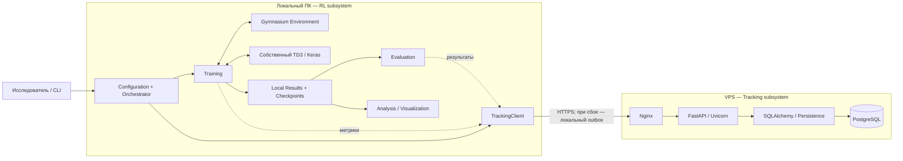

# Архитектура системы обучения с подкреплением

> **Статус документа:** базовая архитектура MVP согласована; подфазы 1.0–1.5 завершены, итоговый аудит валидации выполнен. Архитектура и план реализации 1.6 (Training) согласованы; реализация предстоит.
> **Редакция:** 0.10 от 27.11.2026 (завершение 1.5 и проектирование Training).
> **Главный архитектурный чат:** `00 — Архитектура системы`.

## 0. Как пользоваться документом

Этот документ — актуальная запись **принятых архитектурных решений**, а не исчерпывающая техническая спецификация. Здесь фиксируются границы, требования, ответственность компонентов, связи, основные сценарии и причины существенных решений.

- **MVP / обязательно** — требуется для законченного минимального системного результата.
- **Опциональная операция** — система умеет её выполнять, но она не обязана запускаться при каждом `Run`.
- **Отложено** — не входит в обязательный MVP; возвращаемся при необходимости и наличии времени.
- **Предварительно** — направление выбрано, конкретный формат, API, библиотечные версии или файловая структура ещё не утверждены.

**Рабочий цикл подфазы:** в `00` проектируется **вся подфаза** до уровня основных модулей, классов, публичных контрактов, зависимостей и проверяемых инвариантов; затем реализация разбивается на столько последовательных шагов, сколько оправдано объёмом (обычно 2–5). Единое стартовое ТЗ в `01` (RL) или `02` (backend) передаёт контекст всей подфазы; последующие шаги определяются в чате реализации по этому документу и фактическому состоянию кода, с переходом после подтверждения предыдущего шага пользователем. Отдельные промпты из `00` для каждого шага не требуются. Подробный отчёт в `00` нужен лишь при отклонениях, архитектурных вопросах или изменении контракта; штатное завершение можно подтверждать кратко. Детали приватных функций остаются в реализации, кроме существенных вычислительных границ и инвариантов, необходимых для корректности и тестирования.

В этом документе сохраняются **актуальные существенные решения и их причины**, но не все подробности обсуждений и не код реализации. Отчёт и материалы защиты — в `03`. Один активный архитектурный чат; если контекст станет слишком длинным, допускается его продолжение с опорой на этот документ.

**Правило MVP:** новая возможность не должна задерживать end-to-end результат, если она не требуется темой практики, не нужна для основного сценария и не устраняет подтверждённую проблему.

**Принцип валидации:** доверяем установленным контрактам собственных компонентов и поддерживаемых библиотек. Статические инварианты обеспечиваем конструкцией, тестами или однократной проверкой при создании; внешние данные валидируем на ответственной границе; гарантированные внутренние данные не проверяем повторно, пока операция не способна нарушить их инвариант. Динамические вычислительные инварианты проверяем в минимально достаточных точках до возможной маскировки дефекта или повреждения состояния. Проверка должна защищать конкретный реально нарушаемый инвариант и быть соразмерна риску; не проектируем защиту от произвольной подмены приватных компонентов или обхода контрактов. Это не отменяет проверок на недоверенных внешних границах (конфигурация, файлы, сеть/API) и fail-fast при реальных нарушениях.

---

## 1. Назначение, пользователь и результат

**Назначение.** Система предназначена для проведения воспроизводимых экспериментов по обучению агента с подкреплением в среде с непрерывным пространством действий. Она объединяет конфигурацию запуска, обучение, сбор метрик, сохранение политики, независимую оценку, централизованный учёт результатов и их анализ.

**Основной пользователь:** RL-разработчик / исследователь, задающий параметры эксперимента, запускающий обучение и анализирующий результат. Графический интерфейс не требуется: конфигурационных файлов и/или CLI достаточно.

**Вход на уровне системы:** пользовательская спецификация запуска (среда, алгоритм, гиперпараметры, seed, лимиты обучения и позднее настройки сохранения/оценки). Перед созданием `Run` она проверяется; фактически применённая конфигурация фиксируется отдельно.

**Результат на уровне системы:** сохранённая политика (policy artifact), локальные результаты запуска, при необходимости результаты независимой evaluation, доступные через tracking API метаданные и метрики, возможность сравнения запусков и построения графиков.

Смысл темы — **программная система полного цикла**, а не один обучающий скрипт `train_td3.py` и не реализация универсального RL-фреймворка.

### 1.1. Минимальный сквозной сценарий

```text
Configuration → предстартовая подготовка Environment + TD3 Agent
  → effective config → локальный Run
  → Training + Metrics
  → локальный Policy Checkpoint
  → независимая Evaluation (в отдельном запуске или после обучения)
  → TrackingClient → Tracking API → PostgreSQL
  → чтение результатов и сравнение / графики по запросу
```

Обязательна **работоспособность полного сценария** хотя бы на одном эксперименте с политикой достаточного качества для выбранной среды. Цель MVP — программная система и минимально достаточные результаты, а не доказательство статистической устойчивости алгоритма, масштабный подбор гиперпараметров или сравнение TD3 с другими алгоритмами. Независимая оценка политики на нескольких начальных состояниях не требует повторного обучения на множестве seeds. Evaluation и построение графиков не обязаны автоматически выполняться **после каждого** `Run`.

### 1.2. Явные ограничения MVP (не цели)

- Не разрабатывать универсальную платформу для произвольных RL-алгоритмов, сред и моделей.
- Не делать микросервисы, распределённое обучение, систему пользователей, GUI/dashboard и сложный model registry.
- Не включать в обязательную реализацию SAC, multiprocessing, полноценный resume-training, автоматический подбор гиперпараметров и серверное выполнение RL-среды.
- Не обещать бит-в-бит одинаковых GPU-вычислений или абсолютно идентичных траекторий при повторном эксперименте.
- Не связывать успешность обучения с доступностью VPS, успешностью Evaluation или построением графиков.

---

## 2. Границы системы

### 2.1. Логические и физические границы

**Разрабатываемая система** включает две основные программные подсистемы и средства анализа:

1. **Локальная RL-подсистема:** конфигурация, `Orchestrator`, работа со средой, собственный RL Core / TD3, Training, Evaluation, локальные артефакты, TrackingClient, анализ и визуализация.
2. **Tracking-подсистема:** REST API, серверная проверка запросов, persistence/CRUD, схема данных и миграции, централизованный учёт экспериментов.
3. **Конфигурация развёртывания:** Docker Compose, Nginx/TLS, запуск API и PostgreSQL, переменные окружения, volumes и healthchecks.

**Физическое размещение:** обучение, симуляция и Evaluation выполняются на локальном ПК; VPS выполняет функции tracking/server. VPS **не обучает агент**.



*Стрелки отражают логические отношения, а не утверждённые Python-вызовы. `Orchestrator` координирует жизненный цикл, но не маршрутизирует все данные через себя.*

### 2.2. Разрабатываемые компоненты и внешние зависимости — не одно и то же

| Входит в архитектуру разрабатываемой системы | Внешняя технология или окружение |
|---|---|
| Собственная реализация TD3 и интеграция агента | Keras и выбранный вычислительный backend |
| Интеграция и конфигурация среды | Gymnasium как библиотека, готовая среда |
| Training / Evaluation / Orchestrator | Windows, физический ПК, GPU |
| TrackingClient и собственный Tracking API | Интернет, HTTPS-протокол как технология |
| Схема БД, миграции, запросы persistence | PostgreSQL как сторонняя СУБД |
| Конфигурация Nginx/Compose и deployment | Nginx, Docker, Linux/VPS как платформы |

Сторонняя технология может быть частью **развёрнутой конфигурации** системы, хотя исходный код самой технологии мы не разрабатываем. Интерфейс компонента также **не превращает** его конкретную собственную реализацию во «внешнюю».

### 2.3. Ограниченная заменяемость

- Среды: создание по конфигурации через Gymnasium API (без ветвления кода Trainer по имени среды); начальный поддерживаемый тип — **одномерные числовые векторы наблюдений `Box` и действий `Box`**; action space строго `float32` с конечными границами действий. Размерности не захардкожены; характеристики извлекаются из реальной среды, неподходящие пространства отвергаются при инициализации. Не обещаем корректную работу со всеми Gymnasium-средами.
- Алгоритмы: MVP — **собственный TD3**. `Trainer` взаимодействует с RL Core через ограниченный контракт off-policy агента, а не через внутренности TD3. Потенциальный SAC — будущая реализация, но не требование и не обещание универсального Training для любых RL-алгоритмов.
- Tracking: локальная работа и передача в **наш** удалённый Tracking API, а не универсальный адаптер под любые внешние ML-трекеры.
- Не создавать заранее универсальные реестры плагинов, фабрики и дополнительные абстракции без реальной необходимости.

---

## 3. Функциональные требования (FR)

| ID | Требование | Минимальная проверка |
|---|---|---|
| **FR-01** | Задать конфигурацию: среду, алгоритм, гиперпараметры, лимиты обучения и seed; позднее — настройки checkpoint/evaluation/tracking. Сохранить **фактически применённую** конфигурацию и seed. | Повторно прочитать параметры конкретного `Run`. |
| **FR-02** | Создать и запустить отдельный `Run` в рамках `Experiment` с локальным идентификатором, не требуя доступного VPS. | Запуск начинается при недоступном tracking backend. |
| **FR-03** | Выполнить обучение собственного TD3: взаимодействовать со средой, собирать transitions, использовать Replay Buffer, обновлять нейросети. | Работает завершённый training loop на выбранной среде. |
| **FR-04** | Собирать основные обучающие метрики (reward, длина эпизода, полная история update metrics, счётчики и время; см. 6.8). | Метрики связаны с `Run` и шагами обучения. |
| **FR-05** | Периодически и при штатном завершении сохранять **policy checkpoint**; уметь загрузить его для применения и Evaluation. Полный resume-training не обязателен. | Сохранённая политика успешно загружается в новом контексте. |
| **FR-06** | Поддерживать штатное, пользовательское и аварийное завершение; сохранить доступные результаты и установить корректный статус. | Завершение по лимиту / ручная остановка / моделируемая ошибка. |
| **FR-07** | Независимо выполнить Evaluation сохранённой политики: отдельная среда, эпизоды без обновления весов, несколько seed/эпизодов, агрегированные показатели. Можно выполнить **позже и повторно**. | Результат Evaluation привязан к конкретным `Run` и checkpoint. |
| **FR-08** | Централизованно передавать experiment/run metadata, effective config, batches метрик, результаты Evaluation и статусы через TrackingClient → API → PostgreSQL. | Данные доступны на сервере по завершении синхронизации. |
| **FR-09** | При временном отказе сервера продолжать локальное обучение, устойчиво сохранять неотправленные данные и повторно отправлять их после восстановления связи / перезапуска. | Сервер недоступен → обучение продолжается → позже синхронизация. |
| **FR-10** | Получать сохранённую историю experiments/runs/config/metrics/evaluations/status через API. | Есть запросы чтения и возможность сопоставить runs. |
| **FR-11** | По запросу строить ключевые графики по сохранённым локальным или удалённым метрикам и сравнивать runs; PNG можно сохранять локально. | График строится без повторного обучения. |

**Уточнения:**

- Evaluation — **обязательная возможность системы**, но **опциональный шаг каждого `Run`**. Для принятия всей системы хотя бы один полный сценарий с Evaluation должен пройти успешно.
- Анализ/визуализация — пользовательская операция по запросу, не обязательная стадия завершения обучения.
- Серверный inference (`observation → action` на VPS) и upload/download модели — **отложенные расширения**, не пункты обязательного FR.
- Улучшение качества политики проверяется в экспериментах; не подменяет корректность функционирования программы.

---

## 4. Нефункциональные требования и ограничения (NFR)

| ID | Требование / интерпретация для MVP |
|---|---|
| **NFR-01 — Воспроизводимость** | Хранить effective config, seed, сведения о среде/алгоритме, параметры evaluation; по возможности версию кода. Обеспечить повторный запуск в сопоставимых условиях **без гарантии побитовой идентичности**. |
| **NFR-02 — Сохранность** | Важные сохранённые результаты переживают штатное завершение и ожидаемые сбои. Не обещать спасение ещё не записанных данных при внезапной гибели процесса/оборудования. |
| **NFR-03 — Изоляция отказа tracking** | Недоступность VPS не останавливает Training. Отправка данных не должна чрезмерно блокировать training loop; точный механизм доставки определяется позже. |
| **NFR-04 — Наблюдаемость** | По логам, метрикам и статусам можно понять ход выполнения, причину завершения и доступные результаты. Без обязательной Prometheus/Grafana-инфраструктуры. |
| **NFR-05 — Модульность** | Training не содержит SQL/HTTP, Backend не содержит RL-математику, Evaluation не обновляет модель, Orchestrator не становится god-object. |
| **NFR-06 — Ограниченная расширяемость** | Замена выбранной совместимой среды и потенциальное добавление SAC не должны требовать переделки всей системы. Но произвольные алгоритмы/среды не обещаются. |
| **NFR-07 — Ресурсы и платформа** | Основная локальная работа — Windows 11, ПК с 16 ГБ RAM и RTX 4050; без обязательного WSL2, multiprocessing и распределённого обучения. Tracking — обычный VPS. Текущий проверенный стек Этапа 1 — TensorFlow CPU; GPU не требуется. |
| **NFR-08 — Минимальная безопасность** | При публичном доступе к VPS: HTTPS, API key для операций записи, секреты вне Git/исходников, БД не публикуется в Интернет. Полноценная пользовательская авторизация не нужна. |

Здесь перечислены как качества, так и существенные технологические/ресурсные ограничения. Не вводим пустые обещания «высокая производительность», «99.9% uptime» или «горизонтальная масштабируемость» без задачи и критериев.

---

## 5. Компонентная архитектура и ответственность

### 5.1. Локальная RL-подсистема

| Компонент | Делает / получает / производит | Не делает; существенная граница |
|---|---|---|
| **Configuration** | Читает пользовательский YAML, валидирует общие поля и возвращает типизированный `RunConfig`. | Не создаёт Gymnasium-среду, TD3Agent, `Run` или effective config; не импортирует Environment/RL Core/Orchestrator. |
| **Orchestrator** | Координирует предстартовую проверку и подготовку компонентов, собирает effective config из их результатов, создаёт `Run`, запускает Training, финализирует статус и освобождает ресурсы; в 1.7 — минимальный JSON-экспорт результата, позже — полноценное Local Results и Evaluation. | Не реализует правила TD3 или Gymnasium, `env.step()`, SQL/HTTP, сериализацию Keras и построение графиков. |
| **Environment integration** | Создаёт Gymnasium-среду по `EnvironmentConfig`, проверяет пространства и извлекает `EnvironmentSpec`; при ошибке проверки закрывает уже созданный экземпляр. | Не вызывает `reset()` ради инициализации/seed, не обучает агент, не хранит replay и не управляет Run. После успешной передачи среду закрывает её владелец (в основном Orchestrator). Собственный Environment ABC не нужен. |
| **RL Core / Agent** | Собственная реализация TD3: Actor/Critics, target networks, Replay Buffer, выбор действия, обновления и в будущем сериализация/загрузка policy. По ограниченному `OffPolicyAgent`-контракту принимает transitions, возвращает action и метрики updates; владеет буфером и его sampling. | Не вызывает `env.step()` и не управляет эпизодами, всем Run или tracking. TD3-математика и вычислительный backend не проникают в Trainer/Orchestrator. |
| **Training** | Управляет взаимодействиями со средой, seeding, эпизодами, расписанием warm-up/updates, собирает метрики и выводит настраиваемый консольный прогресс. Возвращает TrainingResult либо передаёт доступный частичный результат через исключение (6.8). В Этапе 2 — расписание checkpoints. | Не создаёт/закрывает среду и Agent, не управляет Run, не выполняет RL-математику, файловое сохранение, HTTP/SQL или независимую Evaluation. |
| **Evaluation** | Загружает сохранённую policy, создаёт **отдельный экземпляр** среды, выполняет эпизоды без update, считает агрегаты, сообщает идентификаторы Run/checkpoint/seeds. | Не использует тренировочный Replay Buffer, не изменяет веса/состояние Training, не требует работающего обучающего процесса. |
| **Local Results / Artifacts** | Устойчиво сохраняет effective config, метрики, логи, checkpoint-файлы, результаты evaluation, metadata; возвращает пути/ссылки для чтения. | Не вычисляет RL-метрики, не решает когда сохранять, не содержит HTTP-логики. Внутреннее разбиение на Store/Logger пока отложено. |
| **TrackingClient** | Переводит предметные данные в API-запросы; пакетирование, timeout, retry, outbox и подтверждение доставки; умеет синхронизировать результаты. | Не обучает, не решает, какие метрики важны, и не использует SQLAlchemy/доступ к PostgreSQL. |
| **Analysis / Visualization** | Читает локальные результаты или Tracking API, строит графики/сравнения, при необходимости сохраняет PNG локально. | Не управляет Training, не меняет agent, не обращается к PostgreSQL напрямую. Пока простые функции, не generic dashboard. |

В 1.4 реализованы `TD3Config`, `MLPConfig` и фабрики Keras Functional-моделей Actor/Critic/target (см. 6.6). Реализованный TD3Agent (1.5, см. 6.7) владеет шестью сетями, тремя Adam, Replay Buffer и отдельными локальными RNG. Он применяет шум и единое дифференцируемое масштабирование действий; Critics принимают реальные действия среды. Trainer работает исключительно через `OffPolicyAgent`, не управляя внутренними обновлениями или состоянием агента.

Критическое разделение: **Training знает, когда обновлять/сохранять; Agent знает, как обучаться и сериализовать policy; Local Results знает, куда сохранять**. `Orchestrator` отвечает за общий жизненный цикл и финальные решения по статусам, а не за каждый шаг обучения.

### 5.2. Tracking-подсистема

| Элемент | Ответственность |
|---|---|
| **Tracking API (FastAPI / Uvicorn)** | HTTP endpoints, запросы/ответы и их валидация, проверка API key, HTTP status codes, вызов операций хранения. Не содержит RL-алгоритма. |
| **Persistence / CRUD (SQLAlchemy)** | ORM, операции записи/чтения, запросы и транзакции. Не знает сетевых retry или training loop. |
| **PostgreSQL** | Централизованное долговечное хранение tracking-данных. ПО стороннее; схема и миграции — часть нашего проекта. |
| **Alembic** | Миграции схемы данных. |

Для MVP достаточно `endpoint → CRUD/persistence → SQLAlchemy → PostgreSQL`. Отдельный service/repository/unit-of-work слой **не вводить заранее**: только если появится оправдывающая его серверная логика.

### 5.3. Инфраструктура (другой архитектурный уровень)

- **Nginx:** публичная HTTPS-точка входа, TLS termination, reverse proxy на API.
- **FastAPI/Uvicorn:** ASGI-приложение, принимающее запросы TrackingClient.
- **PostgreSQL container + persistent volume:** данные переживают перезапуск/обновление контейнеров; порт БД наружу не публикуется.
- **Docker Compose:** конфигурация `nginx`, `api`, `postgres`, сети, volumes, env и healthchecks.
- **VPS:** хостинг tracking-сервера; обучение и оценку модели не выполняет.

План: три постоянно работающих контейнера (`nginx`, `api`, `postgres`). Не требуются микросервисы, отдельная авторизация пользователей, брокер сообщений или публичный доступ к БД.

---

## 6. Основные интерфейсы (смысловые контракты)

На Этапе 0 зафиксированы **смысловые** контракты. Значимые Python-сигнатуры, `Protocol`/ABC, публичные классы, фабрики и экспорты (`__all__`, если нужен) **проектируются в `00` перед реализацией соответствующей подфазы Этапа 1**; не передаются целиком на архитектурное усмотрение чата `01`. Внутренний код методов, не меняющий межмодульные контракты, остаётся в `01`.

| Граница | Передаваемые данные и смысл |
|---|---|
| `Orchestrator → Training` | Созданные зависимости и настройки → выполнение training loop; обратно — результат/причина завершения и итоговые сведения. |
| `Training ↔ Environment` | Стандарт Gymnasium: `reset()`, `step(action)` → observation, reward, `terminated`, `truncated`, info; пространство действий — непрерывное. |
| `Training ↔ Agent` | Observation → action в границах среды (с exploration или без); переход → `store_transition`; запрос `update()` → словарь метрик либо `None` только при недостатке опыта; ошибки агента распространяются вверх (см. 6.7). Агент владеет Replay Buffer; Trainer не получает прямого доступа к его массивам и TD3-внутренностям. Сохранение policy — отдельный будущий контракт. |
| `Training / Agent → Local Results → Evaluation` | Событие сохранения → сериализованная policy + metadata → устойчивый checkpoint; Evaluation загружает его независимо от объекта Agent в памяти. |
| `RL → TrackingClient → Tracking API` | Experiment/Run metadata, effective config, metric batches, evaluation, status; HTTP(S), подтверждения, отложенная доставка. Никаких ORM-моделей в RL-части. |
| `Stored Results → Analysis` | Локальные файлы и/или API чтения → графики и сравнения. Прямое подключение Analysis к PostgreSQL не требуется. |

### 6.1. Основные потоки данных

**Training:** `Configuration → Orchestrator → Training ↔ (Environment, Agent) → Agent updates → metrics`.

**Checkpoint / Evaluation:** `Training (когда) → Agent (что/как сериализовать) → Local Results (куда) → загрузка в Evaluation → результаты`.

**Tracking:** `effective config / metrics / evaluation / statuses → TrackingClient → HTTPS → Nginx → API → Persistence → PostgreSQL`; при неудаче — устойчивый локальный outbox → повторная синхронизация.

**Analysis:** `Local Results и/или Tracking API → Analysis / Visualization → график`; построение не влияет на статусы обучения.

### 6.2. Отказ сети и идемпотентность

- Сервер может быть недоступен в момент начала `Run`, во время обучения и при завершении; локальный `Run` существует независимо от сервера.
- Outbox/retry **семантически принадлежит TrackingClient**, хотя физически использует локальные файлы/хранилище.
- Отправка не должна производить длительных блокировок на каждом `env.step()`; сначала допустимы редкие batch-отправки с ограниченным timeout. Async/background worker — только при подтверждённой необходимости.
- Повтор после потери ответа сервера не должен создавать неконтролируемые дубли `Run`/метрик. Простая идемпотентность (например, локально заданный ID и/или ключ операции) — принцип; конкретная реализация Этапа 4.
- Неотправленные данные должны переживать перезапуск Python-процесса; при следующем запуске или явной команде `sync` система может продолжить отправку. Постоянно работающий фоновый сервис не требуется.

### 6.3. Configuration — контракт подфазы 1.1

**Формат:** входной YAML → безопасная загрузка → Pydantic v2 → `RunConfig`. Структурная валидация не зависит от Gymnasium, TD3 и других runtime-компонентов.

| Публичная модель | Поля и обязательность |
|---|---|
| `EnvironmentConfig` | `id: str` (непустой Gymnasium environment ID); `kwargs: dict` (необязательный, независимый default `{}`). |
| `AlgorithmConfig` | `name: str` (непустая строка); `params: dict` (**обязательный**, допускает `{}` на уровне общей схемы). |
| `TrainingConfig` | Обязательные `total_steps`, `seed`, `warmup_steps`, `learning_starts`, `train_frequency`, `gradient_steps` и вложенный `progress: ProgressConfig`; точные ограничения и семантика — 6.8.2. |
| `ProgressConfig` | Обязательные настройки расписания и состава консольной диагностики; см. 6.8.2. |
| `RunConfig` | Обязательные вложенные `environment: EnvironmentConfig`, `algorithm: AlgorithmConfig`, `training: TrainingConfig`. |

Для всех моделей: неизвестные поля отклоняются (`extra="forbid"`); обычное присваивание запрещено (`frozen=True`, **не** глубокая неизменяемость словарей). Булевы и дробные значения не принимаются вместо целых. Содержимое `kwargs` и `params` — JSON-совместимые значения, включая конечные числа, списки и вложенные словари со строковыми ключами; `NaN`/`Inf`, произвольные Python-объекты и неподходящие типы отклоняются. Повторяющиеся ключи YAML (на любом уровне) запрещены.

**Публичный API:** `load_config(path: str | Path) -> RunConfig` читает файл и проверяет общую схему; при ошибке YAML или Pydantic выдаёт `InvalidConfigError` с сохранением причины. Ошибки доступа к файлу (`FileNotFoundError`, `OSError` и подклассы) сохраняются. При прямом `RunConfig.model_validate(data)` действует стандартный `pydantic.ValidationError`. Дополнительная публичная `validate_config()` и класс `ConfigLoader` не нужны.

**Общие исключения** в `rl_system/exceptions.py`: `RLSystemError(Exception) → ConfigurationError → {InvalidConfigError, UnsupportedConfigError}`. `UnsupportedSpaceError(UnsupportedConfigError)` относится к несовместимой **спецификации запуска**, хотя выявляется Environment. Ошибки создания и зависимостей самой среды принадлежат отдельной ветви `EnvironmentSystemError` (см. 6.4). Множественное наследование не используется.

**Разделение проверок:** Configuration проверяет структуру, типы и общие ограничения, но не существование среды, поддержку алгоритма или диапазоны TD3-специфичных параметров. Environment и Agent Factory/`TD3Config` проверяют свои правила при подготовке компонентов **до Training**. `algorithm.name` может обозначать ещё не реализованный алгоритм: общая схема проверяет строку, поддержку определяет Agent Factory. Точные `TD3Config`/гиперпараметры утверждаются в соответствующих подфазах.

**Effective config:** входной `RunConfig` не мутируется. Во время будущей подготовки Orchestrator использует результаты Environment и валидированную конфигурацию алгоритма (с явно предусмотренными defaults, если будут) и формирует **новый независимо валидированный `RunConfig`**. Лишь после успешной подготовки создаётся локальный `Run`; effective config затем сохраняется как JSON вместе с результатами (минимальный экспорт в 1.7, полноценное Local Results — Этап 2). Runtime metadata среды и версии библиотек могут храниться отдельно. Реализация сборки effective config относится к 1.7, а не к 1.1.

### 6.4. Environment — контракт подфазы 1.2

**Назначение:** создать среду через Gymnasium, проверить совместимость её пространств с текущим векторным RL Core и вернуть характеристики без TD3-математики и без собственного Environment ABC. Реализация располагается в одном `rl_system/environment.py`.

**Публичный API:**

- `extract_environment_spec(env: gym.Env) -> EnvironmentSpec` — проверяет пространства **уже созданной** среды, формирует характеристики; не вызывает `reset()`, не устанавливает seed, не создаёт и не закрывает переданную среду.
- `make_environment(config: EnvironmentConfig) -> tuple[gym.Env, EnvironmentSpec]` — вызывает `gym.make(config.id, **config.kwargs)`, извлекает spec и возвращает среду вместе с ним. Если среда создана, но последующая проверка не прошла, Factory закрывает её и сохраняет причину ошибки. При успешной передаче ответственность за `env.close()` переходит вызывающему компоненту (в основном Orchestrator). Если `gym.make()` не вернула объект, гарантировать очистку его внутренних частично созданных ресурсов нельзя.

**`EnvironmentSpec`:** `@dataclass(frozen=True, slots=True, eq=False)` с полями `observation_dim: int`, `action_dim: int`, `action_low: np.ndarray`, `action_high: np.ndarray`. Массивы границ — независимые копии данных среды, доступные для чтения; обычная запись в них запрещена (`write=False`). Автоматический `__eq__` отключён из-за неоднозначного сравнения `np.ndarray`. В Spec не добавляем отдельные dtype, экземпляр среды и настройки TD3. Проверки корректности Gymnasium spaces принадлежат `extract_environment_spec()`. Сам Spec должен сохранять собственные инварианты и при прямом создании: положительные размерности, согласованную длину/форму массивов границ строго `float32` и допустимый порядок конечных границ, без повторной проверки всей Gymnasium-специфики.

**Поддерживаемые пространства:**

- Observation: одномерный `gymnasium.spaces.Box` с положительной размерностью и вещественным/целочисленным числовым dtype. Бесконечные границы наблюдений допустимы; изображения, `Discrete`, комплексные и нечисловые пространства — нет.
- Action: одномерный `Box` с положительной размерностью и dtype строго `np.float32`; массивы границ в Spec также строго `float32` (без неявного приведения других dtype, в том числе при прямом создании Spec); обе границы каждой координаты конечны, и строго `low < high` покомпонентно. Несимметричные диапазоны поддерживаются. Приведение нормализованных действий Actor к этим диапазонам выполняет **TD3Agent**, не Environment.
- Размерности и границы извлекаются из фактических spaces, не задаются в YAML. Gymnasium-среды с другими пространствами отклоняются как `UnsupportedSpaceError`.

**Иерархия исключений:** в общем `rl_system/exceptions.py` сохраняется `RLSystemError → ConfigurationError → UnsupportedConfigError → UnsupportedSpaceError`; параллельно вводится `RLSystemError → EnvironmentSystemError → {EnvironmentDependencyError, EnvironmentCreationError}`. Имя `EnvironmentError` не используем из-за существующего псевдонима `OSError` в Python. Поддерживаемое название `UnsupportedSpaceError` остаётся именно ошибкой несовместимой конфигурации, а не потомком ошибок выполнения Environment.

**Преобразование ошибок на границе Gymnasium:** незарегистрированный ID → `InvalidConfigError`; заведомо неверные параметры создания → `InvalidConfigError`, заведомо неподдерживаемые возможности → `UnsupportedConfigError`; известная ошибка отсутствующей зависимости → `EnvironmentDependencyError`; прочие ожидаемые ошибки Gymnasium при создании → `EnvironmentCreationError`. Сохранять первопричину через `raise ... from exc`. **Не** перехватывать все `Exception` и не считать произвольный `TypeError` автоматически ошибкой `kwargs`: он может означать дефект кода самой среды. Неизвестный ID также может быть следствием отсутствующей регистрации сторонней среды, а не только опечатки.

**Владение и seeding:** Factory закрывает полученную среду при неудачной проверке, но не закрывает её после успешной передачи. Trainer выполняет первый `env.reset(seed=training.seed)`, последующие `reset()` без seed и однократный seeding action space производным seed через NumPy SeedSequence (6.8.3). Среду после успешной передачи закрывает её владелец — Orchestrator, до его реализации вызывающий тест. Никаких `reset()`, проверки seed и TensorFlow-логики внутри Environment Factory.

**Объём 1.2:** `EnvironmentSpec`, две функции, предметные исключения и тесты. Общую вспомогательную инфраструктуру валидации без подтверждённого повторения логики не вводим. Box2D/LunarLander не были обязательным условием приёмки 1.2.


### 6.5. Off-policy Agent и Replay Buffer — контракт подфазы 1.3

**Назначение:** зафиксировать минимальный контракт взаимодействия `Trainer ↔ Agent` и самостоятельно реализовать хранилище переходов. Сети и TD3 update относятся к 1.4–1.5; полноценный Trainer — к 1.6. Универсальный интерфейс для всех RL-семейств не требуется.

**Agent:** `OffPolicyAgent(Protocol)` в `rl_system/agents/base.py`, без общего поведения и обязательного наследования для произвольной реализации. Собственный `TD3Agent` явно наследуется от этого Protocol. Минимальные операции:

- `select_action(observation: np.ndarray, *, explore: bool) -> np.ndarray` — действие в **реальных границах среды**. Exploration noise и масштабирование нормализованного действия выполняет TD3Agent. При `explore=False` exploration noise не применяется и состояние exploration RNG не расходуется.
- `store_transition(obs, action, reward, next_obs, terminated, truncated) -> None` — передать опыт агенту; его внутренний Replay Buffer недоступен Trainer напрямую.
- `update() -> dict[str, float] | None` — по запросу Trainer агент сам проверяет готовность буфера; недостаточно данных → `None`, выполненный update → словарь метрик. Набор метрик не обязан быть одинаковым на каждом обновлении (Actor обновляется реже Critic).

**Граница расписаний:** Trainer управляет взаимодействиями со средой, начальной фазой случайных действий через `action_space.sample()`, моментами и частотой запросов update. Агент выбирает действие политики, применяет exploration noise, хранит опыт и выполняет алгоритмическое обновление, в том числе TD3-specific `policy_delay` и target policy smoothing. Начальная фаза случайных действий, порог старта обучения (`learning_starts`) и размер batch — разные понятия. Сигнатуры сохранения/загрузки policy не фиксируются в 1.3: их определим при проектировании checkpoint, без заглушек `NotImplementedError` сейчас.

**Replay Buffer:** отдельный класс `ReplayBuffer` в `rl_system/agents/td3/replay_buffer.py`, принадлежит TD3Agent, но сам не зависит от Gymnasium, TensorFlow/Keras и конфигурационных моделей. Конструктор принимает обязательные `capacity`, `obs_dim`, `act_dim`, `seed`; методы `add(obs, action, reward, next_obs, terminated, truncated)`, `sample(batch_size) -> ReplayBatch`, `__len__()`. Память выделяется заранее, массивы одинакового индекса образуют один transition; при заполнении новые записи перезаписывают старые циклически (`ptr`, `size`).

| Массив | Форма | dtype |
|---|---|---|
| `obs`, `next_obs` | `(capacity, obs_dim)` | `float32` |
| `actions` | `(capacity, act_dim)` | `float32` |
| `rewards` | `(capacity, 1)` | `float32` |
| `terminated`, `truncated` | `(capacity, 1)` | `bool` |

**Семантика терминальности:** хранить `terminated` и `truncated` раздельно; не заменять их общим `done`. Trainer завершает эпизод при `terminated or truncated`, но для обычного TD3 Bellman bootstrap блокирует именно `terminated`, не обычная time-limit truncation. При завершении переход содержит `next_obs` текущего шага, не observation после последующего reset. Расчёт Bellman target принадлежит TD3Agent (6.7), не Buffer.

**Sampling и результаты:** буфер использует собственный `np.random.default_rng(seed)`; `sample(B)` равномерно выбирает **без повторений** ровно `B` сохранённых переходов по общим для всех массивов индексам. Если `B > len(buffer)` или размер batch некорректен, вызов отклоняется, а не выдаёт неполный результат. `ReplayBatch` — один `@dataclass(frozen=True, slots=True, eq=False)` с шестью batch-массивами NumPy, не отдельный Python-объект на каждый сохранённый переход. Перевод в tensors выполняет TD3Agent. Автоматическое глубокое замораживание каждого batch-массива не требуется.

**Инварианты Buffer:** положительные целочисленные ёмкость и размерности; неотрицательный целочисленный seed; при `add` строго проверяются формы observations/actions (без неявного broadcasting), числовой dtype (`dtype.kind in ("i", "u", "f")`, включая reward; `timedelta64` исключён) и flags, конечность числовых значений в сохраняемом `float32`; исходные массивы не сохраняются по изменяемой ссылке. `len(buffer)` не превосходит capacity, переполнение не нарушает соответствия полей transition. Для неверных вызовов внутреннего Buffer достаточно стандартных `ValueError`/`TypeError`; отдельную ветвь `ReplayBufferError` пока не вводить.

**Конфигурация и сроки:** общий `seed` уже задан в `TrainingConfig`; Replay Buffer получает простые аргументы и не импортирует `TD3Config`. Обязательные `replay_capacity`, `batch_size` и остальные TD3-параметры реализованы в 1.4 (6.6). Настройки цикла определены в `TrainingConfig` (6.8.2); Trainer не читает специализированную конфигурацию агента.

---

### 6.6. TD3Config и Networks — контракт подфазы 1.4

**Назначение:** сконфигурировать и построить Actor, два независимых Critics и их target-копии для непрерывных векторных `Box`-пространств. Подфаза 1.4 завершена: реализованы модели, их конфигурация, начальные веса и проверки. **TD3Agent, оптимизаторы, Bellman targets, losses, exploration и gradient updates** относятся к контракту 1.5 (6.7). Не создаём универсальный конструктор нейросетей или отдельный `TD3Networks`-класс.

**Конфигурация:** `rl_system/agents/td3/config.py` содержит две frozen Pydantic v2-модели с запретом дополнительных полей: `TD3Config` и `MLPConfig`. Все специализированные поля **обязательные, без неявных defaults**; `TD3Config.model_validate(run_config.algorithm.params)` — предметная валидация после общей проверки YAML/`RunConfig`. Выбор поддерживаемого `algorithm.name` и сборка Agent Factory — 1.7, не 1.4. Общую схему `RunConfig`/`AlgorithmConfig` не менять.

| Поле `TD3Config` | Смысл и ограничения |
|---|---|
| `replay_capacity: int`, `batch_size: int` | Строго положительные целые (без bool); `replay_capacity >= batch_size`, потому что Replay Buffer выбирает без повторений. |
| `gamma: float` | Дисконтирование, конечное `0 <= gamma <= 0.999999`. |
| `tau: float` | Доля новых весов при soft update, конечное `1e-6 <= tau <= 1`. |
| `actor_learning_rate: float`, `critic_learning_rate: float` | Конечные коэффициенты `1e-8 <= learning_rate <= 1` трёх отдельных Adam: один для Actor и два для Critics с общим `critic_learning_rate`; тип оптимизатора не конфигурируется. |
| `policy_delay: int` | Строго положительное целое; интервал между обновлениями Actor измеряется числом **успешно выполненных пар обновлений Critics**, не `env.step()` и не количеством отдельных вызовов Adam. |
| `exploration_noise_std: float` | Конечный std в `[0,1]` шума при выборе действия для среды. |
| `target_policy_noise_std: float`, `target_noise_clip: float` | Конечные std и предел модуля шума target policy smoothing, каждый в `[0,1]`. |
| `actor_output_init_limit: float` | Конечный полудиапазон `[1e-8, 0.1]` **равномерной инициализации kernel только выходного слоя Actor**; bias выходного слоя — нулевой. |
| `actor: MLPConfig`, `critic: MLPConfig` | Независимые настройки скрытых Dense-слоёв Actor и одинаковой архитектуры обоих независимых Critics. |

Численные диапазоны — сознательная политика текущего float32 MVP, а не универсальные ограничения TD3 или гарантия сходимости. Шум задаётся в нормализованных единицах; ограничение std не ограничивает отдельную реализацию Gaussian noise. Нулевой шум допустим; дополнительных связей между параметрами шума нет. Верхний предел `gamma` и нижний предел `tau` исключают крайние случаи округления коэффициентов. Существующие строгие типы и запрет неконечных значений сохраняются.

`MLPConfig`: `hidden_units: tuple[int, ...]` и `hidden_activations: tuple[str, ...]`; обе последовательности непустые, длины совпадают, размеры слоёв — положительные целые без bool. Поддерживаемые скрытые активации: **`relu`, `tanh`, `elu`, `swish`**. YAML-списки превращаются в tuple. Произвольного верхнего лимита числа слоёв или нейронов нет: это не инвариант правильности конфигурации; подбор под CPU/RAM относится к экспериментам. Выходные слои не конфигурируются: Actor — `Dense(action_dim, tanh)`, Critic — `Dense(1, linear)`. Значения `observation_dim`, `action_dim`, `action_low/high` **не дублируются в YAML** — их передаёт `EnvironmentSpec`.

**Первый эксперимент Pendulum-v1 (план, не оптимальные гиперпараметры):** `actor.hidden_units=[512,256]`, `critic.hidden_units=[512,256]`, активации `relu` в обоих слоях; `replay_capacity=100000`, `batch_size=256`, `actor_output_init_limit=0.003`. Для остальных числовых полей в примерном YAML явно указываются выбранные исходные значения (`gamma=0.99`, `tau=0.005`, оба learning rate `0.001`, `policy_delay=2`, noise std `0.1/0.2`, clip `0.5`). Более глубокие сети и другие размеры буфера разрешены без изменения кода; необходимость подтверждается опытным обучением, в частности для LunarLander-v3.

**Публичный API `rl_system/agents/td3/networks.py`:**

```python
build_actor(spec: EnvironmentSpec, config: MLPConfig, *, output_init_limit: float) -> keras.Model
build_critic(spec: EnvironmentSpec, config: MLPConfig) -> keras.Model
create_target_network(model: keras.Model) -> keras.Model
```

- Использовать **Keras Functional API** и стандартные Dense-слои; не вводить классы-наследники `keras.Model` для обычных MLP и не вызывать `model.compile()`/`model.fit()` в фабриках.
- `build_actor`: один вход observation `(B, observation_dim)`; скрытые слои по `MLPConfig`; нормализованный выход `(B, action_dim)` в `[-1,1]` за счёт `tanh`. Выходной kernel инициализируется `RandomUniform(-output_init_limit, +output_init_limit)`, bias — `zeros`; у скрытых слоёв стандартные инициализаторы Keras.
- **Масштабирование не включать в Keras Actor:** при взаимодействии со средой TD3Agent в 1.5 преобразует `u` покоординатно через `a = (high+low)/2 + (high-low)/2 * u` с использованием `EnvironmentSpec` и общим финальным clipping к границам (6.7.2). Exploration и target policy smoothing задаются в **нормализованных единицах** действия; перед Critics действия преобразуются в реальные границы. В ходе Actor update масштабирование обязано сохранять градиентный путь (не разрывать его конвертацией в NumPy).
- `build_critic`: два входа `(B, observation_dim)` и `(B, action_dim)` в **реальных единицах действий среды**, ранняя `Concatenate` перед всеми скрытыми Dense-слоями; выход `(B,1)` — произвольное линейное Q-value. Не смешивать нормализованные действия Actor и реальные действия Replay Buffer на входе одного Critic.
- Создавать два отдельных Critic с одинаковым `critic: MLPConfig`, **без общих обучаемых переменных**. Один Model с двумя Q-head и общий feature extractor для двух Critics в MVP не используются. Для Actor/Critics архитектура может различаться.
- `create_target_network`: `keras.models.clone_model(model)` и затем `set_weights(model.get_weights())`; target-модель обязана иметь **независимые переменные** и начальные веса, равные исходной модели. Только первоначальная полная синхронизация относится к 1.4; последующие soft updates по `tau` принадлежат TD3Agent в 1.5.

**Сохраняемые тестовые инварианты 1.4:** обязательность и строгая валидация полей, формы и численная конечность выходов, диапазон Actor и его выходной initializer, независимость Critics, точное начальное равенство значений весов target/main при независимости переменных, конечные градиенты сетей на искусственных входах. Эти компонентные тесты сохраняются в новой структуре `tests/` (10.1); тесты конфигурации актуализированы в 1.5. Box2D/LunarLander для их выполнения не требуется.

---

### 6.7. TD3Agent — контракт подфазы 1.5

**Вычислительная граница:** NumPy — входная валидация, подготовка scaling constants, ReplayBuffer/sampling и локальные RNG. TensorFlow — все нейросетевые и алгоритмические вычисления, включая добавление шума, clipping, scaling, losses, gradients, Adam и soft updates. Преобразования в tensors выполняются на входе вычислительного пути, обратно — только на выходе (NumPy action, Python float metrics). Не делать TF → NumPy → TF внутри пути. `np.errstate` сохраняется локально при преобразовании внешних числовых данных в `float32` с последующей проверкой; для ограниченных параметров генерации шума штатно не нужен.

**Назначение:** объединить реализованные компоненты в собственный off-policy агент TD3, способный выбирать действия, хранить опыт и выполнять корректные математические обновления. Training loop, Orchestrator, CLI, checkpoints и полноценное обучение не входят в 1.5. Вычислительный режим — TensorFlow eager execution на CPU; без `model.compile()` / `model.fit()`, `tf.function`, gradient clipping и дополнительных диагностических gradient metrics.

#### 6.7.1. Публичный контракт, владение и начальное состояние

`rl_system/agents/td3/agent.py`: обычный класс `TD3Agent(OffPolicyAgent)`, явно реализующий три метода Protocol (6.5). Конструктор:

```python
TD3Agent(spec: EnvironmentSpec, config: TD3Config, *, seed: int)
```

- Агент самостоятельно создаёт компоненты через утверждённые фабрики: Actor, два независимых Critics и три соответствующие target-сети с независимыми переменными и равными исходным значениями весов. Отдельный контейнер `TD3Networks`, публичный DI моделей/оптимизаторов и собственный класс нейросети не нужны.
- Создаёт **три отдельных Adam** один раз: Actor использует `actor_learning_rate`, оба Critics — `critic_learning_rate`. Каждый оптимизатор явно инициализируется через `build(model.trainable_variables)` и сохраняет состояние между updates. Target-сети не имеют оптимизаторов.
- Создаёт и владеет `ReplayBuffer` с параметрами из `TD3Config` и размерностями из `EnvironmentSpec`. `_update_count` — число успешно выполненных пар Critic updates, изначально 0. Конфигурация, spec, сети, оптимизаторы, RNG и счётчик — внутреннее состояние агента (`_name`), без публичных getters для тестов.
- Локальные RNG: `np.random.SeedSequence(seed).spawn(3)` с фиксированным порядком дочерних потоков для Buffer sampling, exploration и target policy noise. Для существующего целочисленного seed Buffer используется производное целое из дочернего `SeedSequence.generate_state(1)`; два остальных потока — отдельные `np.random.default_rng(child)`. Не использовать один общий RNG или одинаковые seed для независимых потоков. Seed агента — обязательное неотрицательное целое, без bool.
- Общий seed задаётся в `TrainingConfig`, без дублирования в `TD3Config`. Установка глобального seed Keras до создания моделей относится к предстартовой координации Orchestrator (1.7); Agent не сбрасывает глобальные RNG. До 1.7 тесты устанавливают seed явно. Диапазон исходного seed Run — `[0, 2**32 - 1]` (6.8.2); Gymnasium seeding принадлежит Trainer (6.8.3); воспроизводимость не означает гарантию побитовой идентичности на разных платформах.

#### 6.7.2. Действия и transitions

Для всех трёх вычислительных путей (inference, target action, Actor update) используется единое дифференцируемое преобразование `_scale_action(u)`:

```text
m = (high + low) / 2
h = (high - low) / 2
a = clip(m + h * u, low, high)        # покоординатно
```

Исходные границы уже гарантированно `float32` в `EnvironmentSpec`. `m` и `h` вычисляются один раз в NumPy с промежуточным `float64`, затем сохраняются как `float32` tensors вместе с границами для общего clipping в TensorFlow. При создании Agent однократно проверить положительность half range, конечность крайних значений аффинного преобразования до clipping (`m-h`, `m+h` в используемой арифметике) и невырожденность диапазона после clipping. Несовместимая среда отклоняется через `UnsupportedSpaceError`; без `longdouble`, `nextafter`, inward rounding и повторной проверки представимости исходных bounds. Поддерживаются многомерные и несимметричные диапазоны. Общий clipping гарантирует допустимые действия во всех трёх путях и корректирует округление; внутри диапазона сохраняется градиент масштабирования, за границами clipping может обнулить его. При конечном `u` в `[-1,1]` и проверенных статических параметрах отдельная runtime-проверка конечности scaled action не нужна.

**`select_action(observation, *, explore)`**: вход — один вектор `(observation_dim,)` с вещественными/целочисленными числовыми значениями, конечными после преобразования в `float32`; `explore` — логическое значение. Некорректные формы не исправляются через произвольный reshape. Добавить batch dimension, выполнить прямой вызов Actor с `training=False` (не `predict()`); форма гарантирована архитектурой и тестами. При `explore=True` сгенерировать отдельный Gaussian noise для каждой координаты NumPy RNG, преобразовать в `float32` tensor, сложить с выходом Actor в TensorFlow, проверить конечность суммы и ограничить её в `[-1,1]`. При `explore=False` RNG не расходуется, проверить конечность выхода Actor и доверять диапазону `tanh` без дополнительного normalized clipping. Применить общий `_scale_action()`, удалить только batch-измерение и вернуть конечный NumPy `float32` вектор `(action_dim,)` в реальных границах среды (включая случай `action_dim=1`). Никакого update или изменения весов. Расписания exploration noise не входят в MVP.

**`store_transition(...)`**: делегирует `ReplayBuffer.add(...)`, отдельно проверяет принадлежность переданного фактически выполненного действия исходным action bounds. Нельзя обрезать/исправлять чужое действие при записи, поскольку reward и next observation относятся к реальному переходу. Проверки форм, типов, конечности и флагов остаются в Buffer; в Agent допустимы минимальные проверки формы/типа action, необходимые для безопасного сравнения с bounds. Частичное дублирование здесь пока сохраняется; не переносить ответственность Buffer в Agent. Документированные нарушения входного контракта Buffer преобразуются в `AgentInputError` с сохранением причины; непредвиденные ошибки не маскируются. Метод не запускает sampling или обучение.

#### 6.7.3. Bellman target и обновления Critics

`update()` проверяет только `len(buffer) >= batch_size`. При недостатке опыта возвращает `None`, не выполняя sampling, не расходуя RNG и не меняя состояние сетей, Adam или счётчика. Warm-up, `learning_starts` и частота запросов update принадлежат Trainer (6.5).

При готовности один раз выбрать `ReplayBatch` размером `B`. `obs`, `actions`, `rewards`, `next_obs` переводятся в локальные `float32` tensors; `terminated` приводится к `float32` (0/1). Дополнительный `TensorReplayBatch` не нужен; `truncated` отдельно хранится в Buffer, но в Bellman mask не участвует. Все scalar-per-transition tensors имеют форму **`(B,1)`**, наблюдения и действия — `(B,obs_dim)` и `(B,act_dim)`. Не допускать broadcasting `(B,)` с `(B,1)`.

**Target policy smoothing и Bellman target** (общий для обоих Critics):

```text
u_next = target_actor(next_obs)
noise ~ Normal(0, target_policy_noise_std²), shape (B, act_dim)
noise = clip(noise, -target_noise_clip, +target_noise_clip)
u_target = clip(u_next + noise, -1, 1)
a_target = scale(u_target)
q_target = minimum(target_critic_1(next_obs, a_target),
                   target_critic_2(next_obs, a_target))
y = rewards + gamma * (1 - terminated) * q_target
```

Шум генерируется отдельным NumPy RNG для каждого transition и координаты, преобразуется в `float32` tensor; clipping, scaling, `tf.minimum` и Bellman target вычисляются TensorFlow. Target-модели вызываются с `training=False`. Использовать покоординатный минимум, не редукцию всего batch. Bootstrap блокирует только `terminated`, а не обычная `truncated`. Bellman target вычисляется вне Critic tapes и явно изолируется через `tf.stop_gradient(y)`; дополнительное изменение `target.trainable` не требуется. Пять точек проверки конечности: raw noise после преобразования в tensor до первого clipping; сумма Target Actor output и ограниченного noise до второго clipping; оба Q-value Target Critics до минимума; итоговый Bellman target. Отдельная проверка Target Actor output или scaled action не требуется. Использовать `target_noise_clip` напрямую из валидированной конфигурации, без дополнительного ограничения по максимальному `float32`. Формы ReplayBatch и выходов сетей гарантированы контрактами и тестами; готовый неизменённый Bellman target повторно перед каждым Critic не проверять.

**Critics:** каждый основной Critic получает `(obs, actions)` из Buffer, то есть фактические действия, а не новые действия Actor. Отдельные losses `L_i = mean((Q_i(obs, actions) - y)^2)` вычисляются явно через `tf.reduce_mean(tf.square(...))`. Использовать два отдельных непостоянных `tf.GradientTape`, каждый охватывает forward pass соответствующего Critic (`training=True`) и его MSE. Градиенты запрашиваются только по `critic.trainable_variables`. Конечность каждого MSE проверяется до `tape.gradient()`; отдельная проверка выхода основного Critic избыточна, так как MSE обнаруживает неконечность. Оба loss и оба набора градиентов вычисляются и проверяются **до применения первого Adam**; затем каждый оптимизатор обновляет исключительно свою сеть. Проверить состояние каждой сети и оптимизатора после применения. Actor и target-сети на этом этапе не меняются.

#### 6.7.4. Delayed Actor update и target-сети

После успешной пары Critic updates (включая обязательные численные проверки) увеличить `_update_count` на 1. Если `_update_count % policy_delay == 0`, выполнить Actor update, затем soft updates всех трёх target-сетей. При `policy_delay=2` это второй, четвёртый и последующие чётные успешные Critic updates; при `policy_delay=1` — каждый. Не считать отдельные Adam updates и вызовы при недостатке опыта.

**Actor:** используется `obs` того же batch и уже обновлённый Critic 1. В одном обычном `tf.GradientTape`: Actor forward (`training=True`) → `_scale_action()` → Critic 1 forward (`training=False`) → `actor_loss = -tf.reduce_mean(q_values)`. Без повторного sampling, exploration/target noise, `next_obs` или дополнительного clipping `tanh`-выхода. Градиент запрашивается только по переменным Actor и применяется только его Adam после проверки; Critic не замораживается временно и его веса не изменяются. Нельзя преобразовывать промежуточные действия в NumPy или использовать `stop_gradient` на пути Actor → scale → Critic → loss. Масштабирование входит в цепное дифференцирование автоматически. Проверить конечность выхода Actor до масштабирования и конечность actor loss до вычисления градиентов; отдельная проверка выхода Critic 1 перед редукцией не нужна. Проверенный tensor не подставлять в дифференцируемый путь вместо исходного (6.7.6).

**Soft updates:** после успешного Actor update выполнить для Actor и обоих Critics `target_weight.assign((1 - tau) * target_weight + tau * source_weight)` по соответствующим `model.weights` через `zip(..., strict=True)`. Начальное соответствие количества, порядка и форм обеспечивается клонированием и тестами; структура сетей не изменяется. Не использовать NumPy-копии, Adam или GradientTape. Не выполнять отдельную `_assert_finite()` после soft update: при конечных исходных весах и `tau` в `[1e-6, 1]` операция является выпуклой комбинацией в точной арифметике. Остаточный риск переполнения вследствие округления float32 принят для MVP; проверки при последующем Bellman target могут выявить численные последствия, но не гарантируют немедленного обнаружения. `tau=1` соответствует полному копированию значений. Source weights остаются неизменными.

#### 6.7.5. Координация и метрики

Публичный `update() -> dict[str, float] | None` координирует readiness, sampling/конвертацию, Bellman target, оба Critic updates, счётчик, delayed Actor/target updates и формирование результата. Успешный вызов возвращает ровно `critic_1_loss`, `critic_2_loss` и дополнительно `actor_loss` **только если Actor update выполнен**. Значения — конечные Python `float` (losses, использованные при соответствующей оптимизации); не возвращать отсутствующий `actor_loss` как `None`, `NaN`, ноль или последнее значение. `update_count` не является loss-метрикой. `None` означает исключительно недостаток transitions, не ошибку. Trainer должен поддерживать переменный набор метрик; episode reward/length и другие training metrics принадлежат 1.6.

Существенные границы приватных операций: `_scale_action`, `_compute_bellman_target`, `_compute_critic_gradients` (общий для двух Critics), `_update_critics` (координация проверок и двух Adam), `_update_actor`, `_soft_update`, `_update_target_networks`. Отдельный `_compute_actor_gradients` не нужен. Python `update()` остаётся координатором; переход к графовым вычислениям в 1.8 может потребовать уточнения границ и передачи noise tensors, но не изменения публичного контракта. Не создавать дополнительные типы или модули ради гипотетической оптимизации.

#### 6.7.6. Численные проверки и исключения

**Проверки следуют общему принципу из раздела 0: статические, внешние, внутренние гарантированные и динамические инварианты различаются. Не проверять повторно неизменяемую конфигурацию, гарантированные формы ReplayBatch и выходов статических сетей, соответствие архитектур или уже проверенный Bellman target. Конструктивные гарантии подтверждаются компонентными и математическими тестами; дополнительных runtime-проверок архитектуры (включая однократную проверку декларативных форм моделей в Agent) не требуется без отдельного обоснования.**

| Момент | Инварианты |
|---|---|
| Создание Agent | Допустимый seed и однократная совместимость scaling с `float32` (6.7.2); dtype/формы bounds гарантированы EnvironmentSpec. |
| Внешние вызовы | Входной контракт `select_action` и `store_transition`; одна проверка конечности: Actor output без exploration либо сумма output и noise до clipping при exploration. Конечность и допустимые границы scaled action обеспечиваются статическими инвариантами и общим clipping. |
| Вычисление target/loss | Bellman target: пять точек по 6.7.3. Основные Critics: только конечность MSE до вычисления градиентов. Actor update: конечность normalized output и actor loss до вычисления градиентов. Не проверять scaled action, гарантированные формы или промежуточные результаты, дефект которых обнаруживается следующей проверкой. Не маскировать `NaN/Inf`. |
| Перед Adam | Нет `None`, все градиенты конечны; нулевой градиент допустим. Количество и формы градиентов гарантированы TensorFlow для используемых Dense-моделей; без отдельных проверок количества/форм, сохранить `zip(..., strict=True)` при сопоставлении с переменными. Для Critics проверить оба loss и набора градиентов до первого применения. |
| После каждого Adam | Проверить конечность весов соответствующей модели и вещественных переменных состояния `optimizer.variables`; целочисленный счётчик итераций не требует проверки `NaN/Inf`. |
| Soft updates | Отдельной проверки конечности target weights нет (6.7.4); формула и `zip(..., strict=True)` сохраняются. |

В `agent.py` переиспользовать `_assert_finite(value, name) -> tf.Tensor` на основе `tf.debugging.assert_all_finite`, `_validate_gradients` и отдельный `_validate_optimization_state`. `_assert_finite` всегда возвращает проверенный tensor, без флагов или `None`; результат можно использовать в inference/Bellman target, а в дифференцируемом forward path и при проверке loss, gradients и weights — игнорировать, чтобы не добавлять проверку `CheckNumerics` в обратный градиентный путь. При будущей графовой оптимизации отдельно проверить зависимости диагностических операций и перевод ошибок исполнения графа (13.1). По итогам аудита 1.5 общие валидаторы не выделяются; см. 6.7.7. Предварительные и последующие проверки не объединять: они выполняются до и после изменения состояния. Известные ошибки численной проверки преобразовывать в предметные исключения с `raise ... from exc`; указывать сеть, операцию и при необходимости переменную. Не оборачивать весь `update()` в общий `except Exception`. Gradient norms, пороги предупреждений, clipping и изменение частоты проверок не вводятся в 1.5; контрольные точки — 1.8 (13.1).

Дополнение к `rl_system/exceptions.py`:

```text
RLSystemError
└── AgentSystemError
    ├── AgentInputError
    ├── AgentUpdateError
    └── AgentNumericalError
```

- `AgentInputError` — известное нарушение входного контракта Agent (тип/форма/значение observation, `explore`, seed, некорректный transition/action, в том числе нечисловые или неконечные входы).
- `AgentUpdateError` — обнаруженное нарушение вычислительного контракта update (например, отсутствующий градиент); не добавлять отдельные проверки гарантированных библиотекой форм/количества градиентов ради этого исключения.
- `AgentNumericalError` — обнаруженный неконечный результат внутренних вычислений или состояние сети/Adam; применим также при `select_action()`.
- Несовместимые action bounds — существующий `UnsupportedSpaceError`. Низкоуровневые Buffer/network factories сохраняют стандартные `TypeError`/`ValueError`, прямой `TD3Config.model_validate` — Pydantic `ValidationError`. Известные ошибки входной валидации переводятся на границе Agent, а непредвиденные библиотечные/программные исключения распространяются с исходным traceback. Не вводить отдельные ошибки для каждой сети, Buffer или оптимизатора.

**Fail-fast:** ошибки Agent прерывают текущий training run; нельзя превращать их в `None`, пропускать некорректные updates или продолжать работу с потенциально частично изменённым агентом. Полная транзакционность/rollback весов, Adam, RNG и счётчика не поддерживаются. При ошибке второго Adam первый мог уже изменить состояние; после успешной пары Critics счётчик остаётся увеличенным даже при ошибке Actor/targets. Ошибки Agent распространяются до границы Training; Trainer оборачивает исключение один раз ради передачи частичного TrainingResult, сохраняя исходную причину через exception chaining (6.8.6). Orchestrator должен финализировать уже созданный Run как `failed` и при неожиданных стандартных исключениях; предстартовые ошибки обрабатываются по 7.2. Новые ветви `RLSystemError` вводятся по мере появления устойчивой предметной семантики на границе подсистемы и реальной потребности различать ошибки, а не заранее по списку компонентов.

---

#### 6.7.7. Итоговый аудит валидации (1.5 завершена)

По итоговому отчёту реализации все компонентные и интеграционные тесты и полная регрессия 1.0–1.5 пройдены. Существенных необоснованных проверок после рефакторинга не обнаружено; повторные проверки на самостоятельных границах преимущественно оправданы контрактами. Содержательное дублирование осталось главным образом в проверке и преобразовании числовых массивов NumPy в Agent и ReplayBuffer; численные проверки TensorFlow уже переиспользуются внутри TD3Agent. Training/Orchestrator не должны дублировать эту логику.

**Решение:** `_internal/validation.py` не создавать в текущем MVP. Польза выделения недостаточна относительно стоимости рефакторинга и повторного тестирования; вернуться к вопросу при появлении реальных новых потребителей (например, SAC) или росте дублирования. Это не обязательный технический долг.

Исправлен дефект ReplayBuffer: `np.issubdtype()` допускал `timedelta64` через категорию `np.integer`, что могло пропускать семантически некорректные данные и обходить проверку action bounds. В `_as_float32_vector()` и `_as_float32_reward()` используется проверка `dtype.kind in ("i", "u", "f")`, согласованная с Environment и Agent. После точечного исправления существующие тесты Buffer пройдены (140 passed, по отчёту); отдельный регрессионный случай на timedelta64 не добавлялся по согласованному решению. Удаление проверки target weights после soft update отражено в 6.7.4 и 6.7.6.

---

### 6.8. Training — контракт подфазы 1.6

#### 6.8.1. Назначение, публичный интерфейс и владение

`rl_system/training.py`: один конкретный класс `Trainer`, без BaseTrainer, Singleton, собственного Environment ABC или универсальных менеджеров. Управляет последовательным процессом обучения off-policy агента в поддерживаемой Gymnasium-среде; не импортирует TensorFlow/Keras, конкретный TD3 или его конфигурацию. Публичный контракт:

```python
Trainer(env: gym.Env, agent: OffPolicyAgent, config: TrainingConfig)
# единственная публичная операция экземпляра
train() -> TrainingResult
```

Environment и Agent уже созданы и совместимы; передаются извне, в 1.7 их подготавливает Orchestrator. Trainer не создаёт их, не читает `EnvironmentSpec`, ReplayBuffer или `RunConfig`, не повторяет валидацию компонентов. Экземпляр одноразовый: `_has_started` устанавливается до первого запуска, повторный вызов (даже после ошибки) отклоняется `RuntimeError` до блока обработки ошибок. Для нового Run — новый комплект компонентов. Нет pause/resume, публичных методов отдельного шага/эпизода или getters метрик.

Постоянные поля: зависимости `_env`, `_agent`, `_config` и `_has_started`. Счётчики, observations, накопители, списки метрик, временные отметки и границы отчётов преимущественно локальны в `train()`. Длины списков допустимо использовать вместо дублирующих счётчиков. Не вводить TrainingState заранее; приватная декомпозиция уточняется по реальному коду (кандидаты `_initialize_environment`, `_build_result`, `_report_progress`, `_summarize_update_metrics`). Среду закрывает владелец через `try/finally`, не Trainer и не `__del__()`.

#### 6.8.2. TrainingConfig и ProgressConfig

Обе модели находятся в общем `rl_system/config.py`, сохраняют `frozen=True`, `extra="forbid"`, все поля обязательны, без defaults; целые и bool строго типизированы (строки, дробные числа и bool вместо int не допускаются). Межполевые границы проверяет TrainingConfig.

| Поле TrainingConfig | Тип и ограничение |
|---|---|
| `total_steps` | `int >= 1` |
| `seed` | `int`, `[0, 2**32 - 1]` — общий диапазон Run, совместимый с глобальным NumPy seeding |
| `warmup_steps` | `int`, `[0, total_steps]` |
| `learning_starts` | `int`, `[1, total_steps]` |
| `train_frequency` | `int >= 1` |
| `gradient_steps` | `int >= 1` |
| `progress` | `ProgressConfig` |

Warm-up и начало запросов update независимы. Нет связи `learning_starts >= batch_size` или `learning_starts >= warmup_steps`; готовность опыта принадлежит Agent. Не вводить произвольные верхние границы вычислительных параметров. `gradient_steps` — максимум вызовов `agent.update()` в одной серии, а не число Adam steps. При готовности Agent установившееся отношение запросов к env steps (UTD) равно `gradient_steps / train_frequency`; это также гиперпараметр обучения, не только производительности.

| Поле ProgressConfig | Тип и ограничение | Семантика |
|---|---|---|
| `step_interval` | `int >= 0` | Максимум шагов с последнего отчёта; 0 отключает расписание по шагам |
| `episode_interval` | `int >= 0` | Периодичность по завершённым эпизодам; 0 отключает это расписание |
| `episode_start` | `int >= 1` | Первый эпизод эпизодического расписания |
| `reward_window` | `int >= 0` | Окно последних завершённых эпизодов; 0 отключает статистику |
| `show_update_count` | `bool` | Показывать общий счётчик успешных updates |
| `show_update_metrics` | `bool` | Показывать статистику метрик Agent |
| `show_metric_counts` | `bool` | Показывать count для каждой update metric, если её блок включён |
| `show_throughput` | `bool` | Показывать интервальную и общую пропускную способность |

Настройки `progress` влияют только на вывод, не на обучение или полноту исходных метрик. Не вводить произвольный kwargs, дополнительные флаги или межполевые запреты для неиспользуемых полей.

Начальная конфигурация `configs/td3_pendulum.yaml` (не результат подбора; корректировки в 1.8 по наблюдениям):

```yaml
training:
  total_steps: 35000
  seed: 42
  warmup_steps: 1000
  learning_starts: 1000
  train_frequency: 1
  gradient_steps: 1
  progress:
    step_interval: 1000
    episode_interval: 2
    episode_start: 30
    reward_window: 10
    show_update_count: true
    show_update_metrics: true
    show_metric_counts: true
    show_throughput: true
```

#### 6.8.3. Training loop и seeding

До защищённого участка проверить одноразовый lifecycle и инициализировать локальное состояние/начальное время (`time.perf_counter()`). Внутри участка один раз инициализировать action space отдельным производным seed (например, `int(np.random.SeedSequence([seed, 1]).generate_state(1)[0])`) и получить первый observation через `env.reset(seed=config.seed)`. Последующие reset без seed. Trainer не вызывает глобальный seeding Python/NumPy/Keras; Orchestrator в 1.7 устанавливает глобальный seed до создания Agent, интеграционные тесты делают это явно. Внутренние RNG Agent сохраняются по 6.7.1. Seed обеспечивает повторяемость управляемых случайных потоков при одинаковых условиях, не гарантирует побитового совпадения всей динамики обучения. Не включать обязательный TF deterministic mode; необходимость оценить в 1.8.

Цикл `for s in range(1, total_steps + 1)`; `s` — номер текущей итерации, подтверждённый `global_step` — число успешно обработанных переходов (изначально 0). Порядок:

1. При `s <= warmup_steps` — `env.action_space.sample()`, иначе `agent.select_action(observation, explore=True)`.
2. `next_obs, reward, terminated, truncated, _ = env.step(action)`; `info` игнорируется. Передать фактические данные в `agent.store_transition(observation, action, reward, next_obs, terminated, truncated)` до reset. Не менять flags, action, observation и не дублировать преобразования/валидацию Agent. Поддерживаемые среды возвращают стабильные observations; не проектировать защиту от нестандартных изменяемых буферов.
3. Только после успешного `store_transition` подтвердить `global_step=s`, накопить недисконтированный `float(reward)` и длину текущего эпизода. Если `terminated or truncated`, зафиксировать один завершённый эпизод и сбросить его накопители **до** Agent updates; сохранить факт завершения для отчёта и последующего reset. Оба флага True не удваивают эпизод.
4. Если `s >= learning_starts` и `(s - learning_starts) % train_frequency == 0`, запросить до `gradient_steps` последовательных updates. `None` прерывает текущую серию без увеличения счётчика; следующая серия по расписанию. Каждый возвращённый словарь — одна успешная запись, номер update с 1. Исключение немедленно прекращает Training. Actor delay и readiness принадлежат Agent.
5. При выполнении условий 6.8.5 сформировать один отчёт после всех успешных updates шага.
6. Если эпизод завершён и остались шаги — `env.reset()`; иначе использовать `next_obs` для продолжения. Reset после последнего шага не выполнять. Последний шаг подчиняется обычному расписанию updates. Не продолжать до конца эпизода сверх `total_steps`, не устанавливать искусственный `truncated=True` из-за исчерпания бюджета.

На успехе ровно `total_steps` обработанных переходов. Незавершённый эпизод отдельно отражается в результате. При ошибках счётчики отражают зафиксированные операции, а не номер попытки (6.8.6). Trainer не вводит собственный max_episode_steps и не переопределяет различие terminated/truncated для Bellman bootstrap.

#### 6.8.4. Метрики и результат

Три `TypedDict` в `training.py`: обычные dict в runtime, аннотации структуры для IDE/статического анализа, без Pydantic-валидации, dataclass-сериализации или копирования истории. Два списка в памяти: `episode_metrics: list[EpisodeMetrics]` и `update_metrics: list[UpdateMetrics]`.

- `EpisodeMetrics`: `episode: int` (с 1), `global_step: int` (шаг завершения либо последнего обработанного transition для partial), `episode_reward: float` (сумма фактических rewards, без gamma), `episode_length: int`, `terminated: bool`, `truncated: bool`. В основной истории только завершённые эпизоды; partial с обоими False, не включается в агрегаты завершённых эпизодов. Не дублировать losses в записях эпизода.
- `UpdateMetrics`: `global_step: int`, `update: int` (с 1, успешные вызовы Agent), `metrics: dict[str, float]`. Полный словарь каждого успешного update без фильтрации по именам и без заполнения отсутствующих ключей; несколько записей могут иметь одинаковый global_step. Agent гарантирует конечные Python float. Полная траектория сохраняется, агрегаты не заменяют исходные данные.
- `TrainingResult`: `environment_steps: int` (подтверждённые шаги), `update_count: int`, `episode_count: int`, `duration_seconds: float`, `steps_per_second: float | None`, `updates_per_second: float | None`, `episode_metrics: list[EpisodeMetrics]`, `update_metrics: list[UpdateMetrics]`, `partial_episode: EpisodeMetrics | None` (None если нет обработанных шагов текущего эпизода). Rates общие, число операций / длительность, при нулевой длительности None. Длительность измеряется от начала train(), включая seeding, interaction, updates и диагностику. Списки передаются по ссылке; result не содержит Run ID, effective config, статус, веса, traceback или checkpoint paths. Все значения пригодны для стандартной JSON-сериализации.

Trainer не валидирует повторно observations/actions/rewards/метрики Agent. Накопление reward в Python float; дополнительных проверок конечности суммы на каждом шаге не требуется. Losses диагностические: Critic MSE не доказывает истинность Q, Actor loss = -mean(Q) не имеет универсального оптимального нуля; качество политики оценивают по rewards и независимой Evaluation. Не вводить loss delta или производные статистики в постоянную историю. Агрегация для консоли — 6.8.5, дальнейший анализ — Analysis.

История хранится в RAM до завершения Training: приемлемо для начального бюджета, но память растёт с числом updates. В Этапе 2 необходимо проектировать постепенное сохранение порций метрик и освобождение записанного буфера с сохранением данных для диагностики; формат и размер порции не утверждены. В 1.6 файловых операций нет.

#### 6.8.5. Консольная диагностика

Два независимых основания: (1) положительный `step_interval` и не менее этого числа шагов с последнего фактического отчёта (изначально от 0); (2) завершился новый эпизод `e`, `episode_interval > 0`, `e >= episode_start`, `(e - episode_start) % episode_interval == 0`. При совпадении — один отчёт. Положительный step interval отсчитывается заново после любого отчёта, в том числе эпизодического. Если хотя бы одно расписание включено, штатный последний шаг даёт итоговый отчёт без дублирования; оба интервала 0 отключают весь вывод. Нет обязательного отдельного отчёта при аварии (результат передаётся через исключение).

Отчёт: global step / total_steps и процент, число завершённых эпизодов, общее elapsed; update count по флагу. При наличии новых завершённых эпизодов показать последний (номер, полный reward, длина, флаги завершения); промежуточный текущий reward допустим только с явной маркировкой partial. При положительном `reward_window` показать min/mean/max полных наград последних N завершённых эпизодов (не больше фактически имеющихся; указать реальное N). Не включать partial. При отсутствии данных не подставлять нули или вымышленные метрики.

Если `show_update_metrics`, агрегировать только новые записи после предыдущего отчёта, отдельно для каждого реально встречающегося ключа: min, mean, max, last и (по `show_metric_counts`) count; отсутствующие значения не участвуют. Показать диапазон шагов интервала отчёта, каждую метрику отдельной строкой/блоком, не таблицей. Не фиксировать имена TD3. При отсутствии updates блок не выводить. Использовать границу предыдущего отчёта/индекс истории, не пересчитывать всю историю при каждом выводе.

При `show_throughput` выводить обе группы: overall steps/s и updates/s = общие счётчики / elapsed; interval = прирост соответствующего счётчика / время с предыдущего отчёта (для первого — от начала train()). Нулевая длительность — значение недоступно, не делить на ноль. Это пропускная способность всего процесса, включая взаимодействия, вычисления и предыдущую диагностику, а не чистое время Agent update; последнее измеряется отдельно в 1.8. Временные отметки и границы отчёта согласованно обновляются после фактического вывода.

Один многострочный `print(report, flush=True)` на отчёт. Не создавать callbacks, отдельную систему reporters, файловое логирование или зависимость от rich/tqdm. Форматирование внутри Trainer, точное оформление не является API; заголовок с именем алгоритма/среды может выводить Orchestrator. Настройки вывода не влияют на собираемые метрики.

#### 6.8.6. Ошибки, частичный результат и ресурсы

```text
RLSystemError
└── TrainingError
    └── TrainingInterruptedError
```

`TrainingError(message: str, result: TrainingResult)` сохраняет `self.result = result` без копирования списков/словаря; `TrainingInterruptedError` наследует конструктор. Классы в `exceptions.py`; для аннотации TrainingResult использовать `TYPE_CHECKING` и отложенную аннотацию, без runtime-циклического импорта. Повторный train() — обычный RuntimeError вне защищённого участка, без создания результата.

На границе train() перехватывать отдельно `KeyboardInterrupt` и обычный `Exception`, включая неожиданные библиотечные/программные ошибки. Формировать доступный частичный TrainingResult и немедленно выбрасывать соответственно `TrainingInterruptedError` или `TrainingError` через `raise ... from exc`. Это оправданное исключение из узкого перехвата Agent: цель — сохранение диагностического состояния, не подавление ошибок или recovery. Не перехватывать весь BaseException, не вводить TrainingAgentError/TrainingEnvironmentError и другие производные без различимой реакции вызывающей стороны. На успехе возвращать TrainingResult; на ошибке не возвращать его как успех. Нет retry/rollback/resume, отмены или фоновых обработчиков сигналов.

При ошибке первого reset — пустые истории и нулевые счётчики; при ошибке выбора действия, step или store — предыдущие подтверждённые переходы. Физический step, для которого store не удался, не считается обработанным. При ошибке update текущий сохранённый переход и уже завершённый эпизод учтены; неудачный update не учитывается даже если Agent частично изменил веса. При ошибке последующего reset завершённый эпизод остаётся в истории, без дубликата partial. Частичный результат — зафиксированные доступные данные, не транзакционный snapshot при произвольном моменте KeyboardInterrupt. Нет гарантий при принудительном завершении процесса, критическом исчерпании памяти или повторном прерывании.

Orchestrator (1.7) получает результат штатно либо из исключения, различает `TrainingInterruptedError` (stopped) и `TrainingError` (failed), сохраняет доступные данные и первопричину, закрывает среду в `finally`. Trainer не определяет статус Run и не пишет файлы. Минимальный JSON-экспорт в 1.7 обязателен для диагностики 1.8 (7.4, 8.1); не ждать полноценного Local Results. Checkpoint в 1.6–1.7 не реализуется; необходимость временного сохранения Actor в 1.8 решается по факту.

---

## 7. Сущности и жизненный цикл

### 7.1. `Experiment`, `Run`, `Checkpoint`, `Evaluation`

- **Experiment** — логическая группа связанных запусков для исследования/сравнения.
- **Run** — конкретное выполнение обучения с зафиксированным effective config и seed. Один Experiment содержит один или несколько Runs.
- **Checkpoint / Policy artifact** — сохранённая политика, принадлежащая конкретному Run и шагу обучения.
- **Evaluation** — отдельная операция оценки конкретного checkpoint конкретного Run; у одного checkpoint может быть несколько оценок с разными параметрами/seeds.
- **Metric** — запись измерения с привязкой к Run и шагу/эпизоду или отдельной операции оценки.

Финальные таблицы/ключи БД не проектируются на Этапе 0. **Концептуальные связи** должны сохраниться независимо от схемы.

### 7.2. Жизненный цикл Run

```text
прочитать YAML → проверить общую схему, включая обязательный seed
        ↓
подготовить Environment + Agent; проверить совместимость и TD3Config
        ↓
собрать и проверить effective config (новый RunConfig)
        ↓
создать локальный Run ID / запись, сохранить effective config
        ↓
Training: interaction → updates → metrics → checkpoints
        ↓
завершить обучение; сохранить доступные итоги и policy
        ↓
Run status: completed / stopped / failed
        │
        ├── Evaluation checkpoint (по запросу, сразу или позже)
        ├── Tracking sync (при доступном сервере или позже)
        └── Analysis / Plotting (по запросу, сейчас или позже)
```

Ошибки структурной или предметной предстартовой проверки обнаруживаются **до создания Run**; их диагностируют без регистрации неудачного Run, освобождая выделенные ресурсы. Конкретная сигнатура `Orchestrator.prepare()` не утверждена: подготовка может вызываться внутри публичного запуска Orchestrator. При проблеме записи/исполнения после создания Run применяются правила его lifecycle.

Evaluation и Analysis **не обязаны быть синхронными этапами финализации Run**. Для полной демонстрации системы хотя бы один успешно завершённый Run должен иметь успешно проведённую Evaluation и синхронизированные tracking-данные.

### 7.3. Семантика состояний

| Состояние `Run` | Значение |
|---|---|
| `created` | Предстартовая проверка успешно пройдена; Run локально зарегистрирован и ожидает начала Training. |
| `running` | Выполняется цикл обучения. |
| `completed` | Обучение штатно завершено. |
| `stopped` | Досрочно остановлено пользователем с корректной финализацией доступных результатов. |
| `failed` | Обучение прервано критической ошибкой. |

Это **состояния выполнения обучения**, а не обобщённая оценка успеха всех независимых операций. Ошибка Evaluation или недоступность VPS не меняют успешно завершённый `Run` на `failed`.

- **Evaluation**: концептуально `not_run / completed / failed`; при нескольких оценках статус относится к каждой записи/операции, а не к одному общему флагу Run.
- **Tracking delivery**: концептуально `pending / synced / error`; точная схема полей и переходов решается позднее.
- **Analysis/Visualization**: не влияет на успешность Run; не требует отдельного state machine.

### 7.4. Остановки, ошибки и сохранение

1. **Нормальное завершение:** Training достигает лимита, сохраняются итоговые метрики и checkpoint, Orchestrator фиксирует `completed`.
2. **Остановка пользователем (`Ctrl+C`):** Trainer передаёт доступный частичный результат в `TrainingInterruptedError` с исходной причиной; Orchestrator сохраняет результат, фиксирует `stopped` и освобождает ресурсы. Финальный checkpoint после реализации соответствующей подсистемы — по возможности.
3. **Критическая ошибка:** Trainer передаёт частичный результат в `TrainingError` с исходной причиной, Orchestrator сохраняет доступные результаты и причину, фиксирует `failed` и освобождает ресурсы. Не обещается успешная запись нового checkpoint при внезапном падении процесса.
4. **Недоступность tracking:** обучение и локальное сохранение продолжаются; доставка откладывается, данные синхронизируются позже.
5. **Ошибка Evaluation:** обучение остаётся в своём статусе; операция оценки может быть повторена без повторного обучения из сохранённого checkpoint.

### 7.5. Политика сохранения модели

**Обязательный MVP:** **model/policy checkpoint**, а не полное восстановление training state. Предпочтительный состав: сериализованная actor/policy (например, `.keras`) и **минимальные метаданные, необходимые для её корректного применения** — идентификаторы Run/checkpoint, размерности/порядок наблюдений, обработка наблюдений, масштабирование действий, relevant config/versions. Конкретный набор определяется при проектировании checkpoint на Этапе 2; необходимость временного сохранения Actor в 1.8 пока открыта.

Keras-модель может содержать архитектуру и веса, но **сама по себе не гарантирует** корректную интерпретацию наблюдений/действий или полное возобновление TD3-обучения. Сохранение состояния critics, optimizer, replay buffer и RNG для полноценного resume — отдельная отложенная задача.

**Размещение:** checkpoints хранятся **локально на вычислительном ПК**; сервер хранит tracking-данные/metadata. Наличие файлов модели на VPS в MVP **не предполагается**.

---

## 8. Данные и анализ

### 8.1. Локальные данные

Локально сохраняются effective config, logs, metrics, checkpoints, evaluation results, metadata Run и при необходимости outbox. Для раннего MVP предпочтительны простые форматы (JSON/JSONL/CSV и файлы модели); локальную БД **не вводить без причины**. В 1.7 Orchestrator выполняет минимальный итоговый JSON-экспорт (например, `runs/<run_id>/training_result.json`) при штатном завершении, ошибке или прерывании: Run ID, статус, effective config/seed, полный либо доступный частичный TrainingResult и сведения о причине ошибки. Не помещать эту логику в Trainer или `__main__.py`. Это временная минимальная функциональность до полноценного Local Results на Этапе 2, когда уточняются формат/дерево каталогов, постепенное сохранение и освобождение буфера метрик, устойчивость записи, необходимость файловых логов. Не обещать сохранение при гибели процесса.

### 8.2. Централизованные данные

Tracking backend хранит сведения об experiments/runs, конфигурации, метрики, оценки и статусы. Предварительные сущности: `Experiment`, `Run`, `Metric`, `Evaluation`; структура таблиц и отношения фиксируются на Этапе 3. PostgreSQL не используется для прямого подключения RL-кода.

### 8.3. Визуализация

Минимальная форма — простые функции построения графиков, например `plot_training_reward`, `plot_losses`, `plot_evaluation`, `compare_runs`. Источник — локальные результаты или Tracking API. Matplotlib может показать график и опционально сохранить PNG **на ПК**; серверное хранение изображений и live-dashboard не требуются.

Не фиксировать класс с `@staticmethod` только ради группировки функций: Python-модуль уже даёт пространство имён. Реальный API определяется при реализации.

---

## 9. Технологический стек и платформенные решения

| Область | Выбор / статус |
|---|---|
| RL-алгоритм | **TD3 — собственная реализация**; SAC — необязательное будущее расширение. |
| Нейросети | **Keras 3 + TensorFlow CPU** для текущего MVP; базовый стек и custom gradient update проверены в 1.0. Будущий GPU-backend — отдельное решение. |
| Configuration | **Pydantic v2 + PyYAML** (подфаза 1.1); YAML на входе, JSON-совместимые данные для записи результатов. |
| Среды | **Gymnasium**: `Pendulum-v1` — начальная среда и интеграционный тест Environment; `LunarLander-v3` с `continuous=True` — более сложная цель, требующая Box2D-зависимостей и отдельной проверки позднее. |
| Локальная система | **Python 3.12.10 на Windows 11**, 16 ГБ RAM, RTX 4050; нативная работа без обязательного WSL2; для текущего RL-MVP используем CPU. |
| Backend | Python 3.12 (предварительный стек), FastAPI, Uvicorn, SQLAlchemy, PostgreSQL, Alembic. |
| Связь | JSON поверх HTTP API; **HTTPS при публичном VPS**; API key на запись. |
| Deployment | Docker Compose, Nginx, контейнеры `nginx/api/postgres`, persistent volume. |
| Analysis | Matplotlib, простые функции; PNG локально по запросу. |
| Concurrency | Однопроцессный RL baseline; multiprocessing и async delivery не требуются без измеренной причины. |

**Завершены 1.0–1.5:** проверены локальный RL-стек и packaging; реализованы Configuration, Environment, OffPolicyAgent, ReplayBuffer, TD3Config/MLPConfig, сети и TD3Agent. Компонентные, интеграционные тесты, регрессия и итоговый аудит валидации завершены (6.7.7). Baseline — eager execution с численными проверками; оптимизацию оцениваем в 1.8. GPU/CUDA не требуются для MVP. Архитектура Training согласована (6.8).

**Возможное развитие:** GPU через Keras/Torch CUDA либо нативный PyTorch рассматривается в следующих итерациях при подтверждённой необходимости. Для снижения стоимости перехода TensorFlow-specific код градиентов/оптимизаторов локализовать в TD3; `Trainer`, `Orchestrator` и обработка Gymnasium-сред не должны импортировать TensorFlow. Переключение backend одной настройкой **не обещается**.

---

## 10. Предварительная структура единого репозитория

Репозиторий: **`continuous-action-rl-system`**; пакет Python: **`rl_system`**. `src` = *source* (исходный код).

```text
continuous-action-rl-system/
├── pyproject.toml            # описание и editable install RL-пакета
├── requirements.txt          # проверенные зависимости локального RL
├── configs/
│   └── td3_pendulum.yaml     # пример конфигурации Run
├── src/
│   └── rl_system/
│       ├── __init__.py
│       ├── __main__.py        # тонкая точка входа (python -m rl_system)
│       ├── config.py          # Pydantic-модели и load_config
│       ├── exceptions.py      # базовая иерархия предметных ошибок
│       ├── environment.py     # Gymnasium factory / EnvironmentSpec
│       ├── orchestrator.py
│       ├── training.py
│       ├── evaluation.py      # Этап 2
│       ├── artifacts.py       # Этап 2, название предварительное
│       ├── agents/
│       │   ├── __init__.py
│       │   ├── base.py        # общий контракт Agent
│       │   ├── factory.py
│       │   └── td3/
│       │       ├── __init__.py
│       │       ├── config.py    # TD3Config и MLPConfig: подфаза 1.4
│       │       ├── agent.py     # подфаза 1.5
│       │       ├── networks.py  # Actor/Critic/target: подфаза 1.4
│       │       └── replay_buffer.py
│       ├── tracking/
│       │   └── client.py      # Этап 4
│       └── analysis/
│           └── plots.py      # по мере необходимости
├── backend/
│   ├── app/
│   │   ├── main.py
│   │   ├── db.py
│   │   ├── models.py
│   │   ├── schemas.py
│   │   └── crud.py
│   ├── alembic/
│   ├── requirements.txt
│   ├── Dockerfile
│   └── .dockerignore
├── deploy/
│   ├── compose.yaml
│   └── nginx/
│       └── nginx.conf
├── tests/
│   ├── rl_system/
│   │   ├── unit/
│   │   │   ├── test_config.py
│   │   │   ├── test_environment.py
│   │   │   ├── test_training.py            # 1.6
│   │   │   ├── ...                         # существующие smoke-тесты 1.0
│   │   │   └── agents/
│   │   │       └── td3/
│   │   │           ├── test_replay_buffer.py
│   │   │           ├── test_config.py
│   │   │           ├── test_networks.py
│   │   │           ├── test_agent.py         # 1.5: создание, actions, transitions
│   │   │           └── test_agent_updates.py # 1.5: математика и updates
│   │   ├── integration/
│   │   │   ├── test_td3_pendulum.py           # 1.5
│   │   │   └── test_training_pendulum.py      # 1.6
│   │   └── e2e/                             # с 1.7
│   ├── backend/                             # Этап 3 и далее
│   │   ├── unit/
│   │   ├── integration/
│   │   └── e2e/
│   └── system/                              # межсистемные проверки с Этапа 4
│       ├── integration/
│       └── e2e/
├── docs/
│   └── architecture.md
├── runs/                     # локальные данные; .gitignore
├── .env.example
├── .gitignore
├── AGENTS.md                 # для Codex, по потребности позже
└── README.md
```

**Это целевая структура, а не требование создать все файлы и каталоги сразу.** Приняты `src layout`, editable install, будущий `__main__.py` и организация тестов сначала по программной части, затем по уровню (10.1). Действующие тесты 1.0–1.4 уже перенесены в новую структуру в начале 1.5, регрессия пройдена. Пустые директории будущих этапов заранее не создаются. `configs/` и `docs/` отслеживаются Git, `runs/` игнорируется. `artifacts.py` и детали остальных будущих модулей остаются предварительными.

- Зависимости локального RL находятся в **корневом `requirements.txt`**, зависимости будущего API — в `backend/requirements.txt`. Tracking-сервер без model serving не устанавливает Keras/Gymnasium. Pydantic v2 и PyYAML включены после 1.1.
- Входной формат пользовательской конфигурации — **YAML**; типизированная проверка — Pydantic v2. После успешной предстартовой подготовки effective config и seed сохраняются как данные конкретного Run (минимальный JSON-экспорт в 1.7, полноценное Local Results на Этапе 2). Не смешивать Run-конфигурацию с `pyproject.toml`.
- В `backend/` лежат Dockerfile, `.dockerignore` и зависимости API (при build context = `backend/`).
- В `deploy/` — описание совместного развёртывания; Compose может использовать Dockerfile из `backend/`.
- `.env` и локальные результаты не коммитить; `.env.example` — только пример без секретов.
- `AGENTS.md` можно добавить в начале реализации Codex-задач; он задаёт правила работы агента, не дублирует всю архитектуру.
- `README.md` описывает назначение, локальный запуск, тесты и путь к архитектуре.

---

### 10.1. Организация тестирования

**Первичная граница — программная часть**, поскольку RL и backend имеют разные зависимости и runtime-условия. Внутри неё — уровень тестирования:

| Группа | Назначение |
|---|---|
| `tests/rl_system/` | Локальная RL-система; не требует работающего backend. |
| `tests/backend/` | Серверная часть; не требует TensorFlow/Gymnasium. |
| `tests/system/` | Только сценарии, пересекающие границу RL ↔ backend; оба набора необходимых зависимостей и инфраструктура по потребности. |
| `unit/` | Unit и компонентные тесты; зеркальная структура исходников там, где полезно. Допустимы реальные Keras-модели и Adam для проверки контракта одного компонента. |
| `integration/` | Взаимодействие самостоятельных компонентов; файлы по сценариям, без обязательного зеркалирования каталогов исходников. |
| `e2e/` | Короткие законченные сценарии через внешнюю точку входа (локальный CLI, позднее межсистемное выполнение); длительная сходимость не является условием автоматического теста. |

Принят **pytest `--import-mode=importlib`**: добавить в существующий `[tool.pytest.ini_options]` в `pyproject.toml` через `addopts`, сохранив остальные параметры. Это устраняет конфликт одноимённых тестовых модулей (`test_config.py` и т. п.) без переименования файлов или добавления `__init__.py` ради импортов. Исходный пакет доступен через editable install. Не полагаться на прямые импорты из соседних тестовых файлов; общие fixtures при фактической необходимости размещать в `conftest.py`. Не вводить новые markers/отдельные pytest-конфигурации без необходимости.

Запуск всей локальной части — `pytest tests/rl_system/`, только компонентных тестов — `pytest tests/rl_system/unit/`, интеграционных — `pytest tests/rl_system/integration/`. Backend и межсистемные тесты запускаются по `tests/backend/` и `tests/system/` в подходящем окружении, когда эти тесты появятся. В 1.7 предусматривается короткая проверка CLI через `python -m rl_system` (например, `subprocess` с уменьшенной тестовой конфигурацией); конкретный E2E-контракт определяется при проектировании запуска. Не создавать заранее тесты будущих этапов.

**Тестовая стратегия 1.5:** комбинированные проверки публичного API и изолированных математических операций. Небольшие реальные сети (например, 8 → 8), маленькие batches/Buffer; для точной математики — контролируемые веса или подмена отдельных выходов в тестах, без публичного DI только ради тестирования. Тесты добавляются вместе с функциональностью. Проверяем собственные контракты на ответственных границах, математические инварианты и реальные динамические сбои. Не создаём искусственные сценарии нарушения гарантированных форм ReplayBatch, статических моделей или градиентов TensorFlow ради повторной защиты Agent; тесты корректных форм, broadcasting, отсутствующих/неконечных градиентов и fail-fast сохраняются.

- `tests/rl_system/unit/agents/td3/test_agent.py`: начальное состояние шести сетей/трёх Adam/Buffer/RNG, независимость переменных, точная синхронизация targets, масштабирование с общим clipping и несовместимые параметры scaling при валидных `float32` bounds, action selection с/без exploration, shape `(1,)` и многомерные несимметричные действия, отсутствие расхода RNG при `explore=False`, входные/численные ошибки, сохранение фактического transition без обрезки или обучения.
- `tests/rl_system/unit/agents/td3/test_agent_updates.py`: точный Bellman target на контролируемых данных с `B>1`, target smoothing (отдельный шум, два clipping в нормализованных единицах и общий clipping при scaling, реальные действия), выбор минимума, `terminated/truncated`, формы `(B,1)` и изоляция градиента; обе MSE и известные градиенты, правильные переменные/Adam, проверка обоих наборов до изменения Critics, конечность до и после Adam; Actor loss и цепное правило через scale с известным градиентом внутри диапазона, соблюдение границ общим clipping, использование того же batch и обновлённого Critic 1, неизменность остальных сетей; soft update по известным значениям, `tau=1`, независимость переменных; готовность Buffer, неизменность состояния/RNG при `None`, `policy_delay=1/2`, расписание и метрики, воспроизводимость в сопоставимых условиях, fail-fast при численных/структурных дефектах. Ненулевые градиенты для тестов изменения весов обеспечиваются контролируемыми данными; не требовать изменения всех весов при каждом update и не воспроизводить вручную сам Adam.
- `tests/rl_system/integration/test_td3_pendulum.py`: один короткий вертикальный сценарий Configuration → Environment Factory → TD3Agent → реальные `reset/step`, transitions, несколько updates с хотя бы одним delayed Actor/target update; конечные метрики, корректный контракт действий и гарантированное закрытие среды (`finally`/fixture). Уменьшенная тестовая конфигурация, без Trainer, Box2D и требований к сходимости/reward.

Реорганизация тестов, проверка discovery, импортов и путей ресурсов, обновление тестов численных контрактов и полная регрессия 1.0–1.5 завершены. Soft update проверяется по математической корректности, граничным tau и независимости сетей, без требования отдельной проверки конечности target weights. Промежуточные шаги проверяются целевыми тестами; полная регрессия в конце подфазы или при обоснованной необходимости.

**Тестовая стратегия 1.6:** небольшие управляемые stateful test doubles Environment/Agent в `test_training.py` (не production-абстракции), реальные Gymnasium и TD3 в интеграционном тесте. Не проверять заново RL-математику.

- `tests/rl_system/unit/test_config.py`: обязательность и строгие типы новых полей, границы seed/warm-up/learning_starts, положительные frequency/gradient_steps, независимость порогов; границы ProgressConfig, строгие bool, extra forbid/frozen, оба интервала 0, загрузка актуального YAML. Обновить затронутые старые fixtures. Не тестировать все комбинации.
- `tests/rl_system/unit/test_training.py`: точный бюджет (включая 1), warm-up 0/весь/промежуточный, explore=True, глобальное расписание с началом относительно learning_starts, несколько updates за шаг, None прерывает серию, последний шаг, порядок store до update/reset, terminated/truncated/оба, суммы и длины, настоящее next_obs до reset, отсутствие лишнего reset, partial episode. Истории и счётчики, произвольные/разреженные метрики, JSON-сериализуемость, время и rates на контролируемом perf_counter (включая нулевую длительность), seeding первого и последующих reset и отдельного action space.
- Progress: минимальные содержательные проверки расписаний (порог, отсчёт от последнего отчёта, только при новом завершённом эпизоде, совпадение и финальный вывод без дублей, отключение), групп флагов, окна завершённых rewards и агрегатов только новых update metrics с разреженными ключами; проверять семантику, а не точные строки, пробелы, число знаков или работу самого print. Например, 30 шагов, эпизоды по 3, step_interval=10, episode_start=4, episode_interval=2 → отчёты на 10,12,18,24,30. Нет необходимости в полном переборе флагов или детальном тестировании косметики.
- Ошибки: повторный запуск RuntimeError; начальный reset, step, store, update, update после завершённого эпизода, последующий reset, неожиданное стандартное исключение и KeyboardInterrupt. Проверить доступный частичный результат, отсутствие дублирования эпизода, cause, отсутствие закрытия среды самим Trainer при успехе/ошибке. Не моделировать прерывания между каждой парой инструкций.
- `tests/rl_system/integration/test_training_pendulum.py`: реальная Factory/TD3Agent/Trainer, глобальный seed до создания агента, закрытие среды в finally. Предварительная компактная конфигурация: 24 шага, warm-up=4, learning_starts=4, frequency=2, gradient_steps=2, batch=4, capacity=32, policy_delay=2, сети (8,8), TimeLimit=10, вывод отключён. Ожидаются 24 обработанных шага, 22 успешных updates, 2 завершённых эпизода и partial length=4, метрики обоих Critics и периодический Actor loss. Не требовать сходимости или побитового совпадения длинных runs.

Полная регрессия 1.0–1.6 — в конце 1.6.

---

## 11. Принятые ключевые решения и причины

| Решение | Почему принято |
|---|---|
| **Система, не алгоритм** | Тема практики требует полного жизненного цикла и объяснимых границ компонентов. |
| **TD3 самостоятельно, SAC необязателен** | Обучающая ценность собственной реализации при реалистичном сроке; два алгоритма не являются необходимым критерием целостности системы. |
| **Keras 3 + TensorFlow CPU на MVP** | Совместимость под нативную Windows 11 подтверждена в 1.0; GPU откладываем, backend-specific операции не переносим в Trainer. |
| **Отдельный Orchestrator** | Чтобы Training не превращался в координатор создания Run, evaluation и tracking. |
| **Gymnasium API + простая Environment Factory** | Создание по YAML-конфигурации и извлечение характеристик пространств без специального кода каждой среды в Trainer; не дублируем Gymnasium своим Environment ABC. |
| **Replay Buffer внутри RL Core** | TD3Agent владеет хранением и sampling переходов; Training работает только с контрактом агента. |
| **OffPolicyAgent через Protocol и NumPy Replay Buffer** | Минимальный независимый от TD3 деталей интерфейс; фиксированная память и индексная выборка по шести массивам без TensorFlow-зависимости в хранилище. |
| **TD3Config + MLPConfig; Functional Actor/Critics** | Специфические TD3-параметры проверяются отдельно от общего `RunConfig`; сети строятся из `EnvironmentSpec` без дублирования размерностей и без дополнительной иерархии классов. |
| **Нормализованный Actor, реальные действия Critics** | Шум задаётся в единой нормализованной шкале, TD3Agent отвечает за дифференцируемое масштабирование; Replay Buffer хранит фактические действия среды. |
| **Независимые target-сети через clone_model + set_weights** | Начальные веса совпадают, но обучение основной сети не меняет target напрямую; soft updates выполняет TD3Agent после delayed Actor update. |
| **Три Adam и отдельные RNG TD3Agent** | Явное владение состоянием и изоляция обновлений; производные случайные потоки через SeedSequence не связывают sampling, exploration и target smoothing. |
| **Ограниченный float32-контракт и единый вычислительный путь** | Action space/bounds строго float32, практические диапазоны TD3Config, однократная подготовка scaling; NumPy для данных/RNG, TensorFlow для вычислений. Не адаптируем неподдерживаемые численные режимы ценой усложнения Agent. |
| **Eager baseline, fail-fast и численные инварианты** | Сначала математически корректное и диагностируемое RL-ядро; графовая оптимизация и дополнительные меры стабилизации только по результатам 1.8. |
| **Тесты: программная часть → уровень; importlib** | Разные runtime RL/backend, отдельные межсистемные сценарии и отсутствие конфликтов одноимённых тестовых модулей. |
| **Отдельная Evaluation + загрузка checkpoint** | Проверяется настоящая пригодность артефакта и независимость от тренировочного объекта в RAM. |
| **Policy checkpoint без полного resume** | Для MVP достаточно inference/evaluation; точное продолжение обучения значительно сложнее. |
| **Локальный Run и локальные артефакты** | Недоступность сети/VPS не должна делать длительное обучение невозможным. |
| **TrackingClient как граница HTTP** | Training не зависит от транспорта и БД; сервер можно интегрировать отдельно после стабилизации RL. |
| **Не создавать отдельный backend service-layer заранее** | CRUD/persistence достаточно, пока не появилась нетривиальная серверная бизнес-логика. |
| **Analysis по запросу** | Графики нужны исследователю и для отчёта, но не должны управлять завершением Run. |
| **Один репозиторий, два набора зависимостей** | Корневой `requirements.txt` для локального RL и `backend/requirements.txt` для API: разные runtime-условия на ПК и VPS. |
| **Pydantic v2 + YAML для Configuration** | Вложенная типизированная модель, раннее выявление ошибок пользователя и контролируемая сериализация; специализированная проверка TD3 остаётся в RL Core. |
| **EnvironmentSpec как dataclass, Gymnasium Factory как функции** | Минимальный объект характеристик и две операции без собственного ABC; проверяем пространства один раз, не создаём _internal-абстракции без дублирования. |
| **Предметные ошибки на границах подсистем** | Configuration и Environment сохраняют существующие ветви; Agent различает входные, вычислительные и численные нарушения. Низкоуровневые стандартные исключения не заменяются повсеместно; первопричины сохраняются. |
| **Trainer через OffPolicyAgent, TrainingConfig + ProgressConfig** | Один последовательный training loop; раздельные расписания и диагностика, без зависимости от TD3/TF и инфраструктуры хранения. |
| **Полные истории метрик и частичный TrainingResult в исключении** | Доступность диагностики при штатном завершении и обычных ошибках/прерывании; минимальный JSON-экспорт в 1.7, постепенное сохранение в Этапе 2. |
| **HTTPS и API key для публичного VPS** | Даже если метрики несекретны, API key — секрет. Нет нужды в пользовательских аккаунтах. |
| **Без multiprocessing/обязательного asyncio в MVP** | Не подтверждена необходимость, возрастает сложность отладки; оптимизация только после измерений. |

---

## 12. Отложенные решения и возможные расширения

### 12.1. Уточнить на этапах реализации

| Вопрос | Когда |
|---|---|
| Общие валидаторы: пересмотреть только при новых потребителях или росте дублирования | Возможное расширение; не входит в текущий MVP (6.7.7) |
| Orchestrator/CLI, глобальный seeding до создания Agent, lifecycle/статусы, финализация и освобождение ресурсов | 1.7 |
| Измерение eager-производительности, оценка `tf.function`, при нестабильности — gradient norms и обоснованность gradient clipping; при значимой стоимости — оптимизация численных проверок | Подфаза 1.8 (13.1), не обязательная реализация |
| Сборка effective config, Run ID и минимальный итоговый JSON-экспорт полного/частичного TrainingResult | 1.7 |
| Сериализация policy, inference-метаданные и cadence checkpoint | Этап 2; необходимость временного Actor export оценить в 1.8 |
| Постепенное сохранение и освобождение буфера метрик, формат/пути Local Results, необходимость файловых логов, Evaluation CLI | Этап 2 |
| Точные сущности/схемы PostgreSQL, URL API, DTO и транзакции | Этап 3 |
| Блокировки/timeout, persistent outbox, batch/retry, дедупликация/idempotency | Этап 4 |
| Docker build context, volumes, secrets, домен/сертификат | Этап 5 |
| Минимальный набор графиков и сравнение выбранных runs | Этап 6 |

### 12.2. Не включать в обязательный MVP

- SAC и поддержка произвольных алгоритмов/моделей.
- Multiprocessing/многопоточный RL, фоновая синхронизация и полноценное асинхронное сетевое взаимодействие (добавлять лишь по необходимости).
- Full training resume (critics/optimizers/replay/RNG).
- Web UI, live-dashboard, хранение PNG на сервере.
- Сложная внешняя авторизация, distributed training, HPO, model registry, object storage и микросервисы.

### 12.3. Приоритетное, но необязательное расширение: Model Storage / Model Inference

**Идея:** после готового MVP уметь загружать на VPS policy artifact (например, `actor.keras` + inference metadata), хранить его в файловом persistent volume с записью metadata в PostgreSQL, скачивать и, при наличии ресурсов, обрабатывать простой запрос `observation → action` через FastAPI.

**Что это не означает:** серверный inference **не является Evaluation** (для оценки нужна среда, эпизоды и награды); VPS по-прежнему не обучает TD3. Это не требование выполнять целую Gymnasium-среду на сервере.

**Причина отложить:** дополнительные upload/download API, хранение и контроль артефактов, совместимость Keras/runtime на VPS, проверки входов и тесты. Даже при одном actor это отдельный блок работы. Если добавить расширение, минимум проверки формы/типа observation и ограничение доступа оставлять — полностью отключать базовую валидацию небезопасно.

---

## 13. Roadmap

| Этап | Результат |
|---|---|
| **0 — Архитектура** | Назначение, границы, FR/NFR, компоненты, ответственности, интерфейсы, данные, lifecycle, структура, риски и DoD. |
| **1 — RL-ядро** | Проверка Keras/TensorFlow CPU/Windows; Configuration, Gymnasium Environment, собственный TD3, Trainer, Orchestrator/CLI; минимально работающее обучение. |
| **2 — Локальная система экспериментов** | Effective config/seeds, локальные метрики, model checkpoints, независимая Evaluation, завершение/ошибки. |
| **3 — Tracking backend** | FastAPI, PostgreSQL, SQLAlchemy, Alembic, API/CRUD и тесты. |
| **4 — Интеграция** | TrackingClient, offline mode, outbox/retry, идемпотентная синхронизация. |
| **5 — Инфраструктура** | Docker Compose, Nginx, HTTPS/API key, VPS, сохранность БД при обновлении. |
| **6 — Эксперименты и анализ** | Достаточные демонстрационные runs, данные в tracking, графики и сравнение; без обязательного масштабного исследования устойчивости. |
| **7 — Проверка и защита** | End-to-end демонстрация, итоговые тесты, объяснение архитектуры и отчёт. |

**Порядок:** сначала рабочий вертикальный срез RL → локальные артефакты → Evaluation; затем backend и интеграция. Backend, инфраструктура и улучшения не должны блокировать первые локальные эксперименты. План уточняется по результатам реального кода.

### 13.1. Подфазы Этапа 1 (рабочий план)

| Подфаза | Результат |
|---|---|
| **1.0 — Основа проекта (завершена)** | Проверенный локальный стек Keras 3 + TensorFlow CPU/Gymnasium, pytest, editable install; корневой `requirements.txt`. |
| **1.1 — Configuration (завершена)** | Типизированный `RunConfig`, YAML-загрузка, проверки структуры и ошибок. |
| **1.2 — Environment (завершена)** | `EnvironmentSpec`, проверка пространств, Factory и корректное владение ресурсами Gymnasium-среды. |
| **1.3 — Agent contract / Replay Buffer (завершена)** | `OffPolicyAgent(Protocol)`, `ReplayBatch`, кольцевой NumPy Replay Buffer с проверками, sampling без повторений и тестами. |
| **1.4 — TD3 Networks (завершена)** | Обязательный `TD3Config`/`MLPConfig`, Actor с малой выходной инициализацией, независимые Critics/target-сети и тесты. |
| **1.5 — TD3Agent (завершена)** | Реализованы и протестированы все контракты TD3Agent и уточнения Configuration/Environment, интеграция Pendulum и полная регрессия 1.0–1.5; итоговый аудит завершён (6.7.7). |
| **1.6 — Training (архитектура согласована)** | Trainer, TrainingConfig/ProgressConfig, training loop, истории метрик, диагностика, частичные результаты при ошибках и интеграционные тесты (6.8, 13.2). |
| **1.7 — Orchestrator / запуск** | Сборка зависимостей, agent factory, `__main__.py`, минимальный CLI, lifecycle, экспорт полного/частичного TrainingResult в JSON и короткая E2E-проверка. |
| **1.8 — Первое обучение** | Проверка обучения на Pendulum, диагностика/стабилизация, оценка производительности и целесообразности `tf.function`; LunarLander — следующая более сложная цель по готовности. |

**Контрольная точка 1.8 после получения корректного обучения:** измерить время `update()`, updates/steps в секунду и оценить, оправдан ли графовый режим на текущем CPU. При необходимости профилировать стоимость численных проверок и оптимизировать их организацию/частоту, сохраняя математические гарантии. Если требуется, экспериментировать с `tf.function` на TensorFlow-вычислительных участках, оставляя NumPy sampling/noise, Python-счётчик и формирование метрик вне графа; проверить tracing, обработку исключений, состояние оптимизаторов, повторную генерацию шума и регрессию математических тестов; сравнивать время после прогрева. Оценка целесообразности обязательна, внедрение — только при измеримой пользе и наличии времени. При признаках нестабильности рассмотреть числовые `tf.linalg.global_norm` для Actor/обоих Critics; gradient clipping или пороги предупреждения — только по обоснованным результатам диагностики, без заранее выбранных универсальных порогов. Не переносить эти идеи автоматически в обязательный будущий GPU-проект.

Каждая подфаза сначала **целиком проектируется в `00`**, затем реализуется последовательно за столько шагов, сколько оправдано её объёмом. Тесты добавляются вместе с функциональностью, а не только в конце подфазы. При штатном выполнении подробные межчатовые отчёты не требуются.

### 13.2. Реализация подфазы 1.6 — четыре шага

Подфаза 1.5 завершена; старый план больше не применяется. Training проектируется по 6.8. Изменения: `src/rl_system/config.py`, `exceptions.py`, `configs/td3_pendulum.yaml`, `tests/rl_system/unit/test_config.py`; новые `src/rl_system/training.py`, `tests/rl_system/unit/test_training.py`, `tests/rl_system/integration/test_training_pendulum.py`. Обновить другие затронутые fixtures с прежним TrainingConfig. RL Core, Environment Factory и OffPolicyAgent не изменять без обнаруженной причины.

| Шаг | Содержание | Критерий завершения |
|---|---|---|
| **1/4 — Configuration** | TrainingConfig, ProgressConfig, YAML и тесты общей Configuration. | Новые обязательные поля, ограничения и актуальный YAML проверены. |
| **2/4 — Trainer: основной процесс** | TypedDict, TrainingError/TrainingInterruptedError, основной цикл, seeding, расписания, эпизоды, метрики, результаты при успехе/ошибке, компонентные тесты. | Основной процесс и передача частичного результата работоспособны без завершённого progress reporting. |
| **3/4 — Progress reporting** | Расписания вывода, reward statistics, update aggregates, интервальный/общий throughput, флаги и форматирование. | Семантика отчётов и агрегатов подтверждена минимальными содержательными тестами; без жёстких тестов косметики print. |
| **4/4 — Integration и финализация** | Реальный Trainer + TD3 + Pendulum, итоговый анализ реализации, полная регрессия. | Интеграционный тест и регрессия 1.0–1.6 пройдены. |

**Общий DoD 1.6:** TrainingConfig/ProgressConfig реализованы и протестированы; Trainer работает через Gymnasium и OffPolicyAgent, соблюдает бюджет и независимые расписания, корректно сохраняет transitions/эпизоды, полные истории метрик и partial episode, формирует TrainingResult со временем/throughput; консольная диагностика подчинена ProgressConfig и не меняет сбор метрик; ошибки и прерывания передают доступный частичный результат с исходной причиной; среду закрывает владелец. Пройдены компонентные, интеграционные и полная регрессия 1.0–1.6. В DoD не входят Orchestrator, CLI, JSON-экспорт (1.7), сохранение policy, Evaluation, сходимость и TF-оптимизация. Приватные сигнатуры и разбиение методов уточняются при реализации без необоснованных абстракций.

## 14. Правило дальнейшего изменения архитектуры

В ходе Этапов 1–7 неизбежны уточнения. Менять архитектуру допустимо, но изменения должны быть объяснимыми:

1. Выявлена проблема, новое требование или фактическое ограничение.
2. Проверено, нельзя ли решить её без нового уровня абстракции/технологии.
3. Если меняется системная граница или ответственность — решение кратко обсуждается/фиксируется в `00`.
4. Обновляется этот документ (что изменилось и почему); подробности реализации остаются в исходниках, тестах и специализированных чатах.

**Принцип:** архитектура должна служить реализации, а не становиться самоцелью.
